<div align="center">

# CUI

### Native UI components for C

About 150 components with spring motion and full keyboard support.<br>
Windows, macOS and Linux from one C99 codebase. No dependencies, about 240 KB, MIT licensed.

[Getting started](docs/getting-started.md) &nbsp;·&nbsp;
[Components](docs/components.md) &nbsp;·&nbsp;
[More components](docs/components-more.md) &nbsp;·&nbsp;
[Layout](docs/layout.md) &nbsp;·&nbsp;
[Theming](docs/theming.md) &nbsp;·&nbsp;
[Integration](docs/integration.md) &nbsp;·&nbsp;
[Examples](examples)

<br>

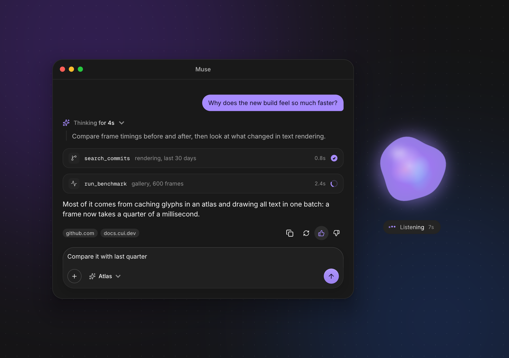

<sub>Every image on this page is drawn by CUI itself, from plain C.</sub>

</div>

<br>

## Why CUI

C has excellent low level libraries and very few ways to build an interface that looks current. CUI is a complete component library rather than a box of primitives. Buttons, inputs, selects, date pickers, dialogs, toasts and tables are all there, along with a command palette, a data grid, kanban boards, calendars and gantt charts, about a dozen kinds of chart and a set of AI chat components. They are designed together and look finished without any styling.

Your interface is plain C that runs every frame. Components are functions that draw themselves and return what happened, and your variables are the state. Behind them sits a flexbox style layout engine with rows, columns, grids, wrapping text, scroll areas and split views.

The look is restrained on purpose: neutral surfaces, one accent, hairline borders, shadows only on things that float, and motion that explains what changed (presses, gliding highlights, menus that open from their trigger). Every animation has a reduced motion path, and every component works from the keyboard. [Design principles](docs/design.md) has the rules, including the generic patterns CUI avoids.

A full screen builds, lays out and paints in 0.1 to 0.25 ms, idle apps use no CPU, and a complete app is about 240 KB. It runs on Win32, Cocoa and X11, or on SDL2 and GLFW, with OpenGL or a software renderer. You can also plug in your own renderer, because the core only emits triangles.

## Showcase

<table>
<tr>
<td colspan="2">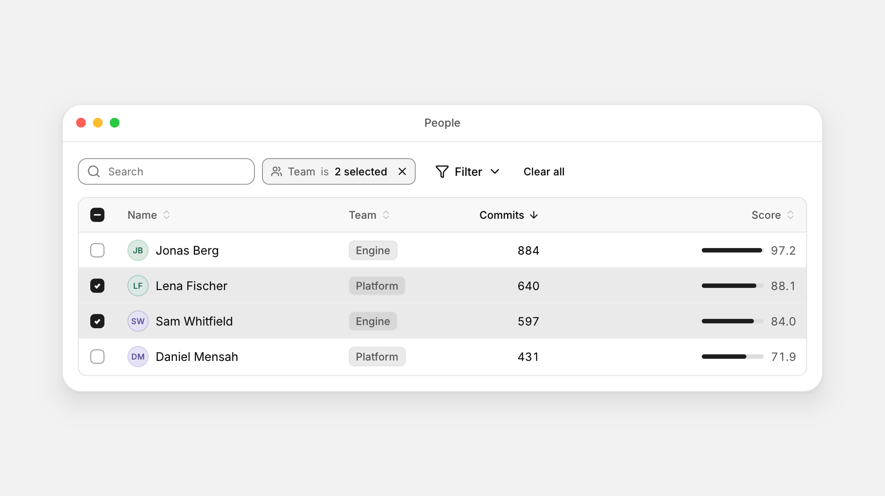</td>
</tr>
<tr>
<td colspan="2" align="center"><sub><b>Data grid</b>: 2,000 virtualized rows, filters, sorting, resizable columns and spreadsheet style selection</sub></td>
</tr>
<tr>
<td width="50%">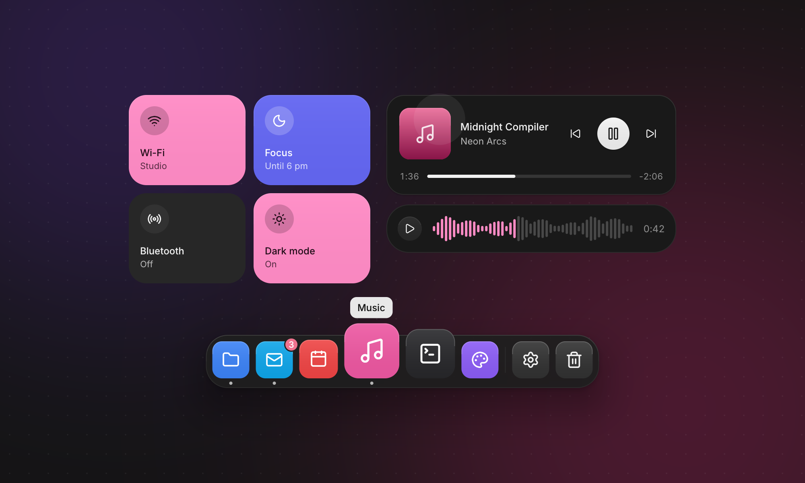</td>
<td width="50%">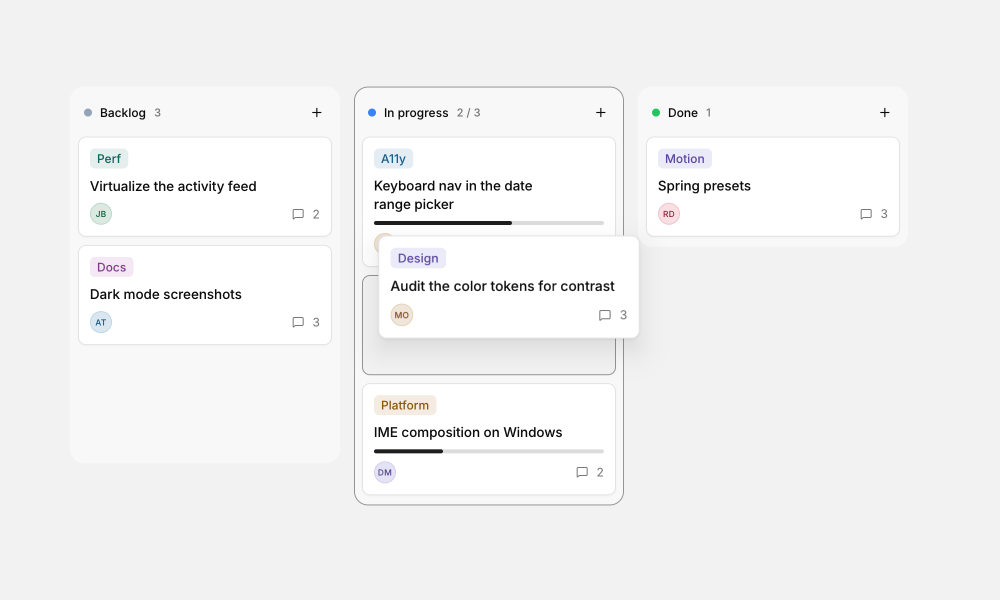</td>
</tr>
<tr>
<td align="center"><sub><b>Dock, tiles and player</b>: icons grow under the pointer, the waveform seeks on click</sub></td>
<td align="center"><sub><b>Kanban</b>: the lifted card follows the pointer and the column opens a slot for it</sub></td>
</tr>
<tr>
<td colspan="2">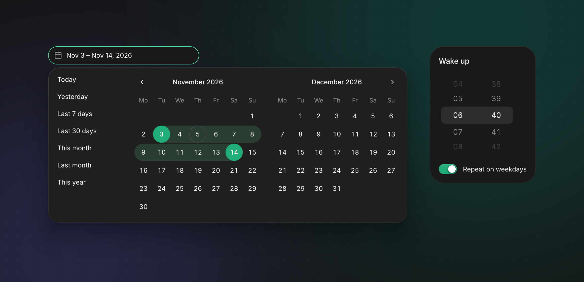</td>
</tr>
<tr>
<td colspan="2" align="center"><sub><b>Pickers</b>: a date range with presets over two months, and wheels that spin with momentum</sub></td>
</tr>
<tr>
<td>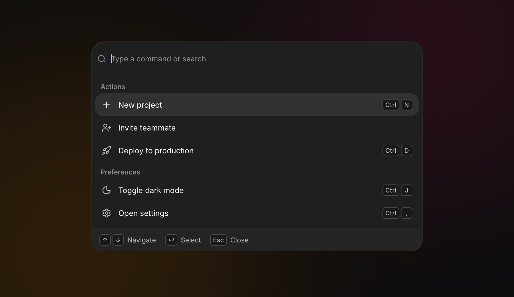</td>
<td>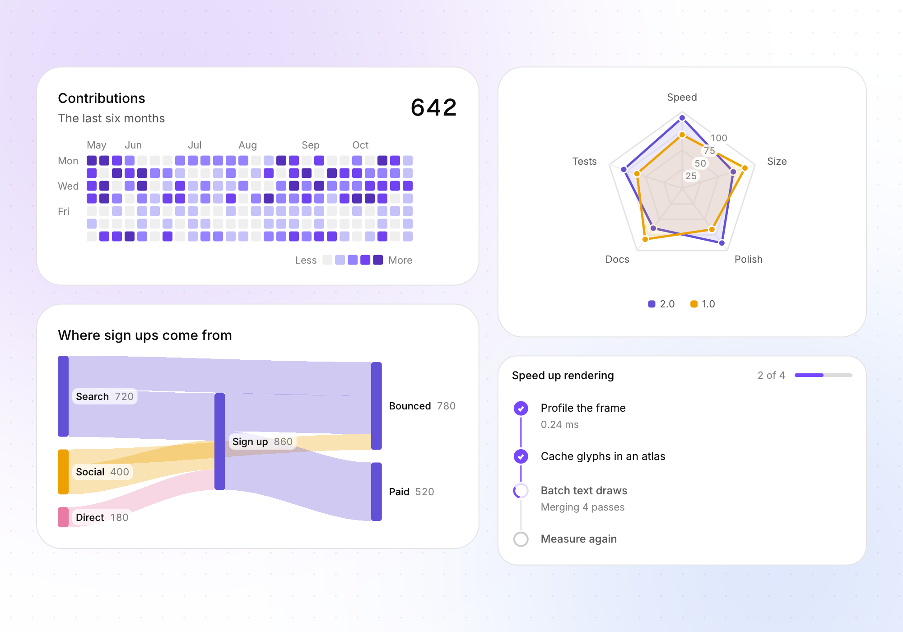</td>
</tr>
<tr>
<td align="center"><sub><b>Command palette</b>: fuzzy search, groups and shortcuts</sub></td>
<td align="center"><sub><b>Charts</b>: calendar heatmap, sankey and radar, with a live task plan</sub></td>
</tr>
<tr>
<td>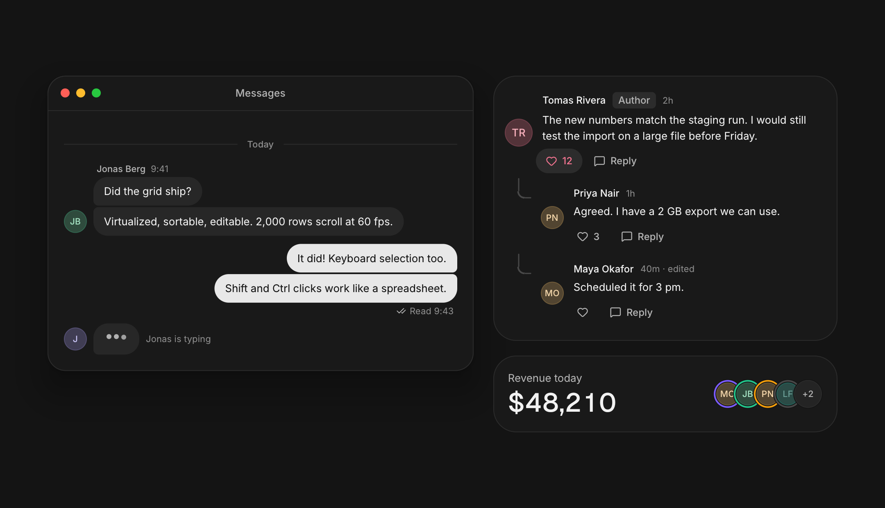</td>
<td>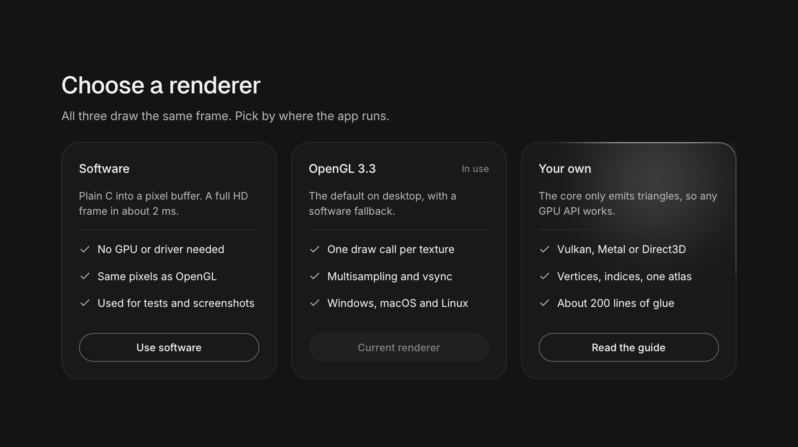</td>
</tr>
<tr>
<td align="center"><sub><b>Conversation</b>: grouped bubbles, threads, a rolling counter, presence</sub></td>
<td align="center"><sub><b>Spotlight cards</b>: the surface and edge nearest the pointer light up</sub></td>
</tr>
<tr>
<td colspan="2">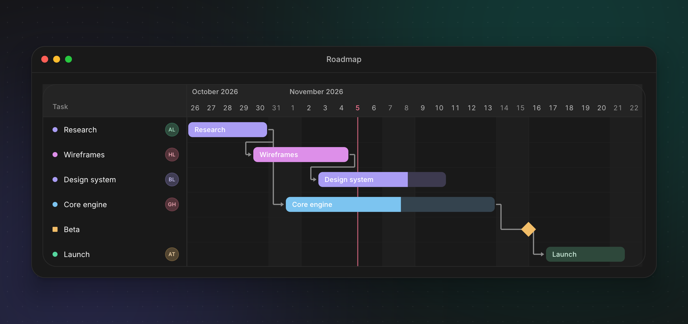</td>
</tr>
<tr>
<td colspan="2" align="center"><sub><b>Gantt</b>: drag to reschedule, pull the ends to resize, arrows follow dependencies</sub></td>
</tr>
</table>

## Built with CUI

Every screenshot here is a real app from [`examples/`](examples), rendered by CUI itself.

<table>
<tr>
<td colspan="2">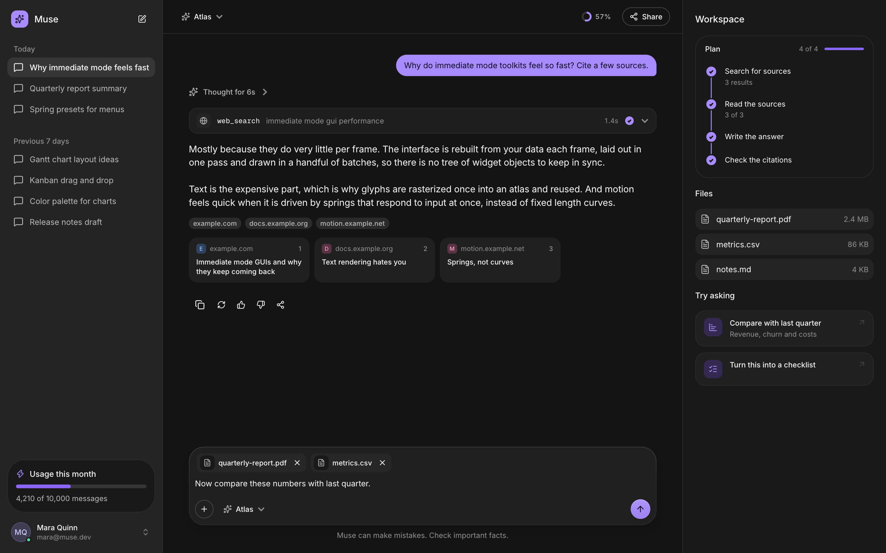</td>
</tr>
<tr>
<td colspan="2" align="center"><sub><b>Muse</b>: reasoning, tool calls, sources, a plan and a composer with a model picker · <a href="examples/assistant.c">assistant.c</a></sub></td>
</tr>
<tr>
<td colspan="2">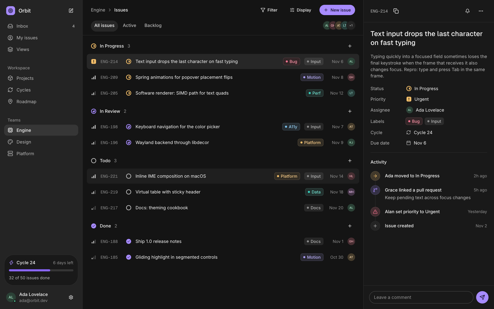</td>
</tr>
<tr>
<td colspan="2" align="center"><sub><b>Orbit</b>: an issue tracker with grouped lists, custom glyphs and an activity pane · <a href="examples/tracker.c">tracker.c</a></sub></td>
</tr>
<tr>
<td width="50%">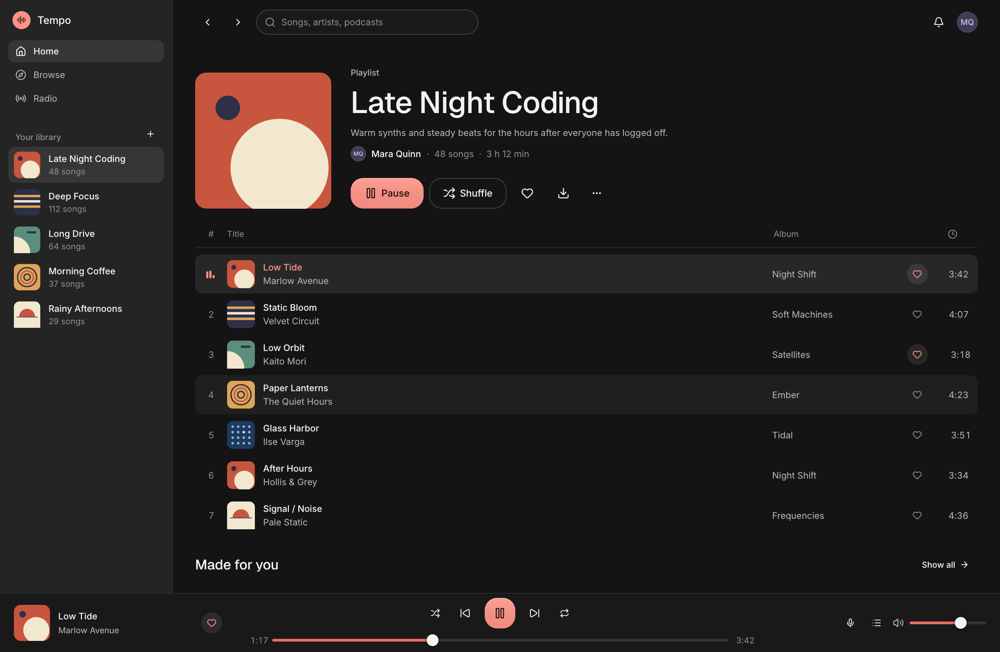</td>
<td width="50%">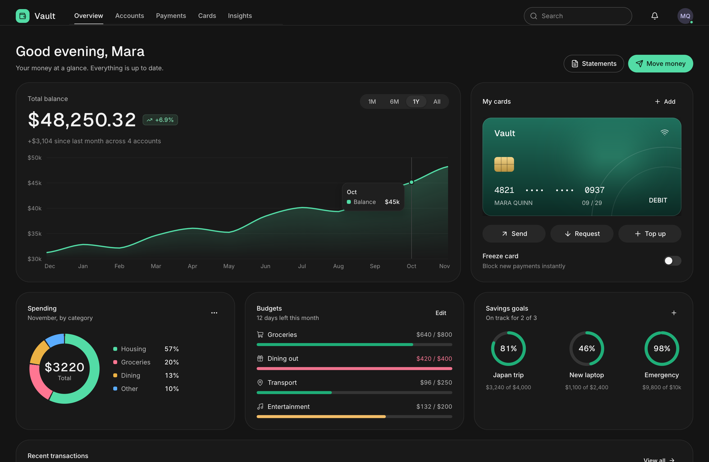</td>
</tr>
<tr>
<td align="center"><sub><b>Tempo</b>: cover art drawn on a canvas, track list, transport bar · <a href="examples/music.c">music.c</a></sub></td>
<td align="center"><sub><b>Halden</b>: balance chart, painted card, budgets, goals · <a href="examples/finance.c">finance.c</a></sub></td>
</tr>
<tr>
<td>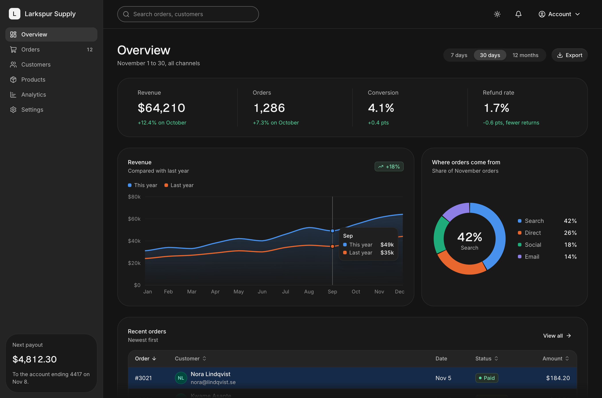</td>
<td>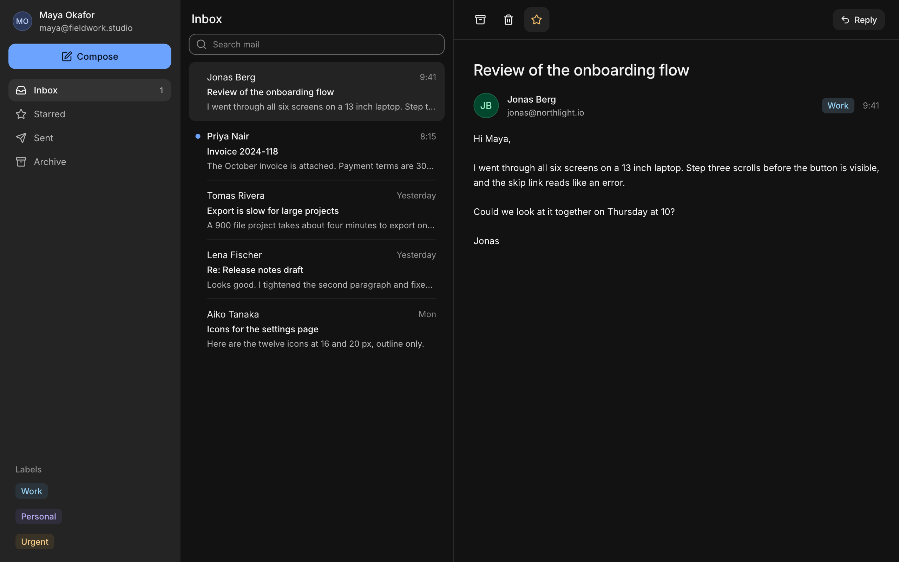</td>
</tr>
<tr>
<td align="center"><sub><b>Larkspur</b>: figures, charts, sortable table · <a href="examples/dashboard.c">dashboard.c</a></sub></td>
<td align="center"><sub><b>Mail</b>: three pane inbox and compose dialog · <a href="examples/mail.c">mail.c</a></sub></td>
</tr>
<tr>
<td>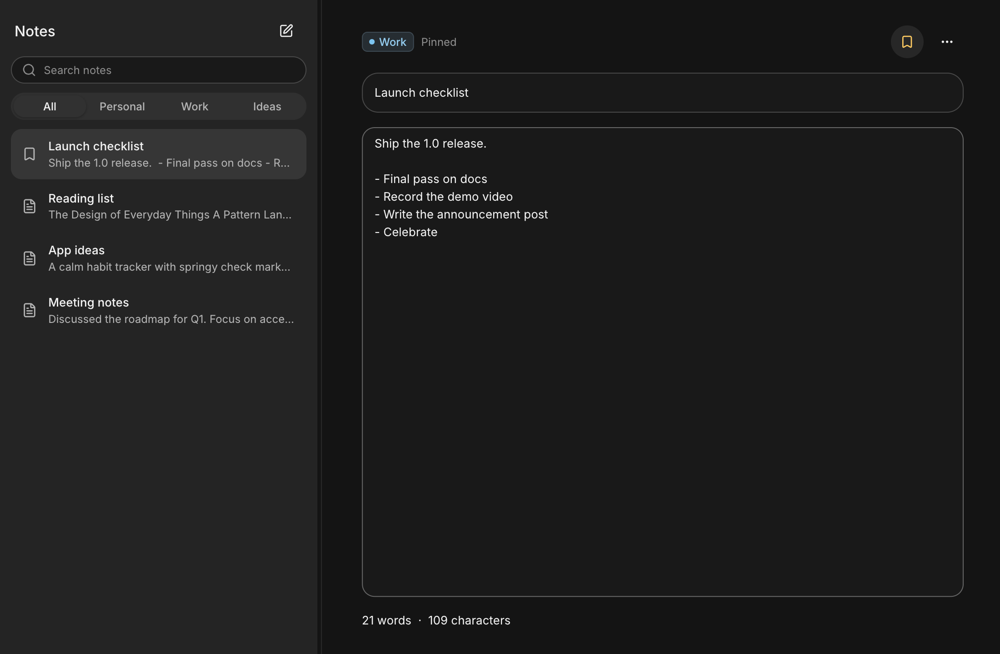</td>
<td>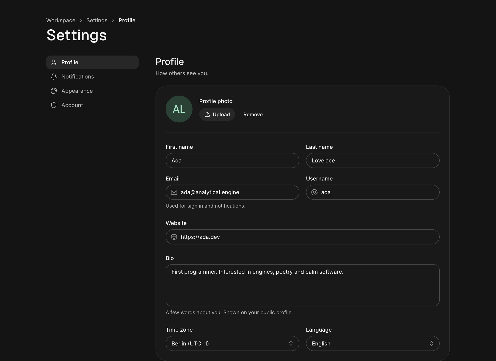</td>
</tr>
<tr>
<td align="center"><sub><b>Notes</b>: split view, search, context menus, export · <a href="examples/notes.c">notes.c</a></sub></td>
<td align="center"><sub><b>Settings</b>: forms, validation, preferences · <a href="examples/settings.c">settings.c</a></sub></td>
</tr>
</table>

## A first app

<table>
<tr>
<td width="58%" valign="top">

```c
#include <cui/cui.h>
#include <cui/cui_app.h>

int main(void) {
    cui_app *app = cui_app_create(&(cui_app_desc){
        .title = "Hello", .width = 420, .height = 300 });
    bool notifications = true;
    int clicks = 0;

    while (cui_app_frame(app)) {
        cui_ctx *ui = cui_app_ui(app);
        cui_column(ui, .pad = 32, .gap = 16) {
            cui_heading(ui, "Hello, CUI", 2);
            cui_secondary(ui, "A native window, a few components "
                              "and no dependencies.");
            cui_switch(ui, "Notifications", &notifications);
            cui_row(ui, .gap = 8) {
                if (cui_button(ui, "Click me", .variant = CUI_BUTTON_PRIMARY))
                    clicks++;
                cui_textf(ui, "Clicked %d times", clicks);
            }
        }
    }
    cui_app_destroy(app);
}
```

</td>
<td width="42%" valign="top">

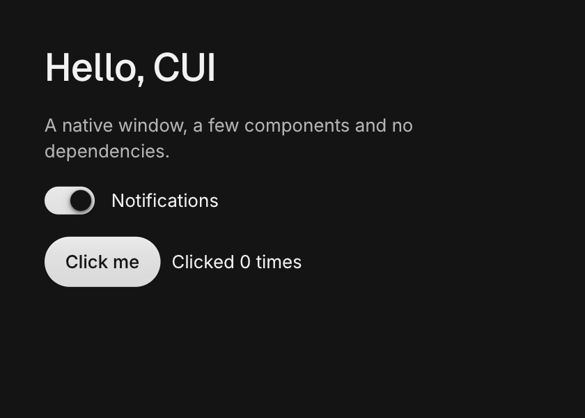

Components are functions. They draw themselves, handle input and return what happened.

Options are named arguments, so the common case stays short and everything else is one `.field = value` away.

Your variables are the state. There is nothing to sync.

</td>
</tr>
</table>

## Build

CUI uses CMake and builds with GCC, Clang, MSVC and MinGW.

```sh
git clone https://github.com/yappologistic/CUI.git
cmake -S CUI -B build -DCMAKE_BUILD_TYPE=Release
cmake --build build
./build/examples/tracker
```

Use it from your own CMake project:

```cmake
add_subdirectory(CUI)            # or FetchContent
target_link_libraries(my_app PRIVATE cui::cui)
```

On Linux you need the X11 development headers (`libx11-dev`). Windows and macOS need nothing beyond the SDK. See [Getting started](docs/getting-started.md) for other build systems and backends.

## Components

<picture>
  <source media="(prefers-color-scheme: dark)" srcset="docs/images/showcase/components-dark.png">
  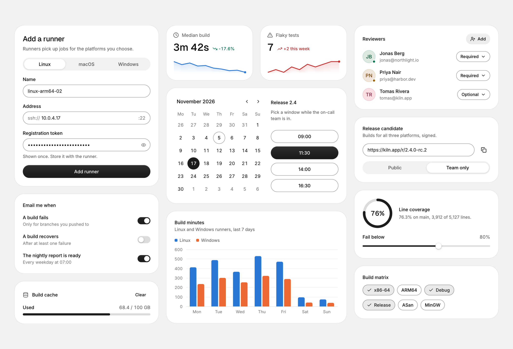
</picture>

| | |
|---|---|
| **Actions** | button, icon button, button group, copy button, hold to confirm, segmented control, dropdown menu, context menu, command palette |
| **Inputs** | text field, password with strength meter, search, text area, number field, tag input, one time code, select, combobox, date picker, calendar, color picker |
| **Selection** | checkbox, switch, radio group, radio cards, elastic slider, range slider, chips, rating |
| **Navigation** | tabs (underline and pill), sidebar navigation, breadcrumb, pagination, stepper |
| **Overlays** | dialog, sheet, popover, tooltip, toast stack |
| **Feedback** | alert, progress bar and ring, meter, spinner, skeleton, badge, avatar, avatar group, empty state, timeline |
| **Data** | card, metric card, table, list, reorderable list, tree view, accordion, virtual list, line, area, bar, stacked bar and donut charts, sparkline, gauge |
| **Layout** | row, column, grid, stack, scroll area, resizable split view, separator, spacer |
| **Custom** | canvas with a full 2D drawing API, per component state, spring animation helpers |

Every component is documented with a screenshot, usage, options and keyboard behaviour in [docs/components.md](docs/components.md).

### And the ones usually sold separately

<picture>
  <source media="(prefers-color-scheme: dark)" srcset="docs/images/showcase/components-pro-dark.png">
  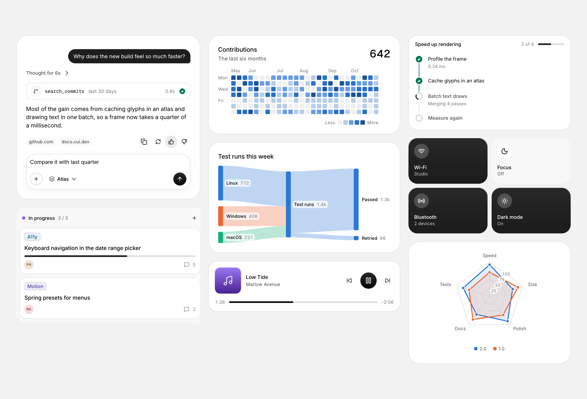
</picture>

| | |
|---|---|
| **Actions** | split button, toggle group, confirm button, status button, reactions, speed dial, theme switcher, user menu, swipe actions |
| **Inputs** | inline edit, scrub field, money field, prefix and suffix, shortcut recorder, multi-select, date range picker, time picker, wheel picker, time dial, ruler and histogram sliders |
| **Capture** | dropzone with real file drops, avatar upload, signature pad |
| **Disclosure** | hover card, confirm popover, expandable text and card, table of contents, banner, countdown, onboarding checklist, undo toast |
| **Data** | virtualized data grid (sort, resize, select, edit), tree cells, filter bar, code block with highlighting, JSON viewer |
| **Planning** | kanban board, week calendar, gantt chart with dependencies |
| **Conversation** | chat bubbles, comments, presence, rolling counter, ticker, carousel, image compare, card stack |
| **Charts** | heatmap, calendar heatmap, treemap, radar, funnel, sankey, waffle, split bar, ranked bar list, activity rings, scatter and bubble |
| **Motion** | shimmer text, typewriter, word reveal, rotating words, gradient text, spotlight cards with a border beam, loaders, dock, tab bar, control tiles, waveform, now playing |
| **AI** | reasoning, tool calls, agent plan and status, sources and citations, context meter, response actions, prompt suggestions, model picker, chat composer, voice orb |

All of them are in [docs/components-more.md](docs/components-more.md), with screenshots that follow your light or dark theme.

## Light, dark and eight accents

<picture>
  <source media="(prefers-color-scheme: dark)" srcset="docs/images/showcase/accents-dark.png">
  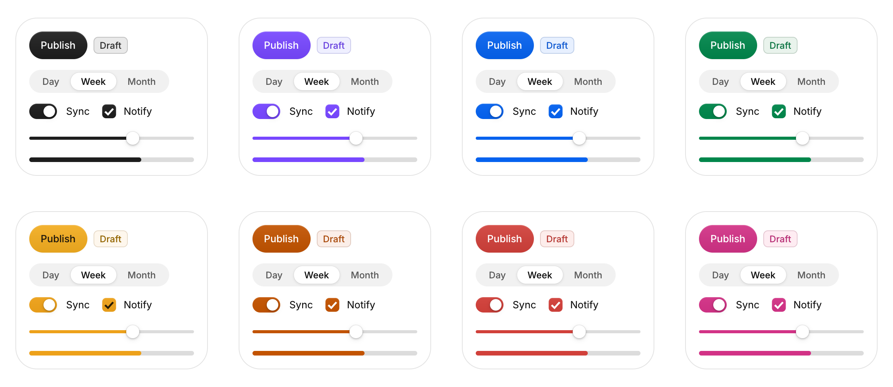
</picture>

| | |
|---|---|
| 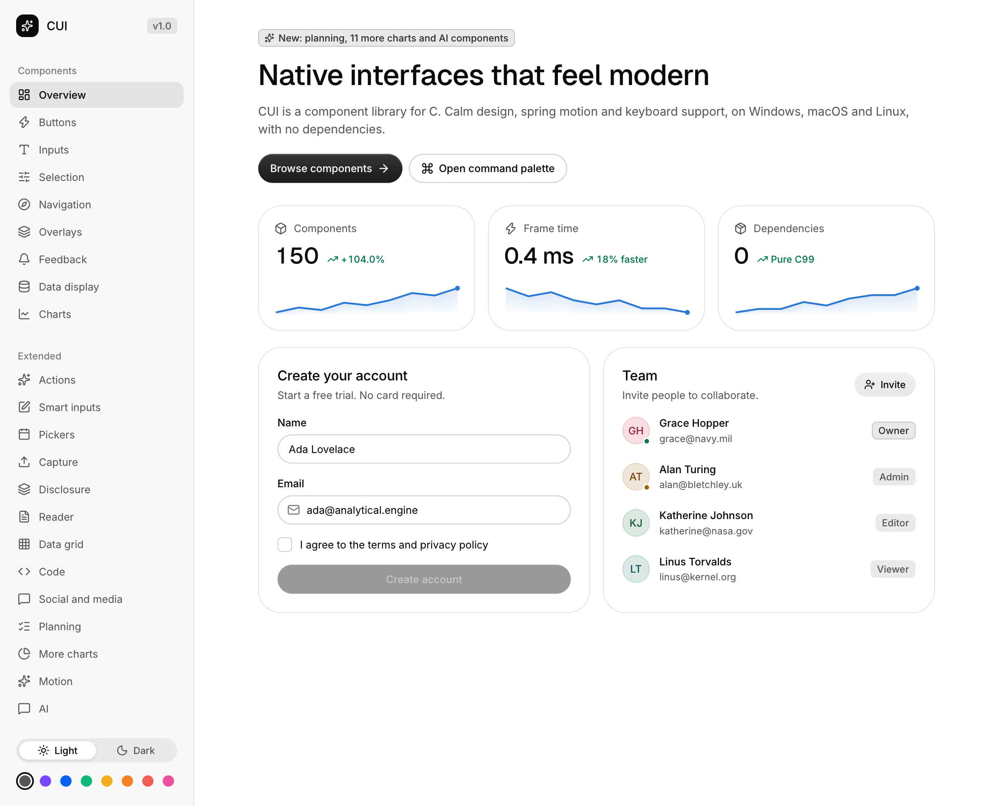 | 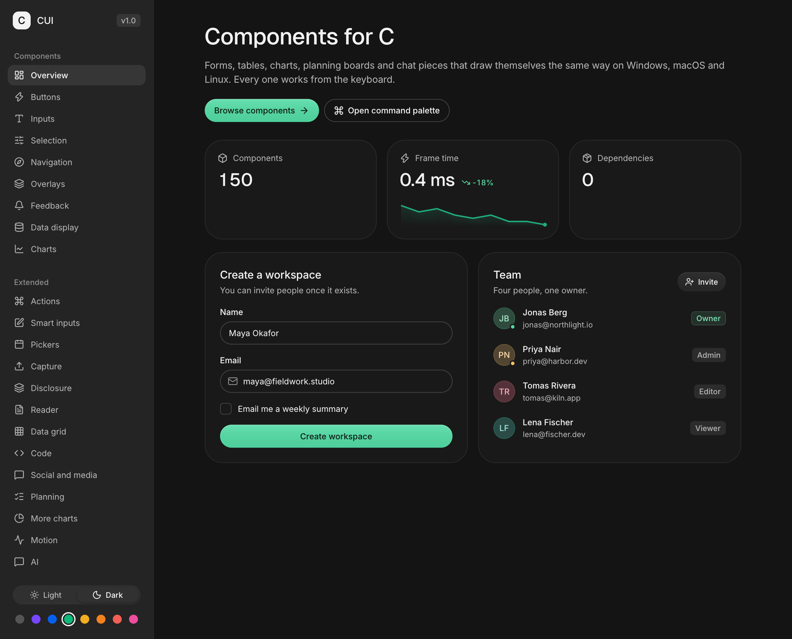 |

```c
cui_set_theme(ui, CUI_THEME_DARK);      /* animates */
cui_set_accent(ui, CUI_ACCENT_BLUE);    /* neutral, violet, blue, green, amber, orange, coral, rose */
```

All colors are semantic tokens (`CUI_COLOR_SURFACE`, `CUI_COLOR_TEXT_SECONDARY`, `CUI_COLOR_ACCENT`...), so your own boxes follow the theme too. Try any app in the other theme with `CUI_THEME=dark` or `CUI_THEME=light`. See [Theming](docs/theming.md).

## Small by design

| | |
|---|---|
| Whole library: every component, both renderers, X11 backend, fonts and icons | about 590 KB |
| `hello` on Linux, stripped, whole executable | about 240 KB |
| `assistant` (the AI app above), whole executable | about 330 KB |
| Embedded fonts (Inter, Geist, Geist Mono, 168 Lucide icons), compressed | 95 KB |

The library is compiled for dead code stripping, so apps only carry what they use, and every heavy part (fonts, image decoding, the window layer) can be turned off. Details in [Integration](docs/integration.md#binary-size).

## Examples

| Example | |
|---|---|
| [`assistant`](examples/assistant.c) | AI assistant: reasoning, tool calls, sources, plan, composer with a model picker |
| [`tracker`](examples/tracker.c) | Issue tracker: grouped list, custom status glyphs, detail pane, activity |
| [`music`](examples/music.c) | Music player: cover art drawn on a canvas, track list, transport bar |
| [`finance`](examples/finance.c) | Personal finance: top navigation, charts, painted card, budgets, goals |
| [`dashboard`](examples/dashboard.c) | Sidebar, top bar, KPIs, charts and a sortable table |
| [`mail`](examples/mail.c) | Three pane inbox, folders, reading pane, compose dialog |
| [`notes`](examples/notes.c) | Split view, search, context menus, dialogs, shortcuts, file export |
| [`settings`](examples/settings.c) | Forms, validation, preferences and a danger zone |
| [`gallery`](examples/gallery_ui.c) | Every component, light and dark, all accents (the extended ones are under *Extended*) |
| [`hello`](examples/hello.c) | The smallest app |

## Platforms

| Platform | Backend | Renderer | Tested in CI |
|---|---|---|---|
| Windows 7+ | Win32 (per monitor DPI, dark title bar) | OpenGL 3.3, GDI software fallback | MSVC, MinGW |
| macOS 10.13+ | Cocoa (Retina, native menus, text input) | OpenGL 3.3+, layer software fallback | Apple clang |
| Linux, BSD | X11 (XIM text input, HiDPI) | OpenGL 3.3 (GLX), XPutImage fallback | GCC, Clang |
| Wayland and others | SDL2 or GLFW | OpenGL 3.3 | GCC |
| Anything | Your own | Your own (one shader) | |

Set `CUI_RENDERER=software` to force the software renderer and `CUI_SCALE=2` to override the display scale.

## Performance

Measured on a 4 core cloud VM (wall clock), gallery pages at 1240 × 820 points on a 2× display:

| | |
|---|---|
| Build, layout and paint a frame | 0.12 to 0.25 ms |
| Vertices per frame | 1,600 to 5,100 |
| Software rasterization (2480 × 1640 pixels, 4 threads) | 12 to 46 ms |
| GPU rendering | one draw call per clip or texture change |
| Idle CPU | 0% (event driven) |

`cui_bench` in the test folder reproduces these numbers.

## Status and limitations

CUI 1.0 is complete enough to build real desktop apps, and it is tested on every push: unit, interaction and render tests, a randomized input fuzzer under AddressSanitizer and UndefinedBehaviorSanitizer, and real windows on Windows, macOS and Linux. Things it does not do yet:

- **Screen readers.** There is no accessibility tree yet. Keyboard navigation and focus are complete.
- **Complex scripts.** Text is UTF-8 with kerning and font fallback, but there is no shaping: right-to-left scripts and scripts that need ligatures (Arabic, Devanagari) do not render correctly. CJK works once you add a fallback font.
- **IME preedit.** Committed text from input methods works; the in-progress composition is shown by the system IME window rather than inline.
- **Wayland natively.** Use the SDL2 or GLFW backend, or XWayland.

## Documentation

- [Getting started](docs/getting-started.md): install, build, the app loop, your first screens
- [Layout](docs/layout.md): rows, columns, sizes, alignment, grids, scrolling, split views
- [Components](docs/components.md): every component with screenshots, options and keyboard support
- [More components](docs/components-more.md): data grid, planning, more charts, motion and AI interfaces
- [Theming](docs/theming.md): tokens, light and dark, accents, fonts, icons, motion
- [Custom components](docs/custom-components.md): canvas, drawing API, state and animation
- [Integration](docs/integration.md): use CUI in your engine with your own window and renderer
- [Rendering](docs/rendering.md): the vertex format and the reference shader
- [Icons](docs/icons.md): the built-in Lucide icons and how to use any other icon
- [Design principles](docs/design.md): the rules the components follow

## Credits

Type: [Inter](https://rsms.me/inter/) and [Geist](https://vercel.com/font) (SIL Open Font License). Icons: [Lucide](https://lucide.dev) (ISC). Font rasterization and PNG output: [stb](https://github.com/nothings/stb) (public domain). See [THIRD_PARTY.md](THIRD_PARTY.md).

## License

MIT. See [LICENSE](LICENSE).
