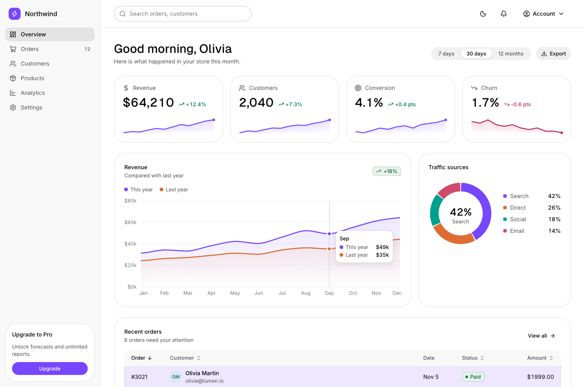
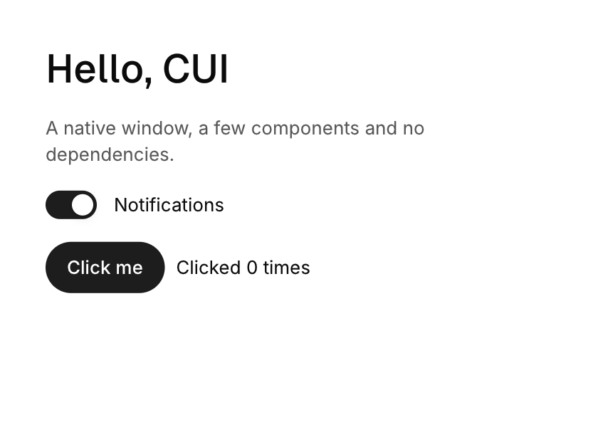
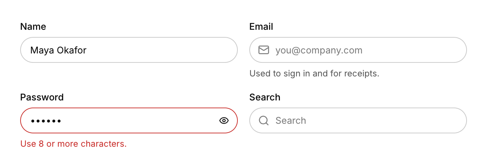
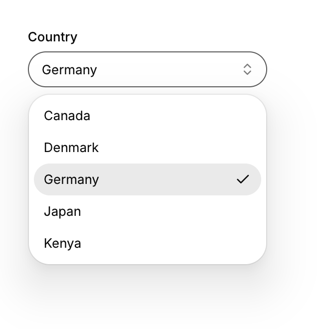
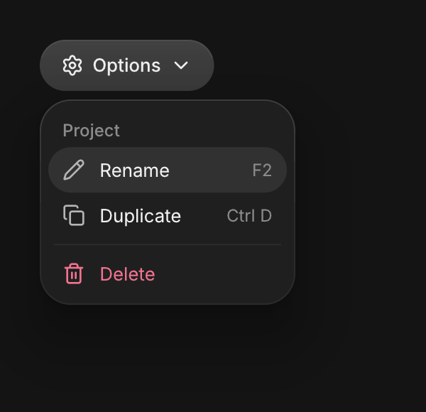
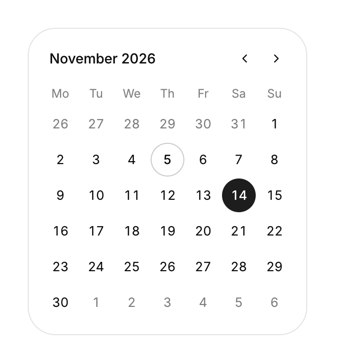
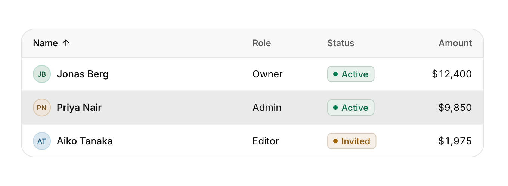
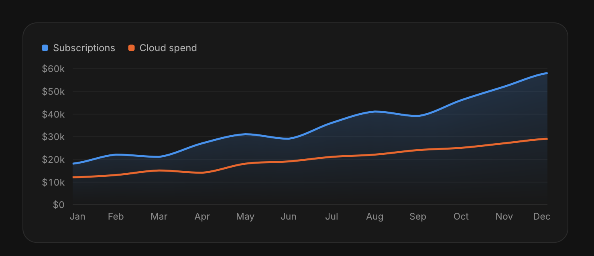
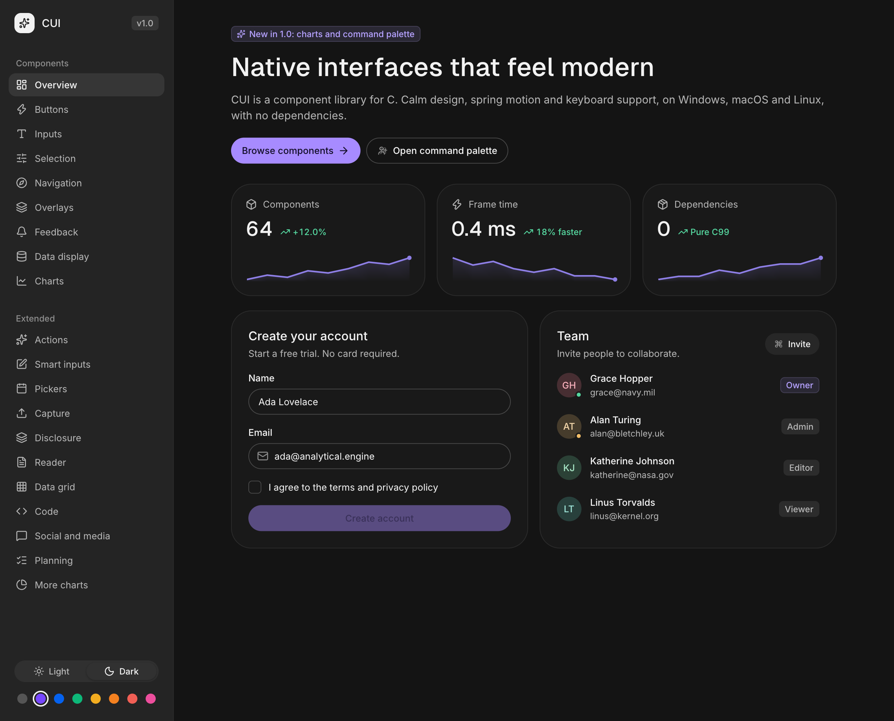
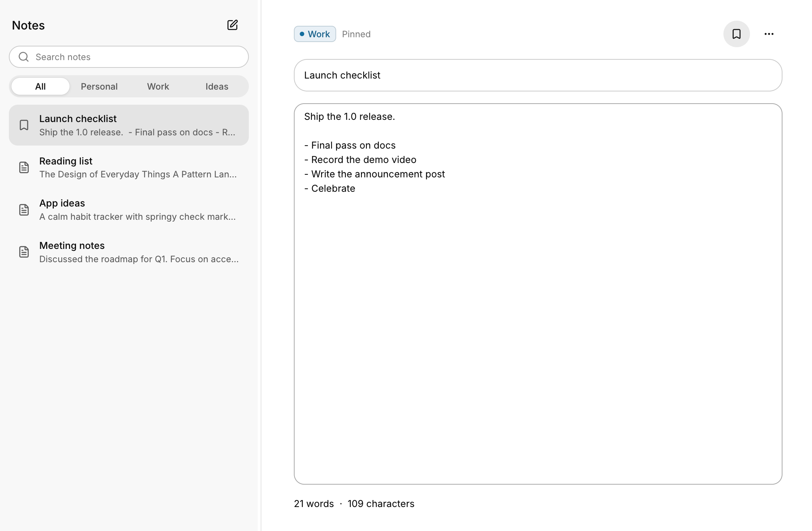

<div align="center">

# CUI

**Modern native UI components for C.**

Calm design, spring motion and full keyboard support.<br>
Windows, macOS and Linux from one C99 codebase, with no dependencies.

[Getting started](docs/getting-started.md) ·
[Components](docs/components.md) ·
[Layout](docs/layout.md) ·
[Theming](docs/theming.md) ·
[Integration](docs/integration.md) ·
[Examples](examples)

</div>

<br>



## Why CUI

C has great low level libraries and very few ways to build an interface that looks like it belongs in 2026. CUI fills that gap. It is a complete component library, not a toolkit of primitives: buttons, inputs, selects, date pickers, dialogs, toasts, tables, charts and a command palette, all designed to work together and to look good without any styling.

- **Looks right out of the box.** A neutral palette with one accent, hairline borders, soft layered shadows on floating layers only, concentric radii and Inter and Geist type. Light and dark themes and eight accents, all animated when they change.
- **Moves with purpose.** Presses scale with a snappy spring, highlights glide between options, dialogs and menus open from where they were triggered, sliders stretch like rubber past their ends. Every animation has a reduced motion path.
- **Keyboard first.** Tab and Shift+Tab move focus, Enter and Space activate, arrows drive menus, tabs, sliders and lists, Esc closes. The focus ring appears only for keyboard focus.
- **Immediate mode, real layout.** Write your UI as plain C that runs every frame. Behind it is a flexbox style layout engine with rows, columns, grids, grow and shrink, wrapping text and scroll areas.
- **Fast and frugal.** Building, laying out and painting a full screen takes **0.1 to 0.25 ms** of CPU. The app sleeps when nothing changes, so idle apps use no CPU at all.
- **Truly portable.** Native Win32, Cocoa and X11 backends, optional SDL2 and GLFW backends for Wayland and other targets, OpenGL 3.3 with an automatic software fallback for VMs and remote desktops.
- **Plays well with others.** The core outputs plain vertex and index buffers. Drop it into your engine with your own renderer in an afternoon. One header, MIT license.

## A first app

```c
#include <cui/cui.h>
#include <cui/cui_app.h>

int main(void) {
    cui_app *app = cui_app_create(&(cui_app_desc){ .title = "Hello", .width = 420, .height = 300 });
    bool notifications = true;
    int clicks = 0;

    while (cui_app_frame(app)) {
        cui_ctx *ui = cui_app_ui(app);
        cui_column(ui, .pad = 32, .gap = 16) {
            cui_heading(ui, "Hello, CUI", 2);
            cui_secondary(ui, "A native window, a few components and no dependencies.");
            cui_switch(ui, "Notifications", &notifications);
            cui_row(ui, .gap = 8) {
                if (cui_button(ui, "Click me", .variant = CUI_BUTTON_PRIMARY)) clicks++;
                cui_textf(ui, "Clicked %d times", clicks);
            }
        }
    }
    cui_app_destroy(app);
}
```



Components are functions. They draw themselves, handle input and return what happened. Options are named arguments, so the common case stays short and everything else is one `.field = value` away.

## Build

CUI uses CMake and builds with GCC, Clang, MSVC and MinGW.

```sh
git clone https://github.com/yappologistic/CUI.git
cmake -S CUI -B build
cmake --build build
./build/examples/gallery
```

Use it from your own CMake project:

```cmake
add_subdirectory(CUI)            # or FetchContent
target_link_libraries(my_app PRIVATE cui::cui)
```

On Linux you need the X11 development headers (`libx11-dev`). Windows and macOS need nothing beyond the SDK. See [Getting started](docs/getting-started.md) for other build systems and backends.

## Components

| | |
|---|---|
|  |  |
|  |  |
|  |  |
|  |  |

**Actions** button, icon button, button group, copy button, hold to confirm, segmented control, dropdown menu, context menu, command palette<br>
**Inputs** text field, password with strength meter, search, text area, number field, tag input, one time code, select, combobox, date picker, calendar, color picker<br>
**Selection** checkbox, switch, radio group, radio cards, elastic slider, range slider, chips, rating<br>
**Navigation** tabs (underline and pill), sidebar navigation, breadcrumb, pagination, stepper<br>
**Overlays** dialog, sheet, popover, tooltip, toast stack<br>
**Feedback** alert, progress bar and ring, meter, spinner, skeleton, badge, avatar, avatar group, empty state, timeline<br>
**Data** card, metric card, table, list, reorderable list, tree view, accordion, virtual list, line, area, bar, stacked bar and donut charts, sparkline, gauge<br>
**Layout** row, column, grid, stack, scroll area, resizable split view, separator, spacer<br>
**Custom** canvas with a full 2D drawing API, per component state and spring animation helpers

Every component is documented with a screenshot, usage, options and keyboard behaviour in [docs/components.md](docs/components.md).

## Light, dark and eight accents

| | |
|---|---|
|  |  |

```c
cui_set_theme(ui, CUI_THEME_DARK);      /* animates */
cui_set_accent(ui, CUI_ACCENT_VIOLET);  /* neutral, violet, blue, green, amber, orange, coral, rose */
```

All colors are semantic tokens (`CUI_COLOR_SURFACE`, `CUI_COLOR_TEXT_SECONDARY`, `CUI_COLOR_ACCENT`...), so your own boxes follow the theme too. See [Theming](docs/theming.md).

## Examples

| Example | |
|---|---|
| [`gallery`](examples/gallery_ui.c) | Every component, light and dark, all accents |
| [`dashboard`](examples/dashboard.c) | Sidebar, top bar, KPIs, charts and a sortable table |
| [`settings`](examples/settings.c) | Forms, validation, preferences and a danger zone |
| [`notes`](examples/notes.c) | Split view, search, context menus, dialogs, shortcuts |
| [`hello`](examples/hello.c) | The smallest app |



## Platforms

| Platform | Backend | Renderer | Tested in CI |
|---|---|---|---|
| Windows 7+ | Win32 (per monitor DPI, dark title bar) | OpenGL 3.3, GDI software fallback | MSVC, MinGW |
| macOS 10.13+ | Cocoa (Retina, native menus, text input) | OpenGL 3.3+, layer software fallback | Apple clang |
| Linux, BSD | X11 (XIM text input, HiDPI) | OpenGL 3.3 (GLX), XPutImage fallback | GCC, Clang |
| Wayland and others | SDL2 or GLFW | OpenGL 3.3 | GCC |
| Anything | Your own | Your own (one shader) | |

Set `CUI_RENDERER=software` to force the software renderer and `CUI_SCALE=2` to override the display scale.

## Performance

Measured on a 4 core cloud VM (wall clock), gallery pages at 1240 × 820 points on a 2× display:

| | |
|---|---|
| Build, layout and paint a frame | 0.12 to 0.25 ms |
| Vertices per frame | 1,600 to 5,100 |
| Software rasterization (2480 × 1640 pixels, 4 threads) | 12 to 46 ms |
| GPU rendering | one draw call per clip or texture change |
| Idle CPU | 0% (event driven) |

`cui_bench` in the test folder reproduces these numbers.

## Status and limitations

CUI 1.0 is complete enough to build real desktop apps, and it is tested on every push (unit, interaction and render tests, a randomized input fuzzer under AddressSanitizer and UndefinedBehaviorSanitizer, and real windows on Windows, macOS and Linux). Things it does not do yet:

- **Screen readers.** There is no accessibility tree yet. Keyboard navigation and focus are complete.
- **Complex scripts.** Text is UTF-8 with kerning and font fallback, but there is no shaping: right-to-left scripts and scripts that need ligatures (Arabic, Devanagari) do not render correctly. CJK works once you add a fallback font.
- **IME preedit.** Committed text from input methods works; the in-progress composition is shown by the system IME window rather than inline.
- **Wayland natively.** Use the SDL2 or GLFW backend, or XWayland.

## Documentation

- [Getting started](docs/getting-started.md): install, build, the app loop, your first screens
- [Layout](docs/layout.md): rows, columns, sizes, alignment, grids, scrolling, split views
- [Components](docs/components.md): every component with screenshots, options and keyboard support
- [Theming](docs/theming.md): tokens, light and dark, accents, fonts, icons, motion
- [Custom components](docs/custom-components.md): canvas, drawing API, state and animation
- [Integration](docs/integration.md): use CUI in your engine with your own window and renderer
- [Rendering](docs/rendering.md): the vertex format and the reference shader
- [Icons](docs/icons.md): the built-in Lucide icons and how to use any other icon
- [Design principles](docs/design.md): the rules the components follow

## Credits

Design language inspired by [Arc](https://uiarc.dev). Type: [Inter](https://rsms.me/inter/) and [Geist](https://vercel.com/font) (SIL Open Font License). Icons: [Lucide](https://lucide.dev) (ISC). Font rasterization and PNG output: [stb](https://github.com/nothings/stb) (public domain). See [THIRD_PARTY.md](THIRD_PARTY.md).

## License

MIT. See [LICENSE](LICENSE).
