# More components

The second half of the library: richer actions and inputs, pickers, disclosure, data views, more charts, motion and AI interface pieces. Everything follows the same rules as the [core components](components.md): named options, keyboard support, light and dark, reduced motion. Each family has a page in the gallery (`./build/examples/gallery`, section *Extended*).

## Actions

### Split button

<picture><source media="(prefers-color-scheme: dark)" srcset="images/components/split-button-dark.png"></picture>

```c
static const char *more[] = { "Save as draft", "Save and publish", "Schedule..." };
switch (cui_split_button(ui, "Save", more, 3, .icon = CUI_ICON_SAVE)) {
case 0: save(); break;              /* the main part */
case 1: save_draft(); break;        /* menu item 0 */
case 2: publish(); break;
case 3: schedule(); break;
}
```

Returns 0 for the main action, 1 + i for menu item i, -1 otherwise. Options: `variant` (primary by default), `size`, `icon`, `item_icons`, `disabled`. Down arrow on the chevron opens the menu.

### Toggle group

<picture><source media="(prefers-color-scheme: dark)" srcset="images/components/toggle-group-dark.png"></picture>

```c
static bool format[4];          /* bold, italic, underline, code */
const char *labels[] = { "Bold", "Italic", "Underline", "Code" };
const char *icons[] = { CUI_ICON_BOLD, CUI_ICON_ITALIC, CUI_ICON_UNDERLINE, CUI_ICON_CODE };
cui_toggle_group(ui, "format", labels, 4, format, .icons = icons, .icon_only = true);
```

Each item flips its own `bool`. With `.exclusive = true` exactly one stays on, like a radio group. With `icon_only` the labels become tooltips. Arrow keys move between items.

### Confirm button

```c
if (cui_confirm_button(ui, "Delete project", .icon = CUI_ICON_TRASH_2)) delete_project();
```

The first click morphs the button into a red "Click to confirm" with a countdown line; the second click fires. It disarms after `timeout` seconds (3), on Esc, or when you click elsewhere. Options: `confirm_label`, `icon`, `variant`, `size`, `timeout`.

### Status button

<picture><source media="(prefers-color-scheme: dark)" srcset="images/components/morph-buttons-dark.png"></picture>

```c
static cui_status status;
if (cui_status_button(ui, "Save changes", status, .success_label = "Saved")) { status = CUI_STATUS_BUSY; start_save(); }
/* later: status = CUI_STATUS_SUCCESS (or CUI_STATUS_ERROR), then back to CUI_STATUS_IDLE */
```

Shows the life of the work it started: idle, a spinner while busy, a check or an error. The width springs between states and the content cross-fades. Clicks only count while idle.

### Reactions

```c
static cui_reaction re[] = { { CUI_ICON_THUMBS_UP, 12, true }, { CUI_ICON_HEART, 4, false } };
int changed = cui_reactions(ui, "reactions", re, 2);   /* index that toggled, or -1 */
```

Clicking toggles `active` and adjusts `count`; the number rolls up or down and the icon pops.

### Speed dial

```c
static const cui_speed_action acts[] = { { CUI_ICON_FILE_TEXT, "New note" }, { CUI_ICON_IMAGE, "Upload image" } };
int pick = cui_speed_dial(ui, "create", acts, 2, .tooltip = "Create");
```

A round floating action button. Clicking fans the actions out with a stagger while the plus morphs into a close icon. Esc or a click elsewhere folds them. `placement` controls the direction (above and right aligned by default).

### Theme switcher and toggle

```c
static int mode = -1;                       /* -1 picks up the current theme */
cui_theme_switcher(ui, &mode, true);        /* light, dark, system */
cui_theme_toggle(ui);                       /* one icon button: sun and moon morph */
```

Light and dark are applied for you. For "system" (mode 2), read the OS setting (for example with `cui_app_desc.follow_system_theme`) and call `cui_set_theme`.

### User menu

<picture><source media="(prefers-color-scheme: dark)" srcset="images/components/user-menu-dark.png"></picture>

```c
cui_user_menu(ui, "Maya Okafor", .detail = "maya@fieldwork.studio", .status = "online") {
    cui_menu_item(ui, "Profile", .icon = CUI_ICON_USER);
    cui_menu_item(ui, "Log out", .icon = CUI_ICON_LOG_OUT);
}
```

An avatar, a name and a detail line that open an account menu with a header. Full width for sidebars; `.compact = true` shows just the avatar for headers. Options: `detail`, `status`, `avatar` (a texture), `compact`, `placement`, `width`.

### Swipe actions

```c
static const cui_swipe_action done[] = { { CUI_ICON_CHECK, "Done", CUI_TONE_SUCCESS } };
static const cui_swipe_action more[] = { { CUI_ICON_ARCHIVE, "Archive", CUI_TONE_INFO }, { CUI_ICON_TRASH_2, "Delete", CUI_TONE_DANGER } };
cui_swipe_item_begin(ui, "mail-42", done, 1, more, 2);
cui_text(ui, "Quarterly report", .width = CUI_FILL);
int action = cui_swipe_item_end(ui);   /* 0 = left action 0, 100 + i = right action i, -1 = none */
```

Drag a row sideways, or swipe with two fingers on a trackpad. Past half the reveal width it snaps open; past 60% of the row it fires the first action on that side. Click the row or anywhere else to close it.

## Inputs

### Inline edit

<picture><source media="(prefers-color-scheme: dark)" srcset="images/components/inline-edit-dark.png"></picture>

```c
static char title[128] = "Q3 roadmap";
if (cui_inline_edit(ui, "title", title, sizeof title, .font = CUI_FONT_DISPLAY, .size = 26) & CUI_CHANGED) rename(title);
```

Looks like text, with a pencil on hover. Click (or Enter when focused) to edit in the same type with the text selected. Enter or clicking away saves, Esc restores the old text. Options: `font`, `size`, `placeholder`, `width`.

### Scrub field

<picture><source media="(prefers-color-scheme: dark)" srcset="images/components/scrub-dark.png"></picture>

```c
static float opacity = 80;
cui_scrub(ui, "Opacity", &opacity, 0, 100, .suffix = "%");
```

Drag sideways anywhere on the field to change the value; hold Shift for steps ten times finer. A click without dragging lets you type a number. Arrow keys step when focused. A hairline along the bottom shows where the value sits in its range. Options: `step` (range / 100), `format`, `suffix`, `icon` (instead of the label), `width`.

### Money field

```c
static double amount = 1249.5;
cui_money_input(ui, "amount", &amount, .label = "Amount", .code = "USD");                       /* $ 1,249.50  USD */
cui_money_input(ui, "salary", &salary, .symbol = "\xe2\x82\xac", .code = "EUR", .decimals = -1); /* whole euros */
```

Shows grouped digits at rest and plain digits while you type, keeps at most `decimals` places (2; -1 for none) and ignores anything that is not a number. Options: `label`, `symbol` ("$"), `code`, `decimals`, `width`, `hint`.

### Prefix and suffix

Every text field takes muted text before and after the value:

```c
cui_input(ui, "site", site, sizeof site, .prefix = "https://");
cui_input(ui, "weight", weight, sizeof weight, .suffix = "kg");
```

### Shortcut recorder

<picture><source media="(prefers-color-scheme: dark)" srcset="images/components/shortcut-recorder-dark.png"></picture>

```c
static cui_key_combo palette_key = { CUI_MOD_PRIMARY, CUI_KEY_K };
if (cui_shortcut_recorder(ui, "palette-key", &palette_key)) save_keymap();
if (cui_shortcut(ui, palette_key.mods, palette_key.key)) open_palette();
```

Click and press a combination. While recording, the field shows the modifiers you hold with a pulsing dot, and app shortcuts stay quiet. Backspace clears, Esc or Tab cancels. `cui_shortcut_label(ui, combo)` gives the text ("Ctrl Shift K"), `cui_key_name(key)` one key.

## Pickers

### Multi-select

<picture><source media="(prefers-color-scheme: dark)" srcset="images/components/multi-select-dark.png"></picture>

```c
static bool chosen[6];
const char *langs[] = { "C", "C++", "Rust", "Zig", "Go", "Swift" };
cui_multi_select(ui, "langs", langs, 6, chosen, .label = "Languages", .searchable = true);
```

The field shows chips (with remove buttons) for up to `max_chips` items and "+N" for the rest. The list keeps itself open while you tick items and has a select all / clear action. Up, Down and Space or Enter work in the list.

### Date range picker

<picture><source media="(prefers-color-scheme: dark)" srcset="images/components/date-range-dark.png"></picture>

```c
static cui_date_range trip;
cui_date_range_picker(ui, "trip", &trip, .label = "Dates");
cui_range_calendar(ui, "inline", &trip, 2);   /* the calendar on its own, one or two months */
```

Click a start and an end (in either order); while you choose the end, the band follows the pointer. Presets (today, last 7 days, this month...) sit on the left unless `.no_presets = true`. `cui_date_to_days` and `cui_date_from_days` convert dates to day numbers for arithmetic.

### Time picker

<picture><source media="(prefers-color-scheme: dark)" srcset="images/components/time-picker-dark.png"></picture>

```c
static int hour = 9, minute = 30;
cui_time_picker(ui, "start", &hour, &minute);
cui_time_picker(ui, "end", &hour2, &minute2, .twelve_hour = true, .minute_step = 15);
```

Hour and minute columns (and AM / PM) that open scrolled to the current value. `hour` is always 0 to 23.

### Wheel picker and time dial

<picture><source media="(prefers-color-scheme: dark)" srcset="images/components/wheels-dark.png"></picture>

```c
cui_wheel_picker(ui, "month", month_names, 12, &month, .width = CUI_PX(128), .loop = true);
cui_time_dial(ui, "alarm", &hour, &minute, 232);
```

Wheels are drums of options: drag with momentum, scroll or use the arrow keys, and they snap to an item. Set `loop` for values that wrap. Put several side by side with `join_left` / `join_right` to share one selection band, as in a date reel.

The time dial sets hours on two rings (1 to 12 outside, 13 to 00 inside), then switches to minutes when you let go. The hand springs the short way round. Click the hour or minute at the top to choose which one you set.

### Ruler and histogram sliders

<picture><source media="(prefers-color-scheme: dark)" srcset="images/components/ruler-histogram-dark.png"></picture>

```c
cui_ruler_slider(ui, "Height", &height, 120, 220, .unit = "cm");
cui_histogram_slider(ui, "Price", bins, 24, &lo, &hi, 0, 240, .format = "$%.0f");
```

The ruler is a tape that slides under a fixed marker; throw it and it glides, then snaps to `step`. Options: `step`, `major_every` (labelled ticks), `spacing` (points per step), `format`, `unit`, `width`. The histogram slider is a range slider with the distribution it filters drawn above it; bars inside the range light up.

## Capture

<picture><source media="(prefers-color-scheme: dark)" srcset="images/components/capture-dark.png"></picture>

### Dropzone

```c
int n = cui_dropzone(ui, "attachments", .description = "PNG, JPG or PDF, up to 25 MB", .accept = "png;jpg;pdf");
if (n > 0) for (int i = 0; i < n; i++) attach(cui_dropped_file(ui, i));
if (n < 0) { char path[1024]; if (cui_app_file_dialog(NULL, &(cui_file_dialog_opts){ 0 }, path, sizeof path)) attach(path); }
```

Files dragged from the desktop or a file manager highlight the zone ("Release to add") and land on it; files that do not match `accept` are left out and the zone says so. `.compact = true` makes a one line version. Drag and drop works with every built-in backend; the live hover highlight appears where the platform reports drags in progress (macOS and X11), elsewhere the drop itself still lands.

If you use your own window layer, feed drops with `cui_input_file_drop(ui, paths, count, x, y)` and hovering with `cui_input_file_hover(ui, true, x, y)`. Files dropped outside any dropzone are available to the app through `cui_dropped_file_count` and `cui_dropped_file` for that frame.

### Avatar upload

```c
static cui_texture photo;
if (cui_avatar_upload(ui, "photo", "Maya Okafor", &photo, 88) < 0) browse_for_photo();
```

Drop an image on the avatar to replace it (the previous texture is destroyed). Hover shows a camera; the pencil badge marks it as editable.

### Signature pad

```c
cui_signature_pad(ui, "signature", .height = 180);
const cui_vec2 *pts; const int *ends; int strokes;
int n = cui_signature_points(ui, "signature", &pts, &ends, &strokes);   /* points relative to the pad */
```

Stroke width follows speed, so signatures look inked rather than drawn with a fixed pen. A Clear button appears once something is drawn; `cui_signature_clear` does the same from code.

## Disclosure

### Hover card

<picture><source media="(prefers-color-scheme: dark)" srcset="images/components/hover-card-dark.png"></picture>

```c
cui_link(ui, "@jonas");
cui_hover_card(ui, "grace", .width = 300) {
    cui_avatar(ui, "Jonas Berg", .size = 44);
    cui_text(ui, "Design lead on the mobile app.");
}
```

Attaches to the previous component. It opens after the pointer rests there for `delay` seconds (0.45) and stays open while the pointer is over the anchor or the card, with a short grace period to cross the gap. Options: `placement`, `width`, `delay`.

### Confirm popover

<picture><source media="(prefers-color-scheme: dark)" srcset="images/components/confirm-popover-dark.png"></picture>

```c
if (cui_button(ui, "Delete branch")) cui_popover_open(ui, "confirm-delete");
if (cui_confirm_popover(ui, "confirm-delete", .title = "Delete feature/grid?", .description = "This cannot be undone.",
                        .confirm_label = "Delete branch", .danger = true))
    delete_branch();
```

A small question anchored to the button that opened it. Focus moves to the confirm button, so Enter confirms and Esc cancels.

### Expandable text and card

<picture><source media="(prefers-color-scheme: dark)" srcset="images/components/expandables-dark.png"></picture>

```c
cui_expandable_text(ui, "about", long_text, .lines = 3);

static bool billing_open;
cui_expandable_card(ui, "Billing", &billing_open, .description = "Pro plan", .icon = CUI_ICON_CREDIT_CARD, .badge = "Active") {
    cui_button(ui, "Change plan");
}
```

Expandable text clamps to `lines` with a fade (into `fade_to`, the background by default) and a Show more / Show less link; the height springs. The card's body opens with a height spring and its chevron turns; content inside is disabled while it closes.

### Table of contents

<picture><source media="(prefers-color-scheme: dark)" srcset="images/components/toc-dark.png"></picture>

```c
static const cui_toc_item toc[] = { { "Install", "install", 0 }, { "With CMake", "cmake", 1 } };
cui_row(ui) {
    cui_scroll(ui, .id = "doc", .width = CUI_FILL) {
        cui_toc_anchor(ui, "install");  cui_heading(ui, "Install", 3);   /* ... */
        cui_toc_anchor(ui, "cmake");    cui_heading(ui, "With CMake", 4);
    }
    cui_toc(ui, "doc", toc, 2);   /* same scope as the scroll area */
}
```

The rail fills as you read, and a marker glides to the section in view. Clicking an entry scrolls there smoothly. `level` indents entries.

## Feedback

### Banner and countdown

<picture><source media="(prefers-color-scheme: dark)" srcset="images/components/banner-countdown-dark.png"></picture>

```c
static bool show_update = true;
if (cui_banner(ui, "Version 1.1 is ready to install.", &show_update, .action = "Restart", .dismissible = true)) restart();
cui_countdown(ui, "launch", launch_time - cui_time(ui));
cui_countdown(ui, "sale", sale_end - now, .compact = true, .hide_days = true);
```

The banner spans its container, tinted with its `tone` (the accent by default), and collapses smoothly when dismissed. The countdown shows days, hours, minutes and seconds as tiles whose digits roll; it schedules its own redraw each second.

### Onboarding checklist

<picture><source media="(prefers-color-scheme: dark)" srcset="images/components/checklist-dark.png"></picture>

```c
static cui_check_step steps[] = {
    { "Create your workspace", "Pick a name and invite your team.", "Create", true },
    { "Connect a repository", "Sync issues and pull requests.", "Connect", false },
};
int act = cui_checklist(ui, "onboarding", steps, 2, .title = "Set up your workspace");
if (act >= 0) run_step(act);
```

A card with a progress ring and steps; the first unfinished step opens to show its description and action button. Clicking a circle toggles `done`.

### Undo toast

<picture><source media="(prefers-color-scheme: dark)" srcset="images/components/undo-toast-dark.png"></picture>

```c
cui_toast(ui, "3 conversations archived", .action = "Undo", .show_timer = true);
```

`show_timer` adds a draining line along the bottom of the toast, so people can see how long Undo stays (6 seconds by default; hovering the stack pauses it).

## Data

### Data grid and filter bar

<picture><source media="(prefers-color-scheme: dark)" srcset="images/components/data-grid-dark.png"></picture>

```c
static const cui_grid_column cols[] = {
    { "Name", 210, CUI_TEXT_LEFT, true }, { "Team", 120, CUI_TEXT_LEFT, true }, { "Commits", 100, CUI_TEXT_RIGHT, true },
};
static bool selected[2000];
static cui_table_sort sort = { 2, true };
int first, last;
cui_filter_bar(ui, "filters", fields, 2, filter_masks, search, sizeof search);
if (cui_data_grid_begin(ui, "people", cols, 3, 2000, &first, &last, .height = CUI_PX(420), .selected = selected, .sort = &sort)) {
    for (int r = first; r < last; r++) {
        cui_data_grid_row(ui, r);
        cui_data_grid_cell(ui);
        cui_avatar(ui, people[r].name, .size = 24);
        cui_data_grid_edit(ui, people[r].name, sizeof people[r].name);   /* double click to rename */
        cui_data_grid_cell_text(ui, people[r].team);
        cui_data_grid_cell_text(ui, people[r].commits_text);
    }
    cui_data_grid_end(ui);
}
```

Only the rows in view are built, so the row count barely matters. Headers are sticky; drag a header edge to resize a column; click a sortable header to set `sort` (you reorder your data). With `selected`, a checkbox column appears and rows select like a spreadsheet: click, Shift+click for a range, Ctrl+click to toggle, Ctrl+A for all, arrows to move the cursor, Esc to clear. Editable cells start on double click or Enter and commit on Enter or clicking away.

The filter bar keeps one bit mask per field in `selected`; each active field shows as a chip that opens its value list, "Filter" adds one and "Clear all" resets them. `cui_tree_cell` draws a disclosure chevron and indentation inside any table or grid cell for tree tables.

## Code

### Code block

<picture><source media="(prefers-color-scheme: dark)" srcset="images/components/code-block-dark.png"></picture>

```c
cui_code_block(ui, "counter", source, .lang = "c", .title = "counter.c", .line_numbers = true, .highlight_from = 7);
```

Highlighting for C, C++, JavaScript, TypeScript, Python, Rust, Go, JSON and shell, in colors that follow the theme. Long lines scroll sideways, `max_height` makes the block scroll vertically, and the copy button morphs into a check after copying.

### JSON viewer

<picture><source media="(prefers-color-scheme: dark)" srcset="images/components/json-view-dark.png"></picture>

```c
if (!cui_json_view(ui, "response", body, .expand_depth = 1)) { /* not valid JSON: the view shows where it broke */ }
```

A collapsible tree with typed colors. Collapsed objects and arrays show their size; click a chevron to fold or unfold.

## Tool panels

Panels for editors and developer tools.

### Property inspector

<picture><source media="(prefers-color-scheme: dark)" srcset="images/components/inspector-dark.png">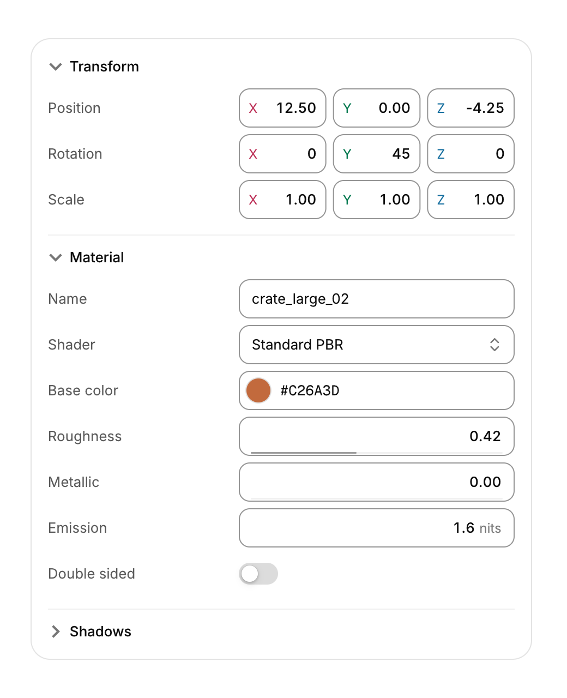</picture>

```c
static bool transform_open = true, material_open = true;
static const char *const shaders[] = { "Standard PBR", "Unlit", "Toon", "Glass" };
if (cui_inspector_begin(ui, "props")) {
    if (cui_inspector_group(ui, "Transform", &transform_open)) {
        cui_prop_vec3(ui, "Position", obj->pos, .step = 0.05f, .format = "%.2f");
        cui_prop_vec3(ui, "Rotation", obj->rot, .step = 1, .format = "%.0f");
    }
    if (cui_inspector_group(ui, "Material", &material_open)) {
        cui_prop_text(ui, "Name", obj->name, sizeof obj->name);
        cui_prop_enum(ui, "Shader", shaders, 4, &obj->shader);
        cui_prop_color(ui, "Base color", &obj->base);
        if (cui_prop_float(ui, "Roughness", &obj->roughness, .min = 0, .max = 1, .step = 0.01f)) mark_dirty(obj);
        cui_prop_float(ui, "Emission", &obj->emission, .step = 0.1f, .suffix = "nits");
        cui_prop_bool(ui, "Double sided", &obj->double_sided);
    }
    cui_inspector_end(ui);
}
```

A panel of named properties in folding groups, each edited with the control that fits its type. Each row is a label on the left and an editor on the right, built from the library's own fields: number rows (`cui_prop_float`, `cui_prop_int`) are scrub fields, so dragging the field or its label sideways changes the value (Shift for fine steps), a click types a number and the arrow keys step it. `cui_prop_vec2`, `cui_prop_vec3` and `cui_prop_vec4` put compact X, Y, Z and W fields side by side, their letters tinted with the theme's tones. Text rows are text fields, bool rows switches (`.checkbox = true` for a checkbox), enum rows selects and color rows open the color picker. Every row returns true when its value changed. With `.min` and `.max` a number shows where it sits in its range; without them it is unbounded. The label column takes 38% of the width (or `.label_width`); drag the line between the columns to resize it. Below 380 points the labels move above their editors.

Groups fold with a chevron and open and close with the disclosure spring; their rows are built only while open or closing, and groups end at the next group or at `cui_inspector_end`. Tab moves through the group headers and every editor in order; Enter, Space or the left and right arrows fold a focused group.

### Log console

<picture><source media="(prefers-color-scheme: dark)" srcset="images/components/log-console-dark.png">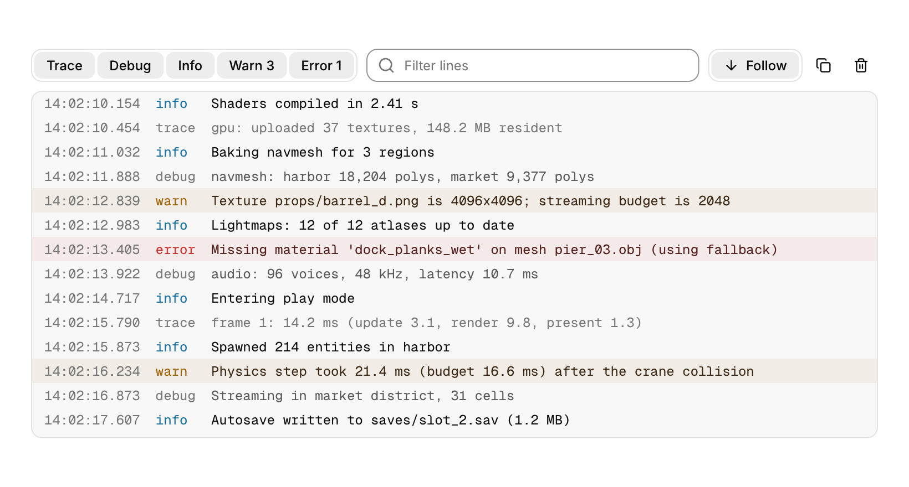</picture>

```c
static cui_log_line lines[8192];
static char text[512 * 1024];
static cui_log_buffer log;
cui_log_init(&log, lines, 8192, text, sizeof text);   /* once */

log.now = seconds_since_start();                     /* timestamp for the next lines */
cui_log_append(&log, CUI_LOG_WARN, "Physics step took %.1f ms (budget %.1f ms)", step_ms, budget_ms);

cui_log_view(ui, "log", &log, .height = 320, .timestamps = true);
```

A log view for many thousands of lines, with level filters, search, follow and copy. The app owns the storage: an array of line records and a byte buffer for the text, used as a ring. Appending never allocates; when either fills up the oldest lines are dropped, and a line longer than the whole text buffer is cut to fit. The view builds only the rows in sight, so a buffer of many thousands of lines scrolls as fast as a short one, and it keeps a small index of the lines that pass its filter (at most one entry per line slot, freed with the context).

Each line shows its level as a quiet tag (warnings and errors also tint their row), an optional `HH:MM:SS.mmm` time and the text in the code font. The toolbar filters by level (warning and error counts appear on their toggles, which shorten to initials when the console is narrow), searches as you type (matches are marked and the field counts the lines found), and Follow keeps the newest line in view: scrolling up turns it off, coming back to the bottom turns it on. Copy takes the selected lines or, with no selection, every line shown; Clear empties the buffer. Click a line to select it, drag or Shift+click for a range. With the list focused, the arrows move through lines, Shift+arrows extend the selection, Page Up, Page Down and Home jump, End returns to following, Ctrl+A selects all, Ctrl+C copies and Esc clears the selection.

## Conversation

### Chat

<picture><source media="(prefers-color-scheme: dark)" srcset="images/components/chat-dark.png"></picture>

```c
cui_chat_divider(ui, "Today");
cui_chat_message(ui, "Did the data grid make it into 1.1?", .author = "Jonas Berg", .time = "9:41", .last_in_group = false);
cui_chat_message(ui, "I need it for the billing page.", .author = "Jonas Berg", .grouped = true, .last_in_group = true);
cui_chat_message(ui, "It did. 2,000 rows scroll at 60 fps on my laptop.", .mine = true, .status = "Read", .time = "9:43");
cui_typing_indicator(ui, "Jonas");
```

Grouped messages stack tightly with the avatar on the last bubble and tighter inner corners. Your own messages sit on the right in the primary color. The typing dots bounce in sequence.

### Comments

<picture><source media="(prefers-color-scheme: dark)" srcset="images/components/comments-dark.png"></picture>

```c
static int likes = 12; static bool liked = true;
int act = cui_comment(ui, "c1", "Tomas Rivera", text, .time = "2h", .likes = &likes, .liked = &liked, .badge = "Author");
if (act & CUI_COMMENT_REPLY) open_reply_box();
cui_comment(ui, "c2", "Priya Nair", "Agreed, one more run.", .time = "1h", .depth = 1);
```

`depth` indents replies under a thread line. The like button toggles `liked` and keeps `likes` in step.

### Presence, counter and ticker

<picture><source media="(prefers-color-scheme: dark)" srcset="images/components/presence-ticker-dark.png"></picture>

```c
cui_presence(ui, "here", users, 7, 5, 30);                     /* show 5, then "+2" */
cui_counter(ui, "revenue", revenue, .format = "$%.0f", .size = 34, .group_thousands = true);
static const cui_ticker_item items[] = { { "Builds", "1,204", 12.0f }, { "Latency", "182 ms", -8.4f, true } };
cui_ticker(ui, "kpis", items, 2);   /* true: lower is better, so the fall shows green */
```

Presence avatars overlap with colored rings and spread out under the pointer; idle people are dimmed. The counter rolls each digit like an odometer when the value changes. The ticker scrolls continuously, fades at the edges and pauses under the pointer.

## Media

### Carousel

<picture><source media="(prefers-color-scheme: dark)" srcset="images/components/carousel-dark.png"></picture>

```c
static int slide = 0;
cui_carousel(ui, "tour", 4, &slide, .height = 200, .auto_advance = 6) {
    for (int k = 0; k < 4; k++) cui_carousel_slide(ui) { draw_slide(ui, k); }
}
```

Drag or flick between slides, scroll sideways, use the arrow buttons, the dots or the arrow keys. The track settles on a spring. `auto_advance` moves on every few seconds, except while hovered; `loop` wraps around.

### Image compare and card stack

<picture><source media="(prefers-color-scheme: dark)" srcset="images/components/compare-stack-dark.png"></picture>

```c
static float split = 0.5f;
cui_image_compare(ui, "cmp", before, after, &split, .height = 230, .aspect = 1600.0f / 1000.0f);

cui_card_stack_begin(ui, "deck", 3, &(cui_card_stack_opts){ .width = CUI_PX(240), .height = 200 });
for (int k = 0; k < 3; k++) cui_card_stack_item(ui, k) { draw_card(ui, deck[k]); }
int dir = cui_card_stack_end(ui);   /* -1 or 1 when the top card was thrown left or right */
```

Drag the divider, or focus it and use the arrow keys. Pass the pictures' `aspect` (width over height) and they are cropped to fill the box instead of stretched. The top card of the stack follows the pointer; past a third of its width, or with a fast flick, it flies off and the cards behind move up. Cards clip their content to a rectangle, so content that fills a card gives itself a radius of 25 (the card's 26, less its 1px border) and its corners line up.

## Planning

### Kanban board

<picture><source media="(prefers-color-scheme: dark)" srcset="images/components/kanban-dark.png"></picture>

```c
cui_kanban_begin(ui, "board");
for (int c = 0; c < column_count; c++) {
    if (cui_kanban_column_begin(ui, columns[c].name, columns[c].count, .dot = columns[c].color, .limit = columns[c].wip))
        add_card(c);                                     /* the "+" in the header */
    for (int k = 0; k < columns[c].count; k++) {
        card *cd = &columns[c].cards[k];
        if (cui_kanban_card_begin(ui, cd->id)) open_card(cd);
        cui_badge(ui, cd->tag, .tone = cd->tone, .size = CUI_SIZE_SM);
        cui_text(ui, cd->title, .font = CUI_FONT_MEDIUM);
        cui_kanban_card_end(ui);
    }
    cui_kanban_column_end(ui);
}
cui_kanban_move m;
if (cui_kanban_end(ui, &m)) move_card(m.card, m.from_column, m.to_column, m.to_index);
```

Cards lift and follow the pointer when dragged; the column under the pointer lights up and a line marks where the card will land. A plain click is a click, not a move. `to_index` is the position in the target column with the dragged card left out, so removing it first and then inserting at `to_index` is always right. The count turns red when a column goes over its `limit`. Wide boards scroll sideways. From the keyboard, Space lifts the focused card, the arrow keys move it between slots and columns, Enter drops it and Esc puts it back.

### Week calendar

<picture><source media="(prefers-color-scheme: dark)" srcset="images/components/week-calendar-dark.png"></picture>

```c
static cui_cal_event events[] = {
    { "Design review", "Room 2", 0, 11, 12.5f, CUI_TONE_VIOLET },   /* Monday 11:00 to 12:30 */
    { "Focus time", NULL, 2, 13.5f, 16, CUI_TONE_TEAL },
};
int clicked = cui_week_calendar(ui, "week", monday, events, 2, .start_hour = 8, .end_hour = 18, .height = CUI_PX(460));
```

Drag an event to move it (it snaps to 15 minutes and keeps its length) or pull its bottom edge to resize it; the calendar writes the new times into your array. Overlapping events share the day side by side. Today is circled and a line marks the current time. `read_only` turns editing off but keeps clicks. With the keyboard, Up and Down move a focused event by 15 minutes, Left and Right by a day, and Shift with Up or Down changes its end.

### Gantt chart

<picture><source media="(prefers-color-scheme: dark)" srcset="images/components/gantt-dark.png"></picture>

```c
static cui_gantt_task tasks[] = {
    /* name, owner, start day, end day, progress, tone, depends on, milestone */
    { "Research", "Maya Okafor", 0, 5, 1.0f, CUI_TONE_VIOLET, -1, false },
    { "Core engine", "Jonas Berg", 6, 19, 0.55f, CUI_TONE_INFO, 0, false },
    { "Beta", NULL, 21, 21, 0, CUI_TONE_WARNING, 1, true },
};
int clicked = cui_gantt(ui, "plan", tasks, 3, start_date, 28, .today = 10);
```

A task list on the left and a timeline that scrolls sideways, with months, day numbers and shaded weekends. Drag a bar to reschedule it, or drag either end to change its length. The darker part of a bar is its progress. Dependencies draw as elbow arrows and milestones as diamonds. A focused bar moves a day with the arrow keys and changes its length with Shift and the arrows.

### Node editor

<picture><source media="(prefers-color-scheme: dark)" srcset="images/components/node-editor-dark.png">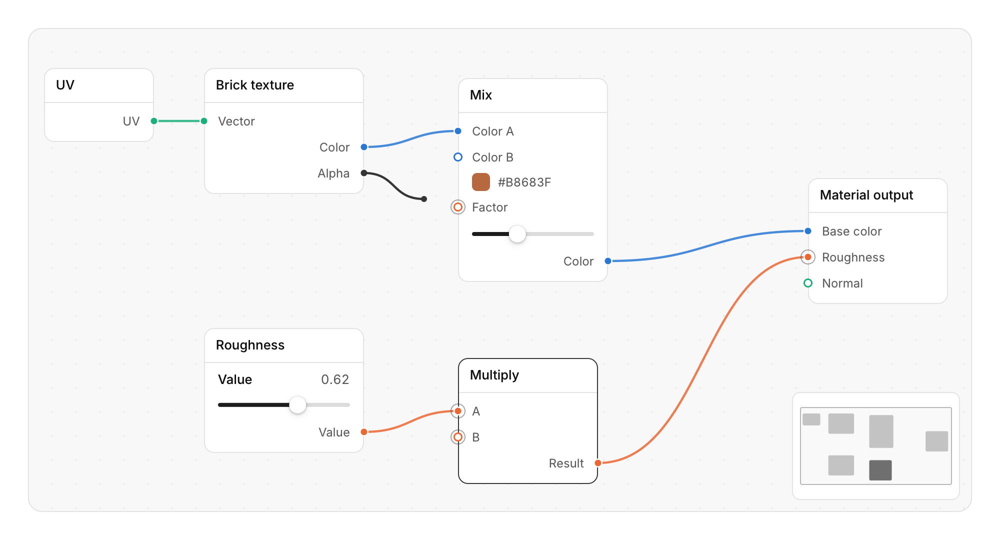</picture>

```c
static cui_node_view view;                                   /* pan and zoom, kept by you */
if (cui_node_editor_begin(ui, "material", &view, .height = CUI_PX(480), .minimap = true)) {
    for (int i = 0; i < node_count; i++) {
        node *n = &nodes[i];
        cui_node_begin(ui, n->id, &n->x, &n->y, n->title, .width = 160);   /* moves n->x, n->y */
        cui_node_input(ui, n->pin_color, "Color", .type = PIN_COLOR);
        if (!cui_node_input(ui, n->pin_factor, "Factor", .type = PIN_FLOAT))
            cui_node_content(ui) { cui_slider(ui, "##factor", &n->factor, 0, 1); }   /* unlinked: set it here */
        cui_node_output(ui, n->pin_out, "Result", .type = PIN_COLOR);
        cui_node_end(ui);
    }
    for (int k = 0; k < link_count; k++) cui_node_link(ui, links[k].id, links[k].from_pin, links[k].to_pin);
    int from, to, id;
    while (cui_node_link_created(ui, &from, &to)) add_link(from, to);   /* output pin, input pin */
    while (cui_node_link_removed(ui, &id)) remove_link(id);
    while (cui_node_deleted(ui, &id)) remove_node(id);           /* its links were reported above */
    cui_node_editor_end(ui);
}
```

A canvas of nodes joined by curved links, for shader graphs, audio patching or visual scripting. You own the graph: node, pin and link ids are your integers, the editor moves the positions you pass and reports links made, links removed and nodes deleted, and you change your data. Scroll to zoom around the pointer (25% to 200%); pan with the middle button, or hold Space and drag. Click a node to select it, Shift or Ctrl click to add to the selection, drag on the empty canvas for a marquee, and drag a node to move it with the rest of the selection, which lifts while it moves. Drag from a pin to make a link: the wire follows the pointer, pins it can join show a ring, and it snaps to the nearest one. Pins of one `type` share a color from the series palette and only join their own type (0 joins anything); an input takes one link, so a new one replaces the old. Drag a link's input end off its pin to detach it, or click a wire and press Delete. With the keyboard, Tab moves through the nodes (focusing a node selects it), the arrow keys move the selection (Shift for single points), Delete or Backspace removes it, Ctrl+A selects every node, F frames them all, + and - zoom, 0 returns to 100% and Esc drops a wire or clears the selection. The editor draws its cards, labels, pins and wires at the zoom, so they stay sharp. Components in `cui_node_content` are laid out at 100% and scaled with the view: they work at any zoom, but their text is sharpest at 100% and below, and menus they open are placed for 100%. Links cannot be made from the keyboard.

## More charts

These follow the same rules as the [core charts](components.md#charts): a tooltip on hover, an intro animation, theme colors. Each returns the index of the mark that was clicked, or -1. Series colors come from a palette checked for color blindness in both modes: neighbouring series stay apart for protanopia and deuteranopia, and the palette rotates so the first series sits next to your accent. Charts that compare amounts on one scale (heatmaps, the treemap, the bar list) use shades of a single hue instead.

### Heatmap

<picture><source media="(prefers-color-scheme: dark)" srcset="images/components/heatmap-dark.png"></picture>

```c
float traffic[7 * 24];   /* values[row * cols + col] */
cui_heatmap(ui, "traffic", traffic, 7, 24, .row_labels = weekdays, .col_labels = hours, .format = "%.0f req");
```

One hue, light to dark (dim to bright in dark mode), with a scale below. Column labels skip themselves when they would collide; pass NULL for the ones you do not want. `min` and `max` fix the range; `cell` fixes the size, otherwise the cells fit the width.

### Calendar heatmap

<picture><source media="(prefers-color-scheme: dark)" srcset="images/components/calendar-heatmap-dark.png"></picture>

```c
cui_calendar_heatmap(ui, "year", start, per_day, 364, .unit = "contributions");
```

One square a day in five levels, weeks as columns starting on Monday, month labels where a month begins. The tooltip shows the date and the value; `unit` also adds a total under the grid.

### Treemap and radar

<picture><source media="(prefers-color-scheme: dark)" srcset="images/components/treemap-radar-dark.png"></picture>

```c
static const cui_viz_item mods[] = { { "Layout", 55 }, { "Text", 42 }, { "Draw", 35 } /* ... */ };
cui_treemap(ui, "bundle", mods, 10, .height = 290, .format = "%.0f KB");

cui_series releases[] = { { "1.0", a, 6 }, { "1.1", b, 6 } };
cui_radar_chart(ui, "radar", releases, 2, axes, 6, .size = 210, .max = 100);
```

The treemap uses a squarified layout, so rectangles stay close to square; labels appear where they fit and the text color follows the fill. Give an item a `color` to pick it out. The radar draws a ring per tick with its value, fills each series lightly and lists them in a legend; hovering near an axis shows every series' value on it.

### Funnel, split bar and waffle

<picture><source media="(prefers-color-scheme: dark)" srcset="images/components/funnel-split-dark.png"></picture>

```c
static const cui_viz_item stages[] = { { "Visited", 12840 }, { "Signed up", 4210 }, { "Activated", 2380 }, { "Subscribed", 860 } };
cui_funnel(ui, "signup", stages, 4);
cui_split_bar(ui, "frame", parts, 5, .format = "%.0f ms");
cui_waffle(ui, "installs", platforms, 3, .cell = 12);
```

The funnel shows each stage's share of the first and, under it, the conversion from the stage before. The split bar is one bar cut into parts with 2 point gaps and a legend of values and shares. The waffle hands out its 100 squares by largest remainder, so the counts always add up. Hovering a part, a square or a legend row picks that item out.

### Sankey

<picture><source media="(prefers-color-scheme: dark)" srcset="images/components/sankey-dark.png"></picture>

```c
static const char *nodes[] = { "Search", "Social", "Referral", "Sign up", "Bounced", "Trial", "Paid", "Churned" };
static const cui_sankey_link links[] = { { 0, 3, 420 }, { 1, 3, 260 }, { 3, 5, 860 }, { 5, 6, 580 } /* ... */ };
cui_sankey(ui, "flow", nodes, 8, links, 8, .height = 300);
```

Columns follow the links from the sources, and an outcome sits at the step it is reached from, so a drop off stays beside the step it left and no ribbon crosses a column of nodes. Color goes to the outcomes, the largest first, and each ribbon takes the color of where it ends; sources and steps stay neutral gray, so the eye follows where things end up. Hover a node to highlight its links, or a ribbon to see the flow and its share of the source. A cycle in the links does not hang the layout.

### Bar list and activity rings

<picture><source media="(prefers-color-scheme: dark)" srcset="images/components/bar-list-rings-dark.png"></picture>

```c
cui_bar_list(ui, "pages", pages, 5);   /* ranked by value; set keep_order to keep yours */
static const cui_viz_item rings[] = { { "Move", 0.82f }, { "Exercise", 1.24f }, { "Stand", 0.58f } };
cui_activity_rings(ui, "rings", rings, 3, .size = 180, .legend = true);
```

Bar list rows are keyed by their label: when the values change, the bars grow or shrink and the rows slide to their new rank. `max_rows` keeps the top few. Ring values are fractions of a goal; past 1 a ring keeps winding, with a shadow under its tip so the overlap reads. `legend` lists each ring's name and share beside it, outer ring first, and hovering a row picks out its ring; without it, `center` and `caption` put a single figure in the middle.

### Scatter and bubble

<picture><source media="(prefers-color-scheme: dark)" srcset="images/components/scatter-dark.png"></picture>

```c
cui_scatter_series s[] = { { "Software", points_a, sizes_a, 40 }, { "OpenGL", points_b, sizes_b, 40 } };
cui_scatter_chart(ui, "frames", s, 2, .height = 300, .x_label = "Nodes", .y_label = "Frame time (ms)", .y_format = "%.2f");
```

Leave `sizes` NULL for a scatter. With sizes, the area of a bubble follows its value. Every mark has a 1.5 point ring in the surface color, so overlapping points stay apart, and the nearest point under the pointer gets guide lines to both axes.

## Motion

Text effects, loaders and the playful pieces. With reduced motion, text effects show their final state at once.

### Text effects

<picture><source media="(prefers-color-scheme: dark)" srcset="images/components/text-effects-dark.png"></picture>

```c
cui_shimmer_text(ui, "Thinking about your question...");
bool done = cui_typewriter(ui, "answer", streamed_text, .caret = true);
cui_text_reveal(ui, "done", "The release build finished in 3 minutes 42 seconds.", .font = CUI_FONT_DISPLAY, .size = 20);
static const char *words[] = { "staging.", "eu-west.", "all regions." };
cui_word_rotate(ui, "rot", words, 3, 2.2f, .font = CUI_FONT_DISPLAY, .size = 26);
```

The shimmer sweeps a soft highlight across muted text. The typewriter lays out the whole text first and uncovers it, so lines never reflow as it types. When you append to the text (streamed tokens), it carries on from where it was and speeds up when it falls far behind; any other change starts over. The reveal fades and lifts words in one after another whenever the text changes. Rotating words roll up into place, and the width follows the word.

### Rolling numbers

```c
char rev[32];
snprintf(rev, sizeof rev, "$%s", grouped(revenue));   /* any formatted figure */
cui_number_roll(ui, "revenue", rev, .font = CUI_FONT_DISPLAY, .size = 28);
```

When the text changes, only the characters that differ roll: up into place when the value rises, down when it falls, each a beat after the one to its left. A prefix and suffix such as `$` or ` ms` stay put, digits are tabular so the figure keeps its width, and the width eases when the number grows or shrinks. With reduced motion the new value simply appears.

### Gradient text and spotlight cards

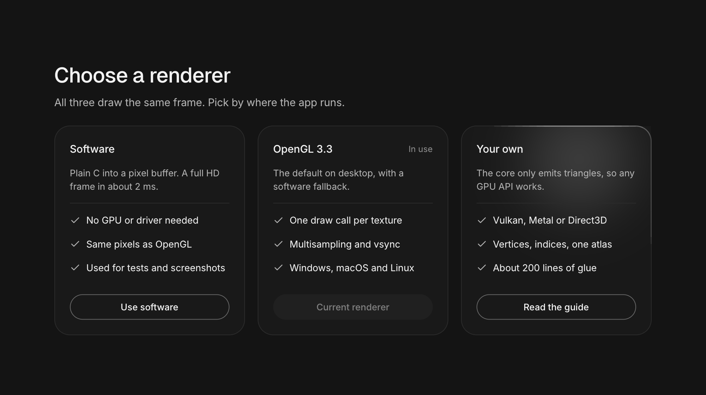

```c
cui_gradient_text(ui, "Kiln 2.4", .font = CUI_FONT_DISPLAY, .size = 38);   /* a tonal blend of the accent */
cui_spotlight(ui, "gl", .width = CUI_PX(270)) {
    cui_text(ui, "OpenGL 3.3", .font = CUI_FONT_MEDIUM);
    /* ... */
}
```

Gradient text blends across its width, by default between two tones of the accent; pass `from` and `to` for other colors, and `animate` to let the blend drift. Keep it for a single brand moment: headings and numbers read better in one solid color. A spotlight card catches a soft light under the pointer, and the stretch of its border nearest the pointer lights up. With `beam`, a light also travels around the edge. Use it for the one card that is live, such as a running deploy, never for a whole row.

### Loaders

<picture><source media="(prefers-color-scheme: dark)" srcset="images/components/loaders-dark.png"></picture>

```c
cui_loader(ui, .style = CUI_LOADER_DOTS);    /* also BARS, PULSE, ORBIT, GRID */
cui_loader(ui, .style = CUI_LOADER_PULSE, .size = 32, .color = CUI_COLOR_ACCENT);
```

### Dock

<picture><source media="(prefers-color-scheme: dark)" srcset="images/components/dock-dark.png"></picture>

```c
cui_dock(ui, "dock") {
    if (cui_dock_item(ui, CUI_ICON_FOLDER, "Files", .color = CUI_RGB(0x3b82f6), .running = true)) open_files();
    cui_dock_item(ui, CUI_ICON_MAIL, "Mail", .color = CUI_RGB(0x0ea5e9), .badge = 3);
    cui_dock_separator(ui);
    cui_dock_item(ui, CUI_ICON_TRASH_2, "Trash");
}
```

Icons grow as the pointer passes, with the item under it largest and its neighbours following on a cosine falloff. Items show their label as a tooltip, a dot when `running` and a count with `badge`. Tab and Enter work as well.

### Control tiles

<picture><source media="(prefers-color-scheme: dark)" srcset="images/components/tiles-dark.png"></picture>

```c
static bool wifi = true;
cui_control_tile(ui, "Wi-Fi", &wifi, .icon = CUI_ICON_WIFI, .detail = wifi ? "Home" : "Off");
cui_control_tile(ui, "Focus", &focus, .icon = CUI_ICON_MOON, .color = CUI_RGB(0x6366f1));
cui_control_tile(ui, "Dark appearance", &dark, .icon = CUI_ICON_SUN, .wide = true);
```

Big toggles for quick settings, which fill their grid cell. They switch with a click or with Space and Enter. `detail` replaces the default On and Off line.

### Now playing, waveform and tab bar

<picture><source media="(prefers-color-scheme: dark)" srcset="images/components/player-dark.png"></picture>

```c
static cui_now_playing np = { "Low Tide", "Marlow Avenue", art, { 0 }, 76, 222, true };
int ev = cui_now_playing(ui, "player", &np);
if (ev & CUI_PLAYER_NEXT) next_track();
if (ev & CUI_PLAYER_SEEK) seek(np.position);

static float progress;
if (cui_waveform(ui, "voice", peaks, 96, &progress, .height = 34)) seek_to(progress);

static int tab;
cui_tab_bar(ui, "tabs", tabs, 4, &tab);
```

The player shows artwork (a texture, or `art_color`), a play button that morphs between play and pause, and a scrubber that thickens and shows its knob under the pointer. The time on the right counts down. The waveform resamples its peaks to fit its width; the played part takes the accent color and a ghost shows where a click would seek. The tab bar's pill glides to the selection, and arrow keys move it.

## AI interfaces

The pieces of an assistant: thinking, tools, plans, sources and the composer. See the *AI* page in the gallery for them working together.

### Reasoning and tool calls

<picture><source media="(prefers-color-scheme: dark)" srcset="images/components/reasoning-tools-dark.png">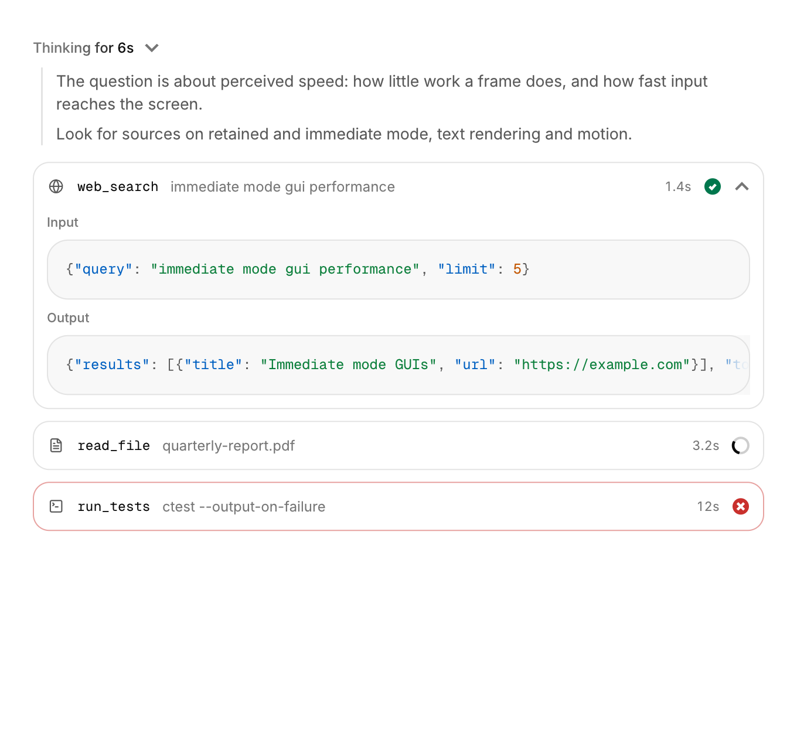</picture>

```c
cui_reasoning(ui, "think", .thinking = streaming, .seconds = elapsed) {
    cui_text(ui, thoughts, .size = 13.5f, .color = CUI_COLOR_TEXT_SECONDARY);
}
cui_tool_call(ui, "search", "web_search", .icon = CUI_ICON_GLOBE, .detail = query, .status = CUI_TASK_DONE, .seconds = 1.4f,
              .input = request_json, .output = response_json);
cui_tool_call(ui, "read", "read_file", .detail = "quarterly-report.pdf", .status = CUI_TASK_RUNNING);
```

While `thinking`, the reasoning header shimmers and counts up; when it ends, the block folds to "Thought for 8s". Clicking the header opens or closes it, and from then on your choice sticks. A tool call shows its status as a ring, a spinner, a check or a cross, with the time. Clicking it opens the input and output, which are highlighted as JSON when they look like JSON.

### Agent plan and status

<picture><source media="(prefers-color-scheme: dark)" srcset="images/components/agent-plan-dark.png">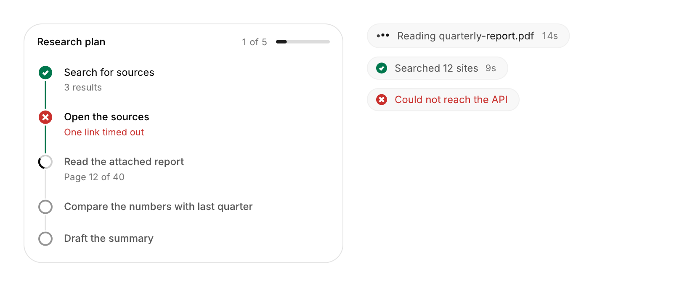</picture>

```c
cui_plan_step steps[] = {
    { "Search for sources", "3 results", CUI_TASK_DONE },
    { "Read the attached report", "Page 12 of 40", CUI_TASK_RUNNING },
    { "Draft the summary", NULL, CUI_TASK_PENDING },
};
int step = cui_agent_plan(ui, "plan", steps, 3, .title = "Research plan");
cui_agent_status(ui, "Reading quarterly-report.pdf", .status = CUI_TASK_RUNNING, .seconds = elapsed);
```

The rail fills up to the step in progress, the running step shimmers, and the header counts finished steps with a progress bar. The status pill shows loader dots while running and a check or a cross when done.

### Sources and citations

<picture><source media="(prefers-color-scheme: dark)" srcset="images/components/sources-dark.png">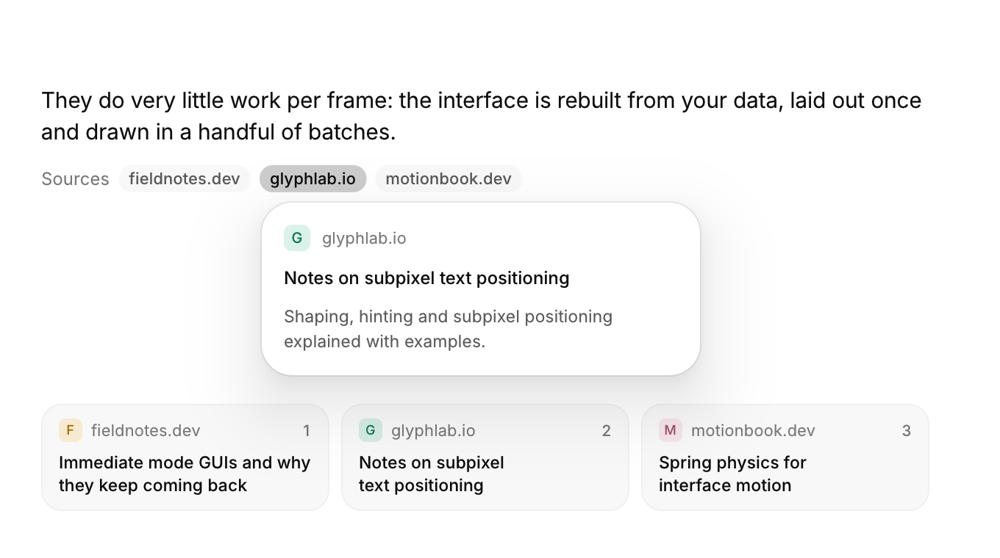</picture>

```c
static const cui_source sources[] = { { "Notes on subpixel text positioning", "https://glyphlab.io/notes/subpixel", "Shaping, hinting and..." } /* ... */ };
for (int k = 0; k < n; k++) cui_citation(ui, k + 1, &sources[k]);   /* a chip; hover for a card */
int open = cui_source_list(ui, "sources", sources, n);              /* cards that scroll sideways */
```

Citations show the source's domain and open a card with the title and snippet when hovered. Source cards get a colored initial (always the same for a domain), the title and the source's number.

### Composer and model picker

<picture><source media="(prefers-color-scheme: dark)" srcset="images/components/composer-dark.png">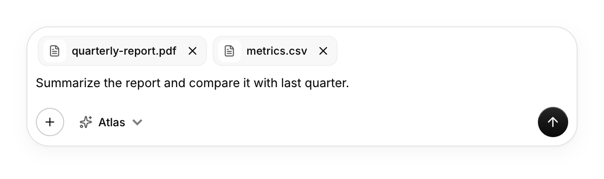</picture>

<picture><source media="(prefers-color-scheme: dark)" srcset="images/components/model-picker-dark.png">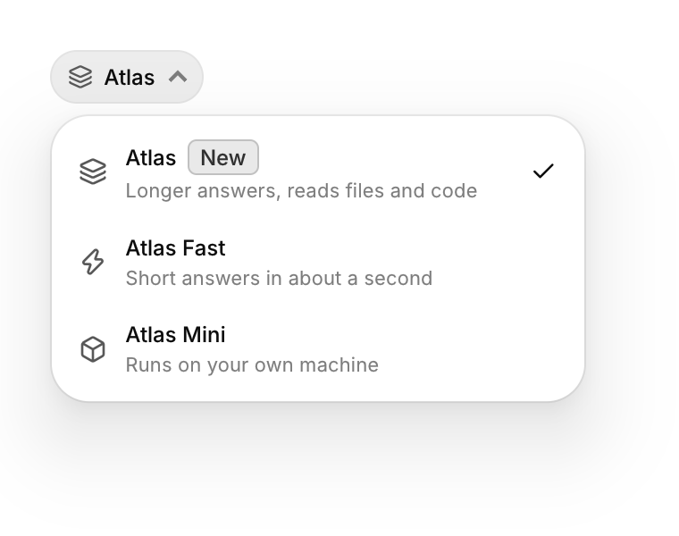</picture>

```c
static char draft[4096];
static int model;
int ev = cui_chat_composer(ui, "composer", draft, sizeof draft, .placeholder = "Ask anything", .busy = generating,
                           .attachments = files, .attachment_count = n, .removed = &removed,
                           .models = models, .model_count = 3, .model = &model);
if (ev & CUI_COMPOSER_SEND) send(draft);
if (ev & CUI_COMPOSER_STOP) stop();
if (ev & CUI_COMPOSER_REMOVE) remove_file(removed);
```

The text area grows with its content up to `max_lines`, then scrolls. Enter sends and Shift+Enter starts a new line. Send stays disabled while the draft is empty, and while `busy` it becomes a stop button. The model picker can also be used alone: `cui_model_picker(ui, "model", models, n, &model)`.

### Suggestions, response actions and the context meter

<picture><source media="(prefers-color-scheme: dark)" srcset="images/components/suggestions-dark.png">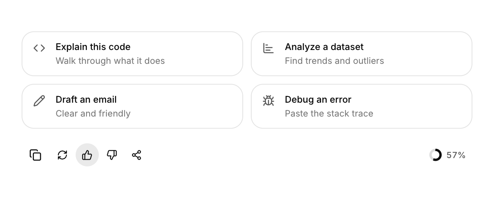</picture>

```c
int pick = cui_prompt_suggestions(ui, "start", suggestions, 4);           /* .columns = 1 for a sidebar */
int act = cui_response_actions(ui, "actions", .copy_text = answer, .vote = &vote);
if (act & CUI_RESPONSE_REGENERATE) regenerate();
cui_context_meter(ui, "ctx", used_tokens, 200000, .parts = parts, .part_count = 3);
```

The response actions copy (the icon turns into a check), regenerate, vote and share. The context meter's ring turns amber past 80% and red past 95%; hovering it shows a split of what fills the context.

### Voice orb

<picture><source media="(prefers-color-scheme: dark)" srcset="images/components/voice-orb-dark.png">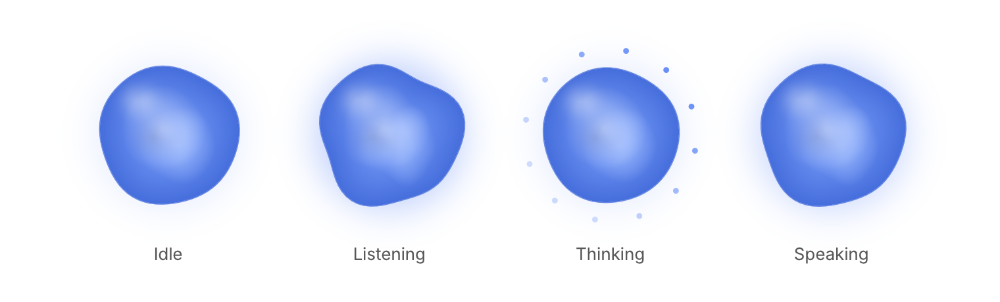</picture>

```c
if (cui_voice_orb(ui, "voice", listening ? CUI_VOICE_LISTENING : CUI_VOICE_IDLE, mic_level)) toggle_listening();
```

A living shape for voice modes. It breathes when idle, ripples with the level while listening, sends a ring of dots around while thinking and swells with the voice while speaking. It moves between states smoothly.

## App chrome

The parts around a desktop window's content: a menu bar, a toolbar, document tabs and a status bar. The bars have no fill of their own and draw a hairline on their inner edge, so they take the color of whatever holds them. In the picture the window's chrome sits in a muted box and the content in a white one.

<picture><source media="(prefers-color-scheme: dark)" srcset="images/components/app-chrome-dark.png">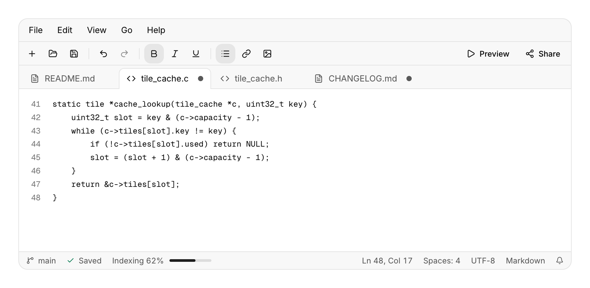</picture>

### Menu bar

<picture><source media="(prefers-color-scheme: dark)" srcset="images/components/menu-bar-dark.png">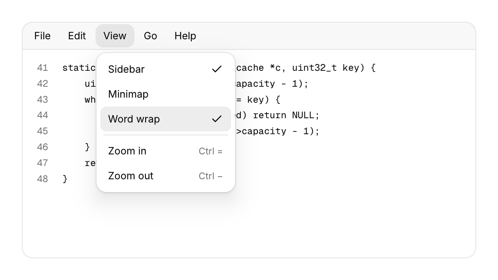</picture>

```c
cui_menu_bar(ui, "menubar") {
    cui_menu_bar_menu(ui, "File") {
        if (cui_menu_item(ui, "Open...", .shortcut = "Ctrl O")) open_file();
        if (cui_menu_item(ui, "Save", .shortcut = "Ctrl S", .disabled = !dirty)) save();
        cui_menu_separator(ui);
        if (cui_menu_item(ui, "Close window", .shortcut = "Ctrl Shift W")) close_window();
    }
    cui_menu_bar_menu(ui, "View") {
        if (cui_menu_item(ui, "Word wrap", .checked = wrap)) wrap = !wrap;
    }
}
```

Each menu holds ordinary menu items, so shortcuts, separators, labels, icons, disabled and checked items work as they do in a dropdown. A press opens a menu; while one is open, moving over another title switches to it. Alt on its own or F10 puts the keyboard on the bar and underlines each title's mnemonic (its first letter, or `.mnemonic`). Then Left and Right move along the bar, Enter or Down opens a menu with its first item ready, Left and Right inside a menu move to the next one, Enter chooses, and Esc steps back to the bar and then gives the keyboard back to what had it. Alt plus a mnemonic opens that menu from anywhere. Shortcuts shown in the menus are labels only: handle them in your app with `cui_shortcut`. A check sits after the shortcut text, so a menu reads best when its checkable items have no shortcut. Submenus are not supported.

### Toolbar

<picture><source media="(prefers-color-scheme: dark)" srcset="images/components/toolbar-dark.png">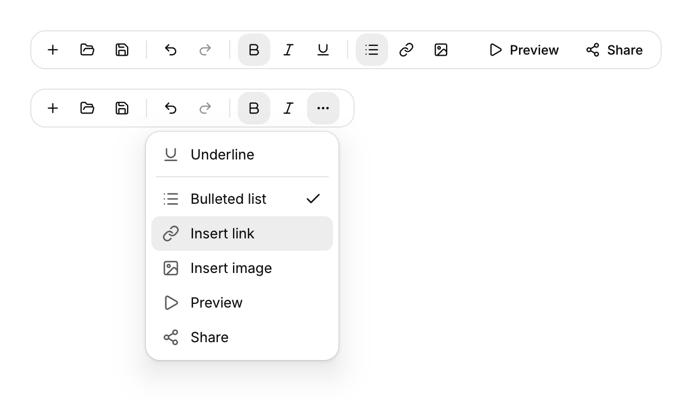</picture>

```c
static bool bold;
cui_toolbar(ui, "tools") {
    if (cui_toolbar_button(ui, CUI_ICON_SAVE, .tooltip = "Save", .shortcut = "Ctrl S")) save();
    cui_toolbar_separator(ui);
    cui_toolbar_button(ui, CUI_ICON_BOLD, .tooltip = "Bold", .toggle = &bold);
    cui_toolbar_spacer(ui);
    if (cui_toolbar_button(ui, CUI_ICON_PLAY, .label = "Preview")) preview();
}
```

Buttons are small ghost buttons; an icon only button needs a `tooltip`, which is its name. A `toggle` flips its bool on each click and shows pressed while it is on. When the row is too narrow, items collapse from the end into a "more" menu that shows their icons, names, check marks and the separators between them. An item chosen there returns true on the next frame (the toolbar learns its width from the previous frame, so a resize settles one frame later too). Every button is in the Tab order; on the more button, Enter or Down opens the menu.

### Document tabs

<picture><source media="(prefers-color-scheme: dark)" srcset="images/components/document-tabs-dark.png">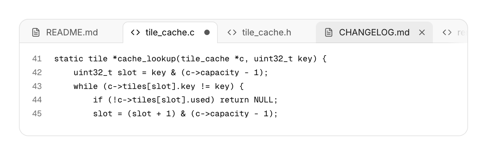</picture>

```c
static cui_doc_tab tabs[16] = { { "README.md", CUI_ICON_FILE_TEXT }, { "tile_cache.c", CUI_ICON_CODE, "src/tile_cache.c", true } };
static int count = 2, active = 0;
cui_doc_tabs_result r = cui_doc_tabs(ui, "docs", tabs, count, &active, .shortcuts = true);
if (r.move_from >= 0) move_tab(tabs, r.move_from, r.move_to);   /* active already follows */
if (r.close >= 0 && confirm_close(r.close)) {
    remove_tab(tabs, &count, r.close);
    if (active > r.close || active == count) active--;
}
```

A click selects a tab, the x or a middle click asks to close it, and dragging a tab sideways reorders the strip while the others make room. A tab with unsaved changes (`dirty`) shows a dot, which turns into the x under the pointer. The selected tab is filled with the surface color and opens into the content below. Too many tabs scroll sideways with a fade at the edge, and a newly selected tab scrolls into view. The component reports closes and moves and leaves your array alone, so you can ask before closing; tabs keep their state by title, so give two tabs with the same name a key (`"main.c##src"`). The selected tab is in the Tab order: Left and Right select, Home and End jump, Shift+Left and Shift+Right move it, Delete closes it. With `.shortcuts = true` Ctrl+Tab and Ctrl+Shift+Tab (or Ctrl+PageDown and Ctrl+PageUp) switch tabs and Ctrl+W (Cmd+W on macOS) closes the selected one from anywhere in the window. `.no_close` and `.no_reorder` turn those parts off.

### Status bar

<picture><source media="(prefers-color-scheme: dark)" srcset="images/components/status-bar-dark.png">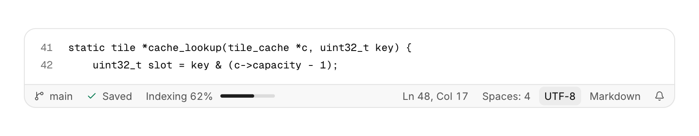</picture>

```c
cui_status_bar(ui, "status") {
    if (cui_status_bar_item(ui, branch, .icon = CUI_ICON_GIT_BRANCH, .tooltip = "Switch branch")) pick_branch();
    cui_status_bar_text(ui, "Saved", .icon = CUI_ICON_CHECK, .tone = CUI_TONE_SUCCESS);
    cui_status_bar_progress(ui, indexed, .label = "Indexing");
    cui_status_bar_spacer(ui);
    char pos[48];
    snprintf(pos, sizeof pos, "Ln %d, Col %d###pos", line, col);
    if (cui_status_bar_item(ui, pos)) go_to_line();
    if (cui_status_bar_item(ui, "UTF-8")) pick_encoding();
}
```

Items run left to right and `cui_status_bar_spacer` sends the rest to the right edge. Texts and items are 12 point with tabular figures, so a counting position keeps its width; give an item whose label changes a fixed key (`"Ln 12, Col 4###pos"`) so it keeps its hover and focus. Items are in the Tab order and return true when clicked. `tone` colors a message's icon. The progress bar is 64 points wide (`.width`) and fills with the accent; `.indeterminate` slides a segment along it, which stays still with reduced motion.
