# More components

The second half of the library: richer actions and inputs, pickers, disclosure, data views, more charts, motion and AI interface pieces. Everything follows the same rules as the [core components](components.md): named options, keyboard support, light and dark, reduced motion. Each family has a page in the gallery (`./build/examples/gallery`, section *Extended*).

## Actions

### Split button


```c
static const char *more[] = { "Save as draft", "Save and publish", "Schedule..." };
switch (cui_split_button(ui, "Save", more, 3, .icon = CUI_ICON_SAVE)) {
case 0: save(); break;              /* the main part */
case 1: save_draft(); break;        /* menu item 0 */
case 2: publish(); break;
case 3: schedule(); break;
}
```

Returns 0 for the main action, 1 + i for menu item i, -1 otherwise. Options: `variant` (primary by default), `size`, `icon`, `item_icons`, `disabled`. Down arrow on the chevron opens the menu.

### Toggle group

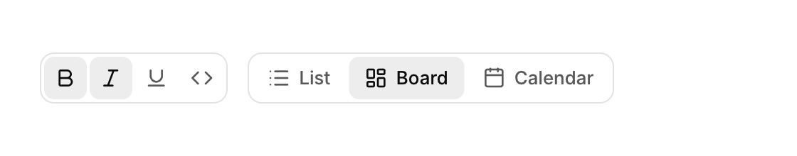

```c
static bool format[4];          /* bold, italic, underline, code */
const char *labels[] = { "Bold", "Italic", "Underline", "Code" };
const char *icons[] = { CUI_ICON_BOLD, CUI_ICON_ITALIC, CUI_ICON_UNDERLINE, CUI_ICON_CODE };
cui_toggle_group(ui, "format", labels, 4, format, .icons = icons, .icon_only = true);
```

Each item flips its own `bool`. With `.exclusive = true` exactly one stays on, like a radio group. With `icon_only` the labels become tooltips. Arrow keys move between items.

### Confirm button

```c
if (cui_confirm_button(ui, "Delete project", .icon = CUI_ICON_TRASH_2)) delete_project();
```

The first click morphs the button into a red "Click to confirm" with a countdown line; the second click fires. It disarms after `timeout` seconds (3), on Esc, or when you click elsewhere. Options: `confirm_label`, `icon`, `variant`, `size`, `timeout`.

### Status button


```c
static cui_status status;
if (cui_status_button(ui, "Save changes", status, .success_label = "Saved")) { status = CUI_STATUS_BUSY; start_save(); }
/* later: status = CUI_STATUS_SUCCESS (or CUI_STATUS_ERROR), then back to CUI_STATUS_IDLE */
```

Shows the life of the work it started: idle, a spinner while busy, a check or an error. The width springs between states and the content cross-fades. Clicks only count while idle.

### Reactions

```c
static cui_reaction re[] = { { CUI_ICON_THUMBS_UP, 12, true }, { CUI_ICON_HEART, 4, false } };
int changed = cui_reactions(ui, "reactions", re, 2);   /* index that toggled, or -1 */
```

Clicking toggles `active` and adjusts `count`; the number rolls up or down and the icon pops.

### Speed dial

```c
static const cui_speed_action acts[] = { { CUI_ICON_FILE_TEXT, "New note" }, { CUI_ICON_IMAGE, "Upload image" } };
int pick = cui_speed_dial(ui, "create", acts, 2, .tooltip = "Create");
```

A round floating action button. Clicking fans the actions out with a stagger while the plus morphs into a close icon. Esc or a click elsewhere folds them. `placement` controls the direction (above and right aligned by default).

### Theme switcher and toggle

```c
static int mode = -1;                       /* -1 picks up the current theme */
cui_theme_switcher(ui, &mode, true);        /* light, dark, system */
cui_theme_toggle(ui);                       /* one icon button: sun and moon morph */
```

Light and dark are applied for you. For "system" (mode 2), read the OS setting (for example with `cui_app_desc.follow_system_theme`) and call `cui_set_theme`.

### User menu

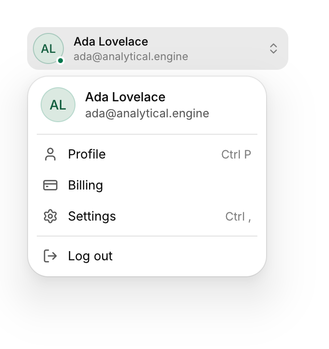

```c
cui_user_menu(ui, "Ada Lovelace", .detail = "ada@analytical.engine", .status = "online") {
    cui_menu_item(ui, "Profile", .icon = CUI_ICON_USER);
    cui_menu_item(ui, "Log out", .icon = CUI_ICON_LOG_OUT);
}
```

An avatar, a name and a detail line that open an account menu with a header. Full width for sidebars; `.compact = true` shows just the avatar for headers. Options: `detail`, `status`, `avatar` (a texture), `compact`, `placement`, `width`.

### Swipe actions

```c
static const cui_swipe_action done[] = { { CUI_ICON_CHECK, "Done", CUI_TONE_SUCCESS } };
static const cui_swipe_action more[] = { { CUI_ICON_ARCHIVE, "Archive", CUI_TONE_INFO }, { CUI_ICON_TRASH_2, "Delete", CUI_TONE_DANGER } };
cui_swipe_item_begin(ui, "mail-42", done, 1, more, 2);
cui_text(ui, "Quarterly report", .width = CUI_FILL);
int action = cui_swipe_item_end(ui);   /* 0 = left action 0, 100 + i = right action i, -1 = none */
```

Drag a row sideways, or swipe with two fingers on a trackpad. Past half the reveal width it snaps open; past 60% of the row it fires the first action on that side. Click the row or anywhere else to close it.

## Inputs

### Inline edit

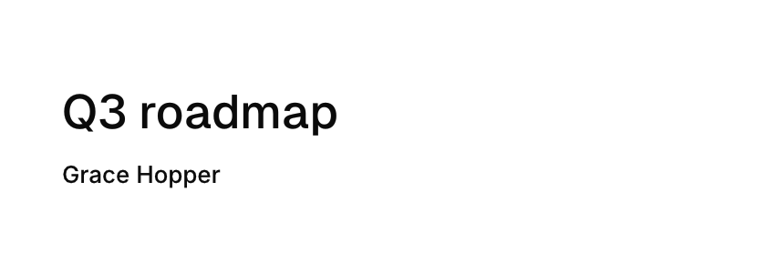

```c
static char title[128] = "Q3 roadmap";
if (cui_inline_edit(ui, "title", title, sizeof title, .font = CUI_FONT_DISPLAY, .size = 26) & CUI_CHANGED) rename(title);
```

Looks like text, with a pencil on hover. Click (or Enter when focused) to edit in the same type with the text selected. Enter or clicking away saves, Esc restores the old text. Options: `font`, `size`, `placeholder`, `width`.

### Scrub field

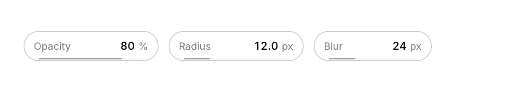

```c
static float opacity = 80;
cui_scrub(ui, "Opacity", &opacity, 0, 100, .suffix = "%");
```

Drag sideways anywhere on the field to change the value; hold Shift for steps ten times finer. A click without dragging lets you type a number. Arrow keys step when focused. A hairline along the bottom shows where the value sits in its range. Options: `step` (range / 100), `format`, `suffix`, `icon` (instead of the label), `width`.

### Money field

```c
static double amount = 1249.5;
cui_money_input(ui, "amount", &amount, .label = "Amount", .code = "USD");                       /* $ 1,249.50  USD */
cui_money_input(ui, "salary", &salary, .symbol = "\xe2\x82\xac", .code = "EUR", .decimals = -1); /* whole euros */
```

Shows grouped digits at rest and plain digits while you type, keeps at most `decimals` places (2; -1 for none) and ignores anything that is not a number. Options: `label`, `symbol` ("$"), `code`, `decimals`, `width`, `hint`.

### Prefix and suffix

Every text field takes muted text before and after the value:

```c
cui_input(ui, "site", site, sizeof site, .prefix = "https://");
cui_input(ui, "weight", weight, sizeof weight, .suffix = "kg");
```

### Shortcut recorder

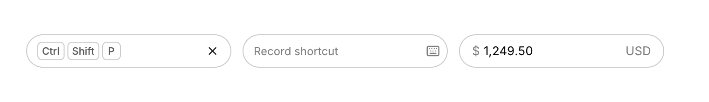

```c
static cui_key_combo palette_key = { CUI_MOD_PRIMARY, CUI_KEY_K };
if (cui_shortcut_recorder(ui, "palette-key", &palette_key)) save_keymap();
if (cui_shortcut(ui, palette_key.mods, palette_key.key)) open_palette();
```

Click and press a combination. While recording, the field shows the modifiers you hold with a pulsing dot, and app shortcuts stay quiet. Backspace clears, Esc or Tab cancels. `cui_shortcut_label(ui, combo)` gives the text ("Ctrl Shift K"), `cui_key_name(key)` one key.

## Pickers

### Multi-select

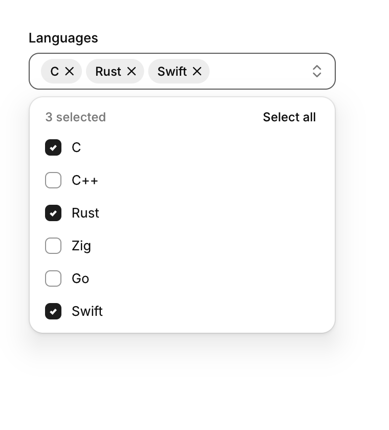

```c
static bool chosen[6];
const char *langs[] = { "C", "C++", "Rust", "Zig", "Go", "Swift" };
cui_multi_select(ui, "langs", langs, 6, chosen, .label = "Languages", .searchable = true);
```

The field shows chips (with remove buttons) for up to `max_chips` items and "+N" for the rest. The list keeps itself open while you tick items and has a select all / clear action. Up, Down and Space or Enter work in the list.

### Date range picker

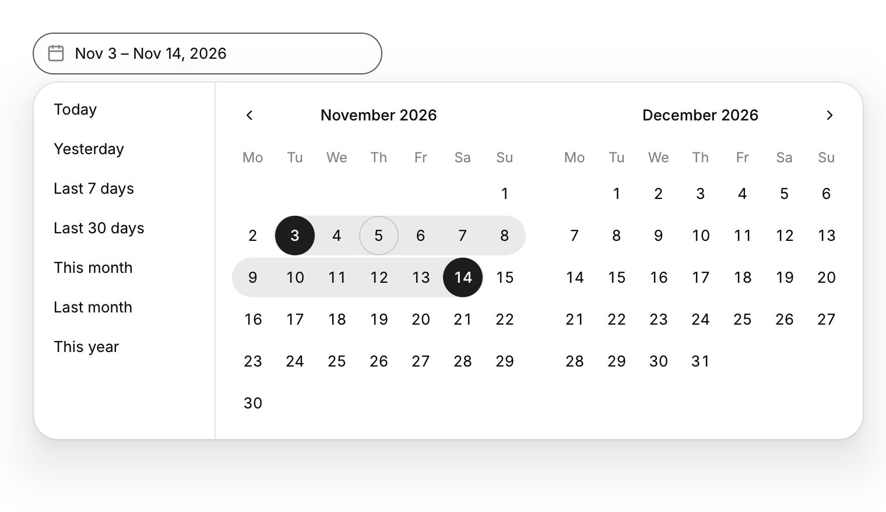

```c
static cui_date_range trip;
cui_date_range_picker(ui, "trip", &trip, .label = "Dates");
cui_range_calendar(ui, "inline", &trip, 2);   /* the calendar on its own, one or two months */
```

Click a start and an end (in either order); while you choose the end, the band follows the pointer. Presets (today, last 7 days, this month...) sit on the left unless `.no_presets = true`. `cui_date_to_days` and `cui_date_from_days` convert dates to day numbers for arithmetic.

### Time picker

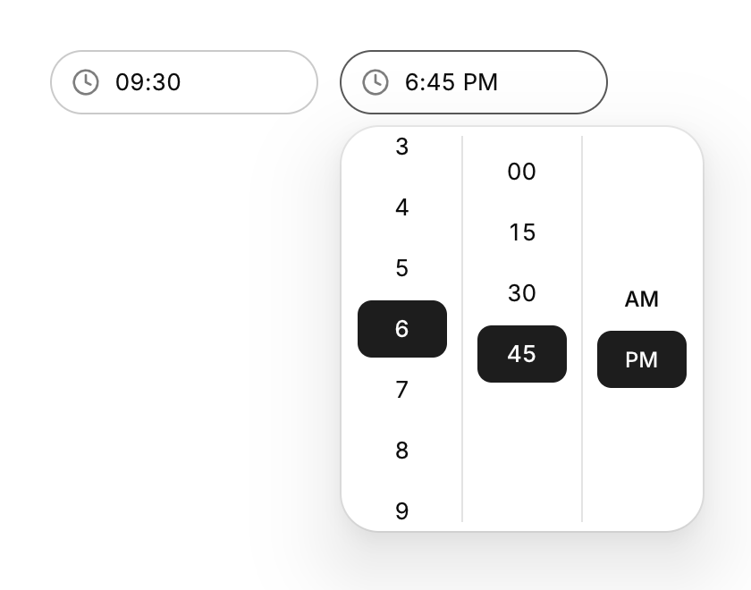

```c
static int hour = 9, minute = 30;
cui_time_picker(ui, "start", &hour, &minute);
cui_time_picker(ui, "end", &hour2, &minute2, .twelve_hour = true, .minute_step = 15);
```

Hour and minute columns (and AM / PM) that open scrolled to the current value. `hour` is always 0 to 23.

### Wheel picker and time dial

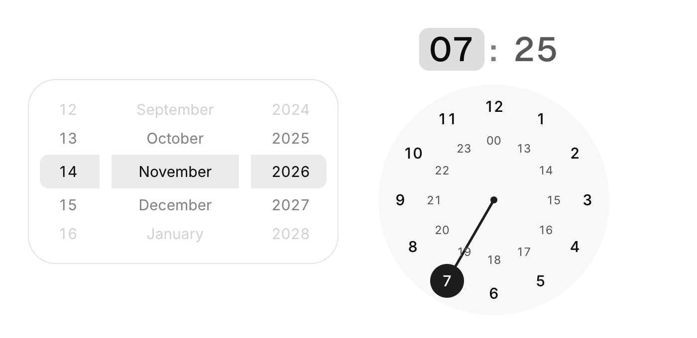

```c
cui_wheel_picker(ui, "month", month_names, 12, &month, .width = CUI_PX(128), .loop = true);
cui_time_dial(ui, "alarm", &hour, &minute, 232);
```

Wheels are drums of options: drag with momentum, scroll or use the arrow keys, and they snap to an item. Set `loop` for values that wrap. Put several side by side with `join_left` / `join_right` to share one selection band, as in a date reel.

The time dial sets hours on two rings (1 to 12 outside, 13 to 00 inside), then switches to minutes when you let go. The hand springs the short way round. Click the hour or minute at the top to choose which one you set.

### Ruler and histogram sliders

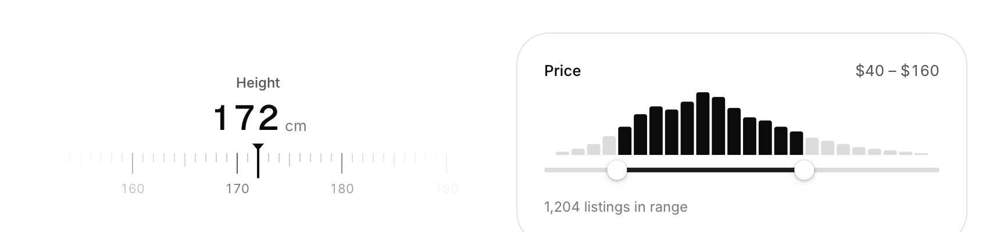

```c
cui_ruler_slider(ui, "Height", &height, 120, 220, .unit = "cm");
cui_histogram_slider(ui, "Price", bins, 24, &lo, &hi, 0, 240, .format = "$%.0f");
```

The ruler is a tape that slides under a fixed marker; throw it and it glides, then snaps to `step`. Options: `step`, `major_every` (labelled ticks), `spacing` (points per step), `format`, `unit`, `width`. The histogram slider is a range slider with the distribution it filters drawn above it; bars inside the range light up.

## Capture

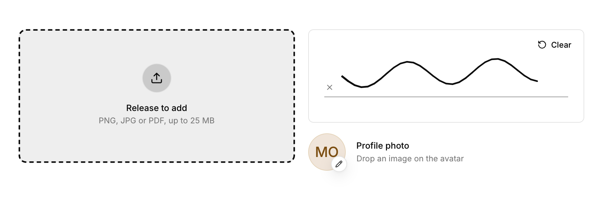

### Dropzone

```c
int n = cui_dropzone(ui, "attachments", .description = "PNG, JPG or PDF, up to 25 MB", .accept = "png;jpg;pdf");
if (n > 0) for (int i = 0; i < n; i++) attach(cui_dropped_file(ui, i));
if (n < 0) { char path[1024]; if (cui_app_file_dialog(NULL, &(cui_file_dialog_opts){ 0 }, path, sizeof path)) attach(path); }
```

Files dragged from the desktop or a file manager highlight the zone ("Release to add") and land on it; files that do not match `accept` are left out and the zone says so. `.compact = true` makes a one line version. Drag and drop works with every built-in backend; the live hover highlight appears where the platform reports drags in progress (macOS and X11), elsewhere the drop itself still lands.

If you use your own window layer, feed drops with `cui_input_file_drop(ui, paths, count, x, y)` and hovering with `cui_input_file_hover(ui, true, x, y)`. Files dropped outside any dropzone are available to the app through `cui_dropped_file_count` and `cui_dropped_file` for that frame.

### Avatar upload

```c
static cui_texture photo;
if (cui_avatar_upload(ui, "photo", "Ada Lovelace", &photo, 88) < 0) browse_for_photo();
```

Drop an image on the avatar to replace it (the previous texture is destroyed). Hover shows a camera; the pencil badge marks it as editable.

### Signature pad

```c
cui_signature_pad(ui, "signature", .height = 180);
const cui_vec2 *pts; const int *ends; int strokes;
int n = cui_signature_points(ui, "signature", &pts, &ends, &strokes);   /* points relative to the pad */
```

Stroke width follows speed, so signatures look inked rather than drawn with a fixed pen. A Clear button appears once something is drawn; `cui_signature_clear` does the same from code.

## Disclosure

### Hover card

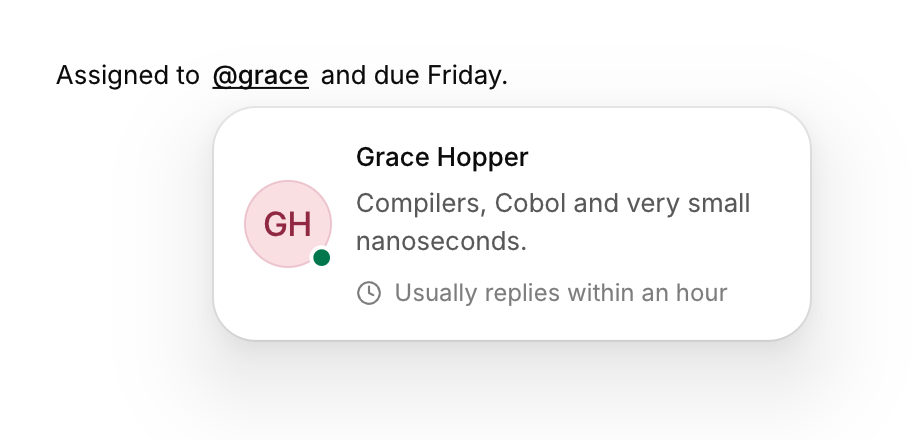

```c
cui_link(ui, "@grace");
cui_hover_card(ui, "grace", .width = 300) {
    cui_avatar(ui, "Grace Hopper", .size = 44);
    cui_text(ui, "Compilers, Cobol and very small nanoseconds.");
}
```

Attaches to the previous component. It opens after the pointer rests there for `delay` seconds (0.45) and stays open while the pointer is over the anchor or the card, with a short grace period to cross the gap. Options: `placement`, `width`, `delay`.

### Confirm popover

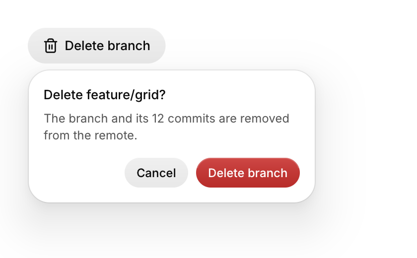

```c
if (cui_button(ui, "Delete branch")) cui_popover_open(ui, "confirm-delete");
if (cui_confirm_popover(ui, "confirm-delete", .title = "Delete feature/grid?", .description = "This cannot be undone.",
                        .confirm_label = "Delete", .danger = true))
    delete_branch();
```

A small question anchored to the button that opened it. Focus moves to the confirm button, so Enter confirms and Esc cancels.

### Expandable text and card

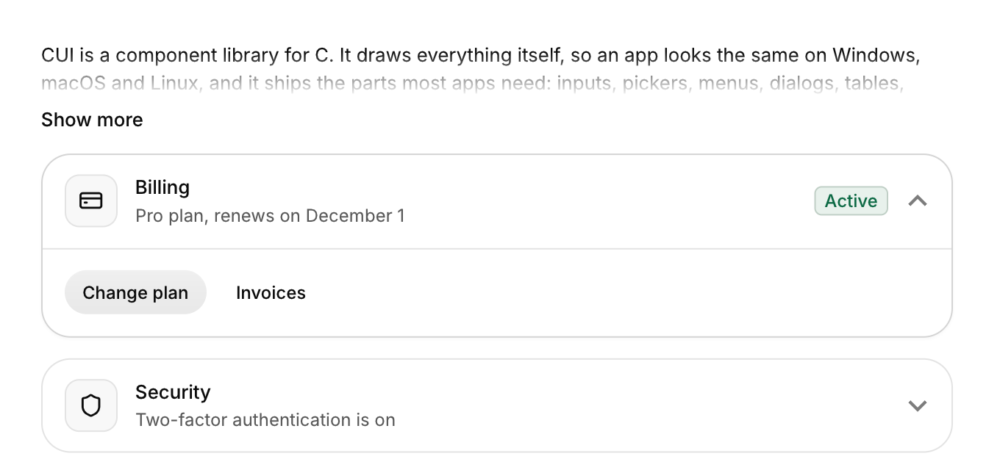

```c
cui_expandable_text(ui, "about", long_text, .lines = 3);

static bool billing_open;
cui_expandable_card(ui, "Billing", &billing_open, .description = "Pro plan", .icon = CUI_ICON_CREDIT_CARD, .badge = "Active") {
    cui_button(ui, "Change plan");
}
```

Expandable text clamps to `lines` with a fade (into `fade_to`, the background by default) and a Show more / Show less link; the height springs. The card's body opens with a height spring and its chevron turns; content inside is disabled while it closes.

### Table of contents

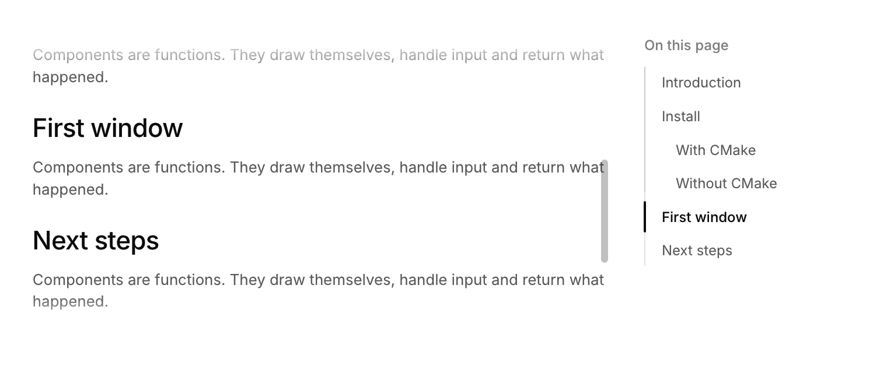

```c
static const cui_toc_item toc[] = { { "Install", "install", 0 }, { "With CMake", "cmake", 1 } };
cui_row(ui) {
    cui_scroll(ui, .id = "doc", .width = CUI_FILL) {
        cui_toc_anchor(ui, "install");  cui_heading(ui, "Install", 3);   /* ... */
        cui_toc_anchor(ui, "cmake");    cui_heading(ui, "With CMake", 4);
    }
    cui_toc(ui, "doc", toc, 2);   /* same scope as the scroll area */
}
```

The rail fills as you read, and a marker glides to the section in view. Clicking an entry scrolls there smoothly. `level` indents entries.

## Feedback

### Banner and countdown

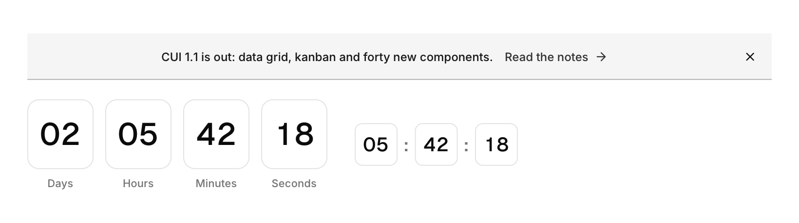

```c
static bool show_update = true;
if (cui_banner(ui, "Version 1.1 is ready to install.", &show_update, .action = "Restart", .dismissible = true)) restart();
cui_countdown(ui, "launch", launch_time - cui_time(ui));
cui_countdown(ui, "sale", sale_end - now, .compact = true, .hide_days = true);
```

The banner spans its container, tinted with its `tone` (the accent by default), and collapses smoothly when dismissed. The countdown shows days, hours, minutes and seconds as tiles whose digits roll; it schedules its own redraw each second.

### Onboarding checklist

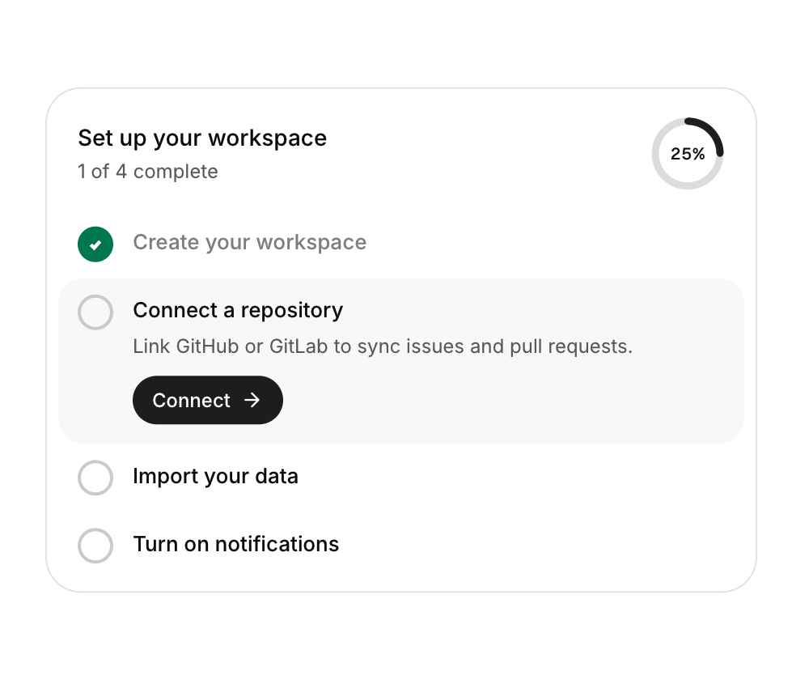

```c
static cui_check_step steps[] = {
    { "Create your workspace", "Pick a name and invite your team.", "Create", true },
    { "Connect a repository", "Sync issues and pull requests.", "Connect", false },
};
int act = cui_checklist(ui, "onboarding", steps, 2, .title = "Set up your workspace");
if (act >= 0) run_step(act);
```

A card with a progress ring and steps; the first unfinished step opens to show its description and action button. Clicking a circle toggles `done`.

### Undo toast

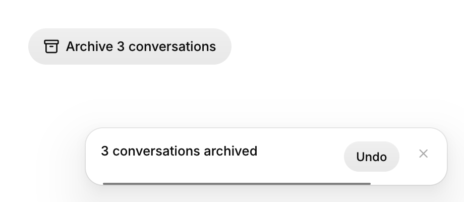

```c
cui_toast(ui, "3 conversations archived", .action = "Undo", .show_timer = true);
```

`show_timer` adds a draining line along the bottom of the toast, so people can see how long Undo stays (6 seconds by default; hovering the stack pauses it).

## Data

### Data grid and filter bar

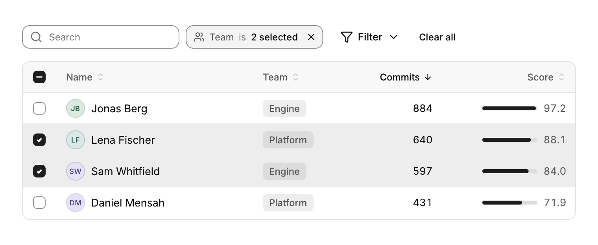

```c
static const cui_grid_column cols[] = {
    { "Name", 210, CUI_TEXT_LEFT, true }, { "Team", 120, CUI_TEXT_LEFT, true }, { "Commits", 100, CUI_TEXT_RIGHT, true },
};
static bool selected[2000];
static cui_table_sort sort = { 2, true };
int first, last;
cui_filter_bar(ui, "filters", fields, 2, filter_masks, search, sizeof search);
if (cui_data_grid_begin(ui, "people", cols, 3, 2000, &first, &last, .height = CUI_PX(420), .selected = selected, .sort = &sort)) {
    for (int r = first; r < last; r++) {
        cui_data_grid_row(ui, r);
        cui_data_grid_cell(ui);
        cui_avatar(ui, people[r].name, .size = 24);
        cui_data_grid_edit(ui, people[r].name, sizeof people[r].name);   /* double click to rename */
        cui_data_grid_cell_text(ui, people[r].team);
        cui_data_grid_cell_text(ui, people[r].commits_text);
    }
    cui_data_grid_end(ui);
}
```

Only the rows in view are built, so the row count barely matters. Headers are sticky; drag a header edge to resize a column; click a sortable header to set `sort` (you reorder your data). With `selected`, a checkbox column appears and rows select like a spreadsheet: click, Shift+click for a range, Ctrl+click to toggle, Ctrl+A for all, arrows to move the cursor, Esc to clear. Editable cells start on double click or Enter and commit on Enter or clicking away.

The filter bar keeps one bit mask per field in `selected`; each active field shows as a chip that opens its value list, "Filter" adds one and "Clear all" resets them. `cui_tree_cell` draws a disclosure chevron and indentation inside any table or grid cell for tree tables.

## Code

### Code block

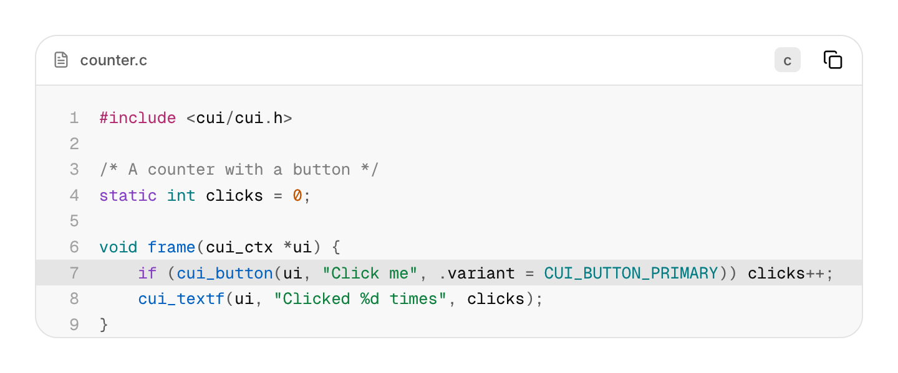

```c
cui_code_block(ui, "counter", source, .lang = "c", .title = "counter.c", .line_numbers = true, .highlight_from = 7);
```

Highlighting for C, C++, JavaScript, TypeScript, Python, Rust, Go, JSON and shell, in colors that follow the theme. Long lines scroll sideways, `max_height` makes the block scroll vertically, and the copy button morphs into a check after copying.

### JSON viewer

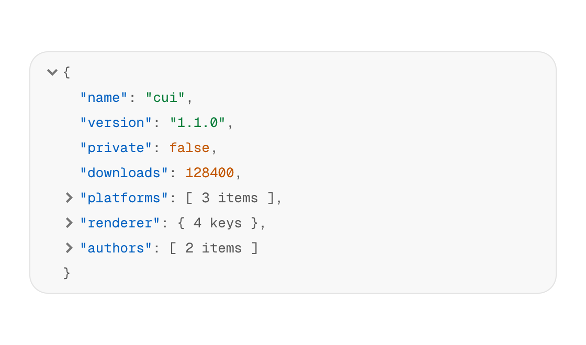

```c
if (!cui_json_view(ui, "response", body, .expand_depth = 1)) { /* not valid JSON: the view shows where it broke */ }
```

A collapsible tree with typed colors. Collapsed objects and arrays show their size; click a chevron to fold or unfold.

## Conversation

### Chat

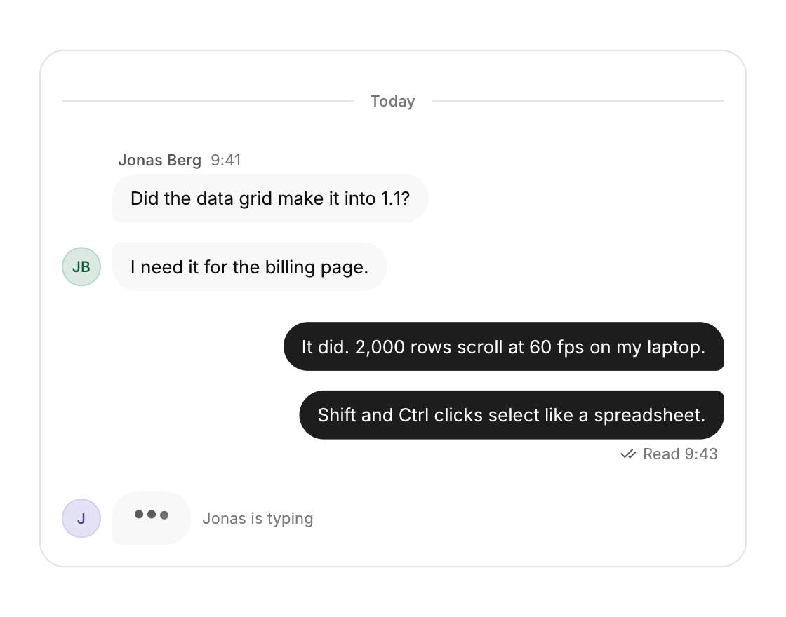

```c
cui_chat_divider(ui, "Today");
cui_chat_message(ui, "Did the grid ship?", .author = "Grace Hopper", .time = "9:41", .last_in_group = false);
cui_chat_message(ui, "Virtualized and sortable.", .author = "Grace Hopper", .grouped = true, .last_in_group = true);
cui_chat_message(ui, "It did!", .mine = true, .status = "Read", .time = "9:43");
cui_typing_indicator(ui, "Grace");
```

Grouped messages stack tightly with the avatar on the last bubble and tighter inner corners. Your own messages sit on the right in the primary color. The typing dots bounce in sequence.

### Comments

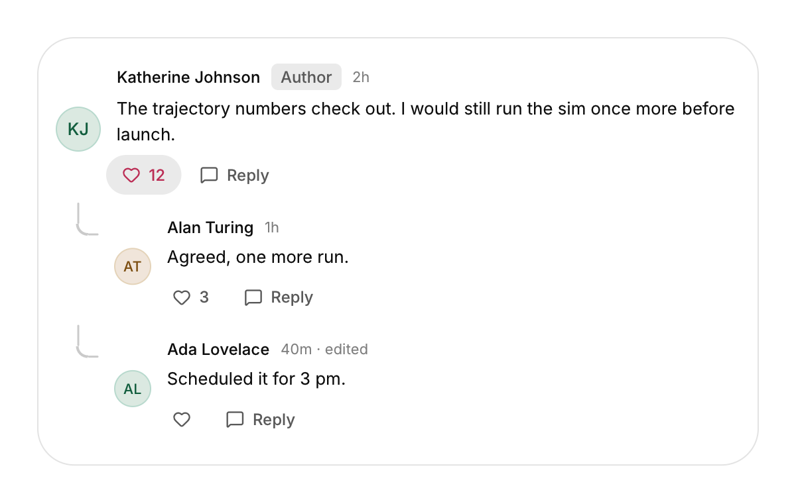

```c
static int likes = 12; static bool liked = true;
int act = cui_comment(ui, "c1", "Katherine Johnson", text, .time = "2h", .likes = &likes, .liked = &liked, .badge = "Author");
if (act & CUI_COMMENT_REPLY) open_reply_box();
cui_comment(ui, "c2", "Alan Turing", "Agreed, one more run.", .time = "1h", .depth = 1);
```

`depth` indents replies under a thread line. The like button toggles `liked` and keeps `likes` in step.

### Presence, counter and ticker

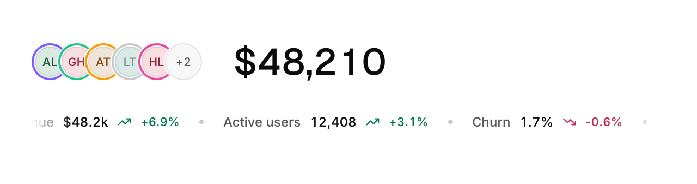

```c
cui_presence(ui, "here", users, 7, 5, 30);                     /* show 5, then "+2" */
cui_counter(ui, "revenue", revenue, .format = "$%.0f", .size = 34, .group_thousands = true);
cui_ticker(ui, "kpis", items, 6);
```

Presence avatars overlap with colored rings and spread out under the pointer; idle people are dimmed. The counter rolls each digit like an odometer when the value changes. The ticker scrolls continuously, fades at the edges and pauses under the pointer.

## Media

### Carousel

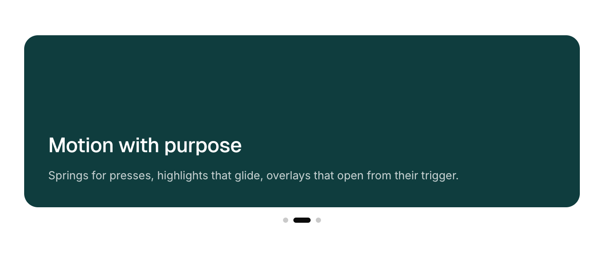

```c
static int slide = 0;
cui_carousel(ui, "tour", 4, &slide, .height = 200, .auto_advance = 6) {
    for (int k = 0; k < 4; k++) cui_carousel_slide(ui) { draw_slide(ui, k); }
}
```

Drag or flick between slides, scroll sideways, use the arrow buttons, the dots or the arrow keys. The track settles on a spring. `auto_advance` moves on every few seconds, except while hovered; `loop` wraps around.

### Image compare and card stack

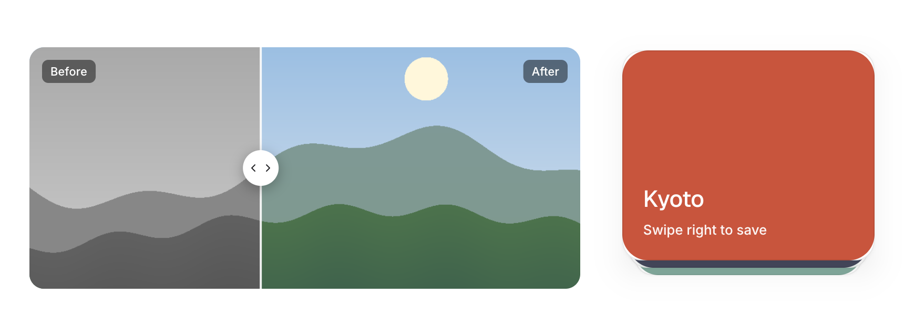

```c
static float split = 0.5f;
cui_image_compare(ui, "cmp", before, after, &split, .height = 230);

cui_card_stack_begin(ui, "deck", 3, &(cui_card_stack_opts){ .width = CUI_PX(240), .height = 200 });
for (int k = 0; k < 3; k++) cui_card_stack_item(ui, k) { draw_card(ui, deck[k]); }
int dir = cui_card_stack_end(ui);   /* -1 or 1 when the top card was thrown left or right */
```

Drag the divider, or focus it and use the arrow keys. The top card of the stack follows the pointer; past a third of its width, or with a fast flick, it flies off and the cards behind move up.

## Planning

### Kanban board

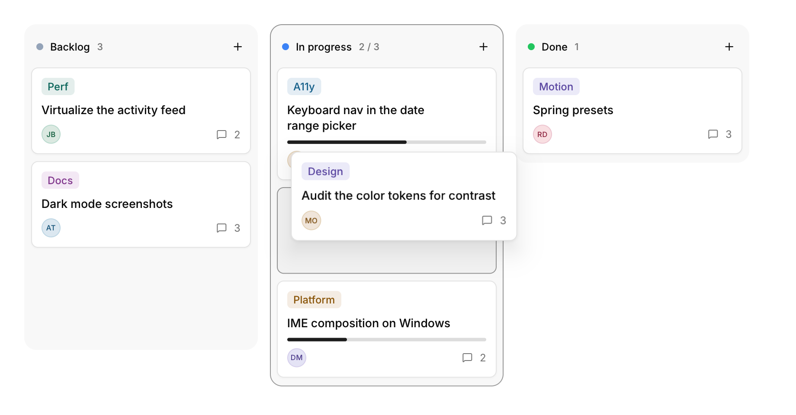

```c
cui_kanban_begin(ui, "board");
for (int c = 0; c < column_count; c++) {
    if (cui_kanban_column_begin(ui, columns[c].name, columns[c].count, .dot = columns[c].color, .limit = columns[c].wip))
        add_card(c);                                     /* the "+" in the header */
    for (int k = 0; k < columns[c].count; k++) {
        card *cd = &columns[c].cards[k];
        if (cui_kanban_card_begin(ui, cd->id)) open_card(cd);
        cui_badge(ui, cd->tag, .tone = cd->tone, .size = CUI_SIZE_SM);
        cui_text(ui, cd->title, .font = CUI_FONT_MEDIUM);
        cui_kanban_card_end(ui);
    }
    cui_kanban_column_end(ui);
}
cui_kanban_move m;
if (cui_kanban_end(ui, &m)) move_card(m.card, m.from_column, m.to_column, m.to_index);
```

Cards lift and follow the pointer when dragged; the column under the pointer lights up and a line marks where the card will land. A plain click is a click, not a move. `to_index` is the position in the target column with the dragged card left out, so removing it first and then inserting at `to_index` is always right. The count turns red when a column goes over its `limit`. Wide boards scroll sideways.

### Week calendar

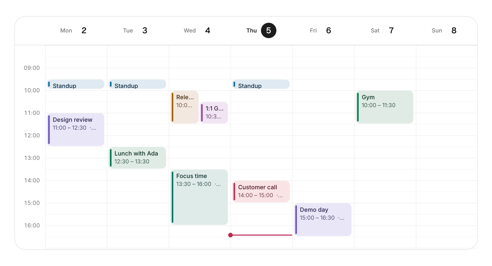

```c
static cui_cal_event events[] = {
    { "Design review", "Room 2", 0, 11, 12.5f, CUI_TONE_VIOLET },   /* Monday 11:00 to 12:30 */
    { "Focus time", NULL, 2, 13.5f, 16, CUI_TONE_TEAL },
};
int clicked = cui_week_calendar(ui, "week", monday, events, 2, .start_hour = 8, .end_hour = 18, .height = CUI_PX(460));
```

Drag an event to move it (it snaps to 15 minutes and keeps its length) or pull its bottom edge to resize it; the calendar writes the new times into your array. Overlapping events share the day side by side. Today is circled and a line marks the current time. `read_only` turns editing off but keeps clicks.

### Gantt chart

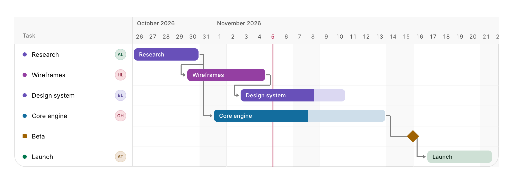

```c
static cui_gantt_task tasks[] = {
    /* name, owner, start day, end day, progress, tone, depends on, milestone */
    { "Research", "Ada Lovelace", 0, 5, 1.0f, CUI_TONE_VIOLET, -1, false },
    { "Core engine", "Grace Hopper", 6, 19, 0.55f, CUI_TONE_INFO, 0, false },
    { "Beta", NULL, 21, 21, 0, CUI_TONE_WARNING, 1, true },
};
int clicked = cui_gantt(ui, "plan", tasks, 3, start_date, 28, .today = 10);
```

A task list on the left and a timeline that scrolls sideways, with months, day numbers and shaded weekends. Drag a bar to reschedule it, or drag either end to change its length. The darker part of a bar is its progress. Dependencies draw as elbow arrows and milestones as diamonds.

## More charts

These follow the same rules as the [core charts](components.md#charts): a tooltip on hover, an intro animation, theme colors. Each returns the index of the mark that was clicked, or -1. Series colors come from a palette checked for color blindness in both modes: neighbouring series stay apart for protanopia and deuteranopia, and the palette rotates so the first series sits next to your accent. Charts that compare amounts on one scale (heatmaps, the treemap, the bar list) use shades of a single hue instead.

### Heatmap

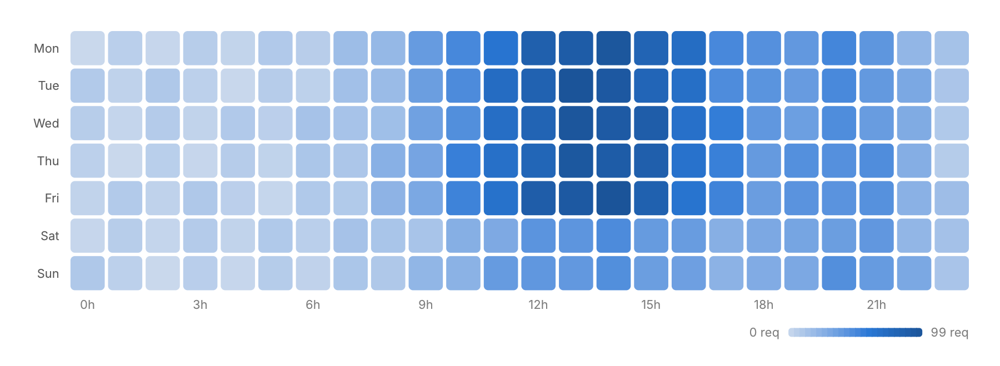

```c
float traffic[7 * 24];   /* values[row * cols + col] */
cui_heatmap(ui, "traffic", traffic, 7, 24, .row_labels = weekdays, .col_labels = hours, .format = "%.0f req");
```

One hue, light to dark (dim to bright in dark mode), with a scale below. Column labels skip themselves when they would collide; pass NULL for the ones you do not want. `min` and `max` fix the range; `cell` fixes the size, otherwise the cells fit the width.

### Calendar heatmap

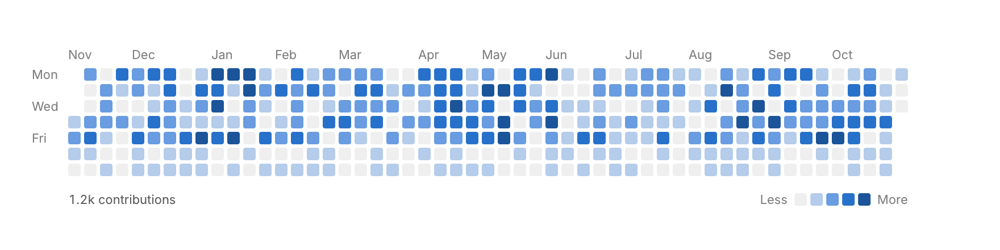

```c
cui_calendar_heatmap(ui, "year", start, per_day, 364, .unit = "contributions");
```

One square a day in five levels, weeks as columns starting on Monday, month labels where a month begins. The tooltip shows the date and the value; `unit` also adds a total under the grid.

### Treemap and radar

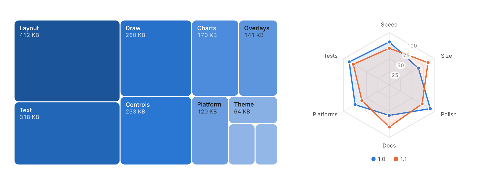

```c
static const cui_viz_item mods[] = { { "Layout", 412 }, { "Text", 318 }, { "Draw", 260 } /* ... */ };
cui_treemap(ui, "bundle", mods, 10, .height = 290, .format = "%.0f KB");

cui_series releases[] = { { "1.0", a, 6 }, { "1.1", b, 6 } };
cui_radar_chart(ui, "radar", releases, 2, axes, 6, .size = 210, .max = 100);
```

The treemap uses a squarified layout, so rectangles stay close to square; labels appear where they fit and the text color follows the fill. Give an item a `color` to pick it out. The radar draws a ring per tick with its value, fills each series lightly and lists them in a legend; hovering near an axis shows every series' value on it.

### Funnel, split bar and waffle

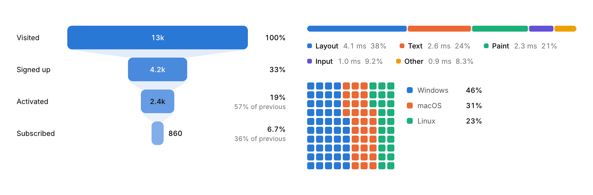

```c
static const cui_viz_item stages[] = { { "Visited", 12840 }, { "Signed up", 4210 }, { "Activated", 2380 }, { "Subscribed", 860 } };
cui_funnel(ui, "signup", stages, 4);
cui_split_bar(ui, "frame", parts, 5, .format = "%.0f ms");
cui_waffle(ui, "installs", platforms, 3, .cell = 12);
```

The funnel shows each stage's share of the first and, under it, the conversion from the stage before. The split bar is one bar cut into parts with 2 point gaps and a legend of values and shares. The waffle hands out its 100 squares by largest remainder, so the counts always add up. Hovering a part, a square or a legend row picks that item out.

### Sankey

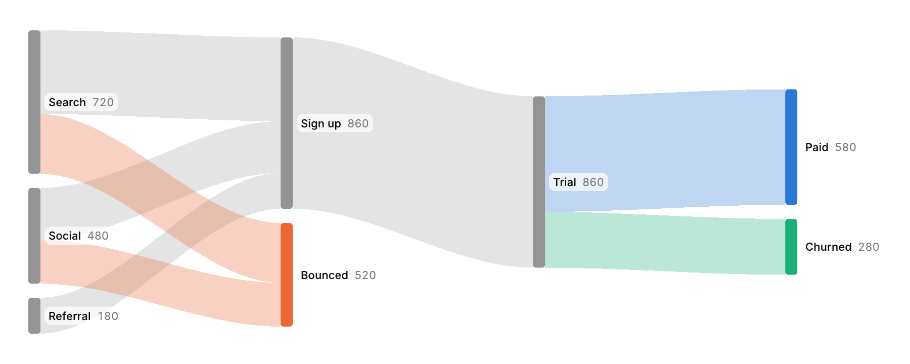

```c
static const char *nodes[] = { "Search", "Social", "Referral", "Sign up", "Bounced", "Trial", "Paid", "Churned" };
static const cui_sankey_link links[] = { { 0, 3, 420 }, { 1, 3, 260 }, { 3, 5, 610 }, { 5, 6, 330 } /* ... */ };
cui_sankey(ui, "flow", nodes, 8, links, 9, .height = 300);
```

Columns follow the links from the sources, and nodes with no way out line up on the right. Sources take the palette in order and every other node inherits the color of its largest inflow, so a flow keeps its color as it moves across the chart. Hover a node to highlight its links, or a ribbon to see the flow and its share of the source. A cycle in the links does not hang the layout.

### Bar list and activity rings

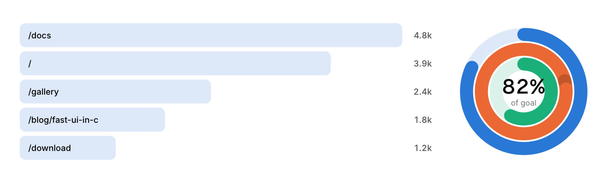

```c
cui_bar_list(ui, "pages", pages, 5);   /* ranked by value; set keep_order to keep yours */
static const cui_viz_item rings[] = { { "Move", 0.82f }, { "Exercise", 1.24f }, { "Stand", 0.58f } };
cui_activity_rings(ui, "rings", rings, 3, .size = 180, .center = "82%", .caption = "of goal");
```

Bar list rows are keyed by their label: when the values change, the bars grow or shrink and the rows slide to their new rank. `max_rows` keeps the top few. Ring values are fractions of a goal; past 1 a ring keeps winding, with a shadow under its tip so the overlap reads.

### Scatter and bubble

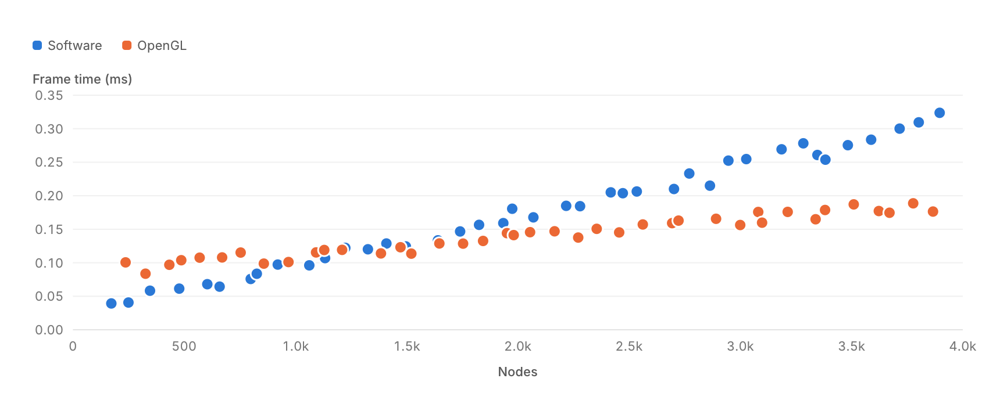

```c
cui_scatter_series s[] = { { "Software", points_a, sizes_a, 40 }, { "OpenGL", points_b, sizes_b, 40 } };
cui_scatter_chart(ui, "frames", s, 2, .height = 300, .x_label = "Nodes", .y_label = "Frame time (ms)", .y_format = "%.2f");
```

Leave `sizes` NULL for a scatter. With sizes, the area of a bubble follows its value. Every mark has a 1.5 point ring in the surface color, so overlapping points stay apart, and the nearest point under the pointer gets guide lines to both axes.

## Motion

Text effects, loaders and the playful pieces. With reduced motion, text effects show their final state at once.

### Text effects

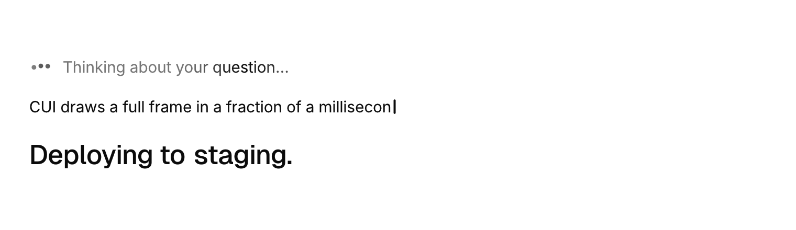

```c
cui_shimmer_text(ui, "Thinking about your question...");
bool done = cui_typewriter(ui, "answer", streamed_text, .caret = true);
cui_text_reveal(ui, "hero", "Calm by default. Motion with purpose.", .font = CUI_FONT_DISPLAY, .size = 20);
static const char *words[] = { "native.", "fast.", "calm." };
cui_word_rotate(ui, "rot", words, 3, 2.2f, .font = CUI_FONT_DISPLAY, .size = 26);
```

The shimmer sweeps a soft highlight across muted text. The typewriter lays out the whole text first and uncovers it, so lines never reflow as it types. When you append to the text (streamed tokens), it carries on from where it was and speeds up when it falls far behind; any other change starts over. The reveal fades and lifts words in one after another whenever the text changes. Rotating words roll up into place, and the width follows the word.

### Loaders

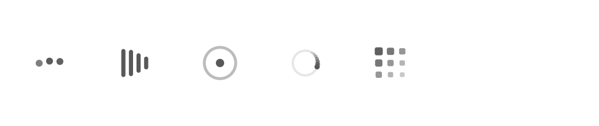

```c
cui_loader(ui, .style = CUI_LOADER_DOTS);    /* also BARS, PULSE, ORBIT, GRID */
cui_loader(ui, .style = CUI_LOADER_PULSE, .size = 32, .color = CUI_COLOR_ACCENT);
```

### Dock

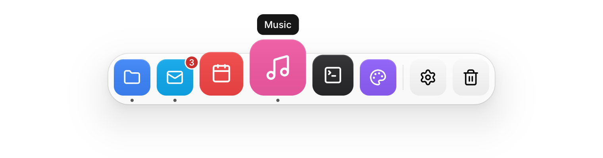

```c
cui_dock(ui, "dock") {
    if (cui_dock_item(ui, CUI_ICON_FOLDER, "Files", .color = CUI_RGB(0x3b82f6), .running = true)) open_files();
    cui_dock_item(ui, CUI_ICON_MAIL, "Mail", .color = CUI_RGB(0x0ea5e9), .badge = 3);
    cui_dock_separator(ui);
    cui_dock_item(ui, CUI_ICON_TRASH_2, "Trash");
}
```

Icons grow as the pointer passes, with the item under it largest and its neighbours following on a cosine falloff. Items show their label as a tooltip, a dot when `running` and a count with `badge`. Tab and Enter work as well.

### Control tiles

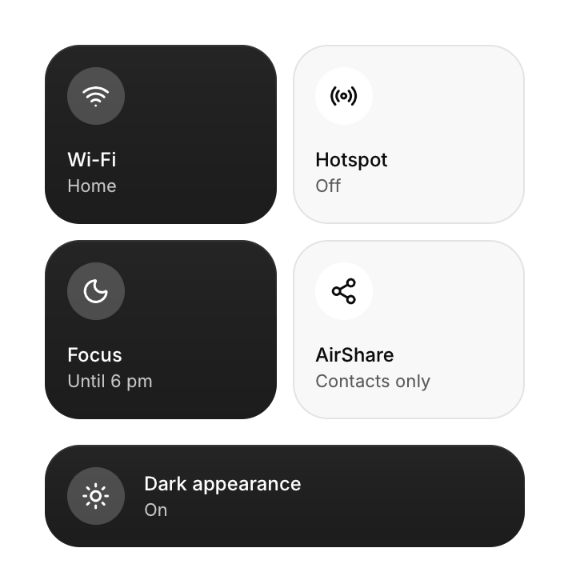

```c
static bool wifi = true;
cui_control_tile(ui, "Wi-Fi", &wifi, .icon = CUI_ICON_WIFI, .detail = wifi ? "Home" : "Off");
cui_control_tile(ui, "Focus", &focus, .icon = CUI_ICON_MOON, .color = CUI_RGB(0x6366f1));
cui_control_tile(ui, "Dark appearance", &dark, .icon = CUI_ICON_SUN, .wide = true);
```

Big toggles for quick settings, which fill their grid cell. They switch with a click or with Space and Enter. `detail` replaces the default On and Off line.

### Now playing, waveform and tab bar

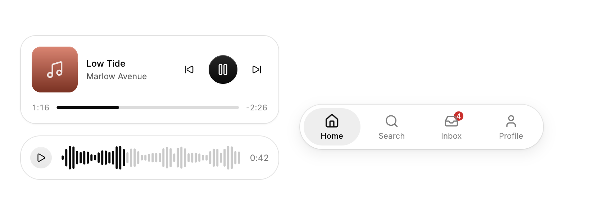

```c
static cui_now_playing np = { "Midnight Compiler", "Neon Arcs", art, { 0 }, 76, 222, true };
int ev = cui_now_playing(ui, "player", &np);
if (ev & CUI_PLAYER_NEXT) next_track();
if (ev & CUI_PLAYER_SEEK) seek(np.position);

static float progress;
if (cui_waveform(ui, "voice", peaks, 96, &progress, .height = 34)) seek_to(progress);

static int tab;
cui_tab_bar(ui, "tabs", tabs, 4, &tab);
```

The player shows artwork (a texture, or `art_color`), a play button that morphs between play and pause, and a scrubber that thickens and shows its knob under the pointer. The time on the right counts down. The waveform resamples its peaks to fit its width; the played part takes the accent color and a ghost shows where a click would seek. The tab bar's pill glides to the selection, and arrow keys move it.
