# Components

Every component, what it is for, how to use it and what it does with the keyboard. Screenshots are rendered by `tests/component_shots.c`, so they always match the code.

Contents:
[Text](#text) ·
[Button](#button) ·
[Icon button](#icon-button) ·
[Segmented control](#segmented-control) ·
[Checkbox, switch, radio](#checkbox-switch-and-radio) ·
[Slider](#slider) ·
[Chips and rating](#chips-and-rating) ·
[Text field](#text-field) ·
[Text area](#text-area) ·
[Select and combobox](#select-and-combobox) ·
[Date picker and calendar](#date-picker-and-calendar) ·
[Number field](#number-field) ·
[Color picker](#color-picker) ·
[Tabs](#tabs) ·
[Sidebar navigation](#sidebar-navigation) ·
[Breadcrumb, pagination, stepper](#breadcrumb-pagination-and-stepper) ·
[Dropdown and context menu](#dropdown-and-context-menu) ·
[Popover](#popover) ·
[Tooltip](#tooltip) ·
[Dialog](#dialog) ·
[Sheet](#sheet) ·
[Toast](#toast) ·
[Command palette](#command-palette) ·
[Alert](#alert) ·
[Progress, meter, spinner, skeleton](#progress-meter-spinner-and-skeleton) ·
[Badge, avatar, keycap](#badge-avatar-and-keycap) ·
[Card and metric](#card-and-metric) ·
[Empty state](#empty-state) ·
[Table](#table) ·
[List and tree](#list-and-tree) ·
[Accordion](#accordion) ·
[Charts](#charts) ·
[Image](#image) ·
[Radio cards](#radio-cards) ·
[Tag input](#tag-input) ·
[One time code](#one-time-code) ·
[Password strength](#password-strength) ·
[Button group, copy, hold](#button-group-copy-and-hold-to-confirm) ·
[Timeline and progress ring](#timeline-and-progress-ring)

---

## Text

```c
cui_heading(ui, "Settings", 1);          /* 1..4: 36, 28, 22, 17 pt; Geist for 28 and up */
cui_text(ui, "Body text wraps to the available width.");
cui_secondary(ui, "Supporting text in the secondary color.");
cui_muted(ui, "Small, muted text.");
cui_label(ui, "Medium weight label");
cui_textf(ui, "%d unread", unread);
cui_code(ui, "cui_button()");
if (cui_link(ui, "Read the docs")) open_docs();
cui_icon(ui, CUI_ICON_ZAP, 16, CUI_COLOR_ACCENT);
```

`cui_text` options: `font` (`CUI_FONT_BODY`, `MEDIUM`, `DISPLAY`, `MONO`), `size`, `color`, `align`, `nowrap` (one line with an ellipsis), `tabular` (aligned digits), `width`, `line_height`.

Hierarchy comes from size and color, not weight: CUI uses regular and medium only.

## Button


```c
if (cui_button(ui, "Save", .variant = CUI_BUTTON_PRIMARY, .icon = CUI_ICON_CHECK)) save();
cui_button(ui, "Cancel");
cui_button(ui, "Saving", .variant = CUI_BUTTON_PRIMARY, .loading = true);
```

| Option | Values |
|---|---|
| `variant` | `CUI_BUTTON_SECONDARY` (default), `PRIMARY`, `OUTLINE`, `GHOST`, `DANGER`, `LINK` |
| `size` | `CUI_SIZE_SM` (30), `CUI_SIZE_MD` (36, default), `CUI_SIZE_LG` (44) |
| `icon`, `icon_right` | Any `CUI_ICON_*` |
| `loading` | Shows a spinner, ignores clicks, keeps the label so nothing jumps |
| `disabled`, `selected`, `full_width`, `width` | |
| `tooltip`, `shortcut` | Tooltip text and a shortcut hint |

Use one primary button per view. Presses scale to 0.97 on a snappy spring. Keyboard: Tab to focus, Enter or Space to press.

## Icon button

```c
if (cui_icon_button(ui, CUI_ICON_TRASH_2, .tooltip = "Delete", .shortcut = "Del")) remove_item();
```

A round button with only an icon, ghost by default. Always give it a `tooltip`: it is the button's name.

## Segmented control


```c
static int view = 0;
const char *items[] = { "List", "Board", "Timeline" };
const char *icons[] = { CUI_ICON_LIST, CUI_ICON_LAYOUT_DASHBOARD, CUI_ICON_HISTORY };
cui_segmented(ui, "view", items, 3, &view, .icons = icons);
```

For switching between two to five views of the same content. The highlight glides between options on a morph spring. Options: `size`, `full_width`, `icons`. Keyboard: arrows move the selection.

## Checkbox, switch and radio


```c
cui_checkbox(ui, "Email notifications", &email, .description = "Product news, monthly.");
cui_switch(ui, "Wi-Fi", &wifi);
cui_radio(ui, "Monthly", &billing, 0);
cui_radio(ui, "Yearly", &billing, 1);
cui_radio_group(ui, "plan", (const char *[]){ "Hobby", "Pro", "Team" }, 3, &plan);
```

Each returns true when it changes the value. The whole row, label included, is clickable. A switch applies immediately; a checkbox is for choices confirmed later with a button. Options: `description`, `disabled`, `indeterminate` (checkbox). Keyboard: Space toggles.

## Slider

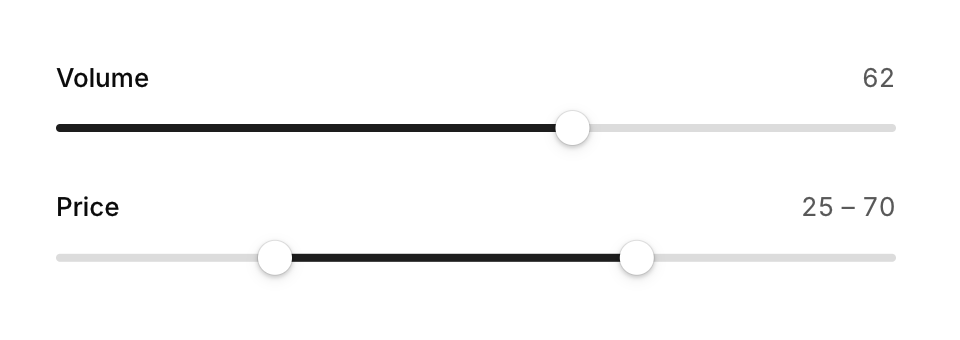

```c
cui_slider(ui, "Volume", &volume, 0, 100, .show_value = true);
cui_slider(ui, "Brightness", &brightness, 0, 100, .step = 10, .show_value = true, .format = "%.0f%%");
cui_range_slider(ui, "Price", &lo, &hi, 0, 500);
```

Drag past either end and the track stretches like rubber, then springs back on release. Clicking the track glides the thumb to the spot. Options: `step`, `show_value`, `format`, `disabled`, `width`. Keyboard: arrows step (Shift for 10 steps), Home and End.

## Chips and rating

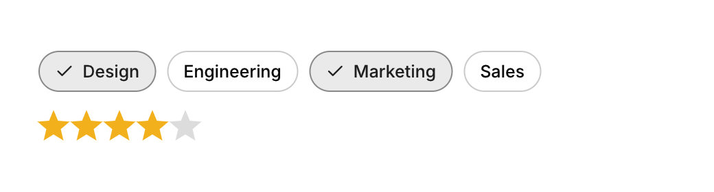

```c
cui_chip(ui, "Design", &design);           /* toggle chip */
cui_rating(ui, "stars", &stars, 5);         /* click the current value again to clear */
```

## Text field

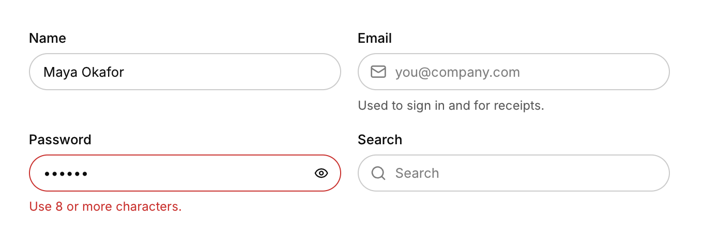

```c
static char email[128];
int r = cui_input(ui, "email", email, sizeof email, .label = "Email", .icon = CUI_ICON_MAIL,
                  .placeholder = "you@company.com", .hint = "We never share it.");
if (r & CUI_CHANGED) validate();
if (r & CUI_SUBMITTED) submit();          /* Enter */

cui_input(ui, "password", pw, sizeof pw, .label = "Password", .password = true,
          .error = strlen(pw) < 8 ? "Use 8 or more characters." : NULL);
cui_search(ui, "q", query, sizeof query, .placeholder = "Search projects");
```

You own the buffer; CUI never writes past `cap`. Returns flags: `CUI_CHANGED`, `CUI_SUBMITTED`, `CUI_FOCUSED`, `CUI_BLURRED`.

| Option | |
|---|---|
| `label`, `placeholder`, `hint`, `error` | |
| `icon` | Leading icon |
| `password` | Masks the text and adds a show/hide button |
| `clearable` | Adds a clear button when not empty (always on for `cui_search`) |
| `autofocus`, `read_only`, `disabled`, `size`, `width` | |

Editing: click to place the caret, drag or Shift+arrows to select, double click selects a word, triple click selects everything. Ctrl (Option on macOS) with arrows or Backspace moves or deletes by word. Home/End, Ctrl+A, cut, copy, paste, undo and redo (Ctrl+Z, Ctrl+Shift+Z or Ctrl+Y; Cmd on macOS). Esc clears the selection, then leaves the field. Full UTF-8.

## Text area

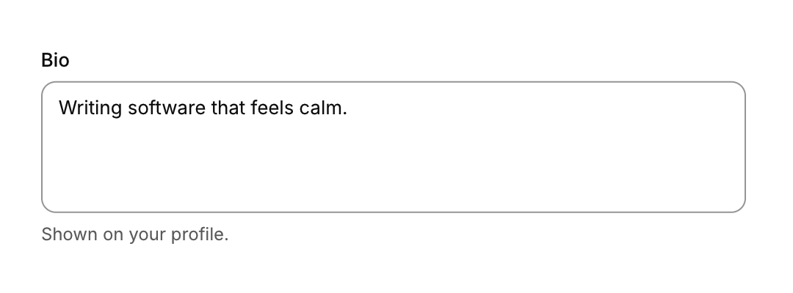

```c
cui_textarea(ui, "bio", bio, sizeof bio, .label = "Bio", .height = 120);
cui_textarea(ui, "body", body, sizeof body, .height = -1);   /* fill the available height */
```

Word wraps, scrolls with the wheel, Up and Down move between visual lines. Enter inserts a newline; Ctrl+Enter submits.

## Select and combobox

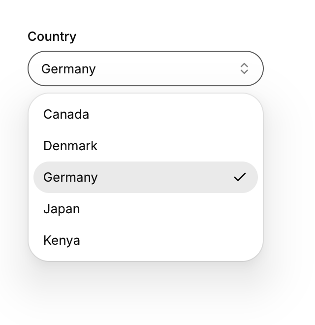

```c
static int country = 2;
const char *items[] = { "Canada", "Denmark", "Germany", "Japan", "Kenya" };
cui_select(ui, "country", items, 5, &country, .label = "Country");
cui_select(ui, "lang", languages, n, &lang, .searchable = true, .placeholder = "Pick a language");
```

`searchable` adds a filter field at the top of the list (a combobox). Options: `label`, `placeholder`, `icons`, `searchable`, `disabled`, `width`. Keyboard: Up/Down open the list and move the highlight, Enter chooses, Esc closes.

## Date picker and calendar

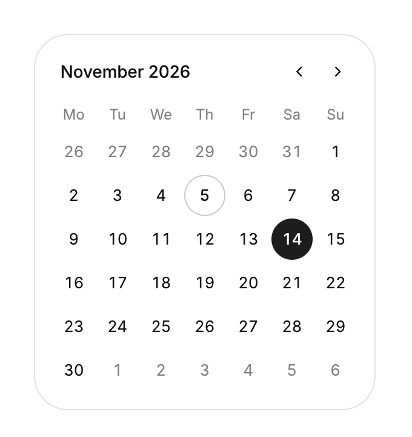

```c
static cui_date due = { 2026, 11, 14 };
cui_date_picker(ui, "due", &due, .label = "Due date");
cui_calendar(ui, "cal", &due);             /* inline calendar */
cui_date today = cui_date_today();
```

Weeks start on Monday. Today has a ring, the selected day is filled.

## Number field

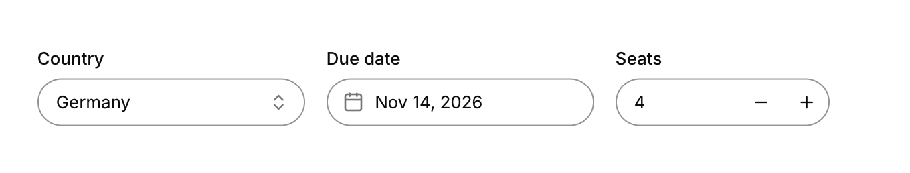

```c
static double seats = 4;
cui_number(ui, "seats", &seats, 1, 100, .label = "Seats", .step = 1);
cui_number(ui, "price", &price, 0, 1e6, .decimals = 2, .suffix = "USD");
```

Type a value, use the minus and plus buttons, or Up/Down (Shift for 10 steps). Values are clamped to the range.

## Color picker

```c
static cui_color brand = CUI_RGB(0x7747ff);
cui_color_picker(ui, "brand", &brand);
```

A swatch that opens a saturation and brightness square, a hue bar and preset swatches.

## Tabs

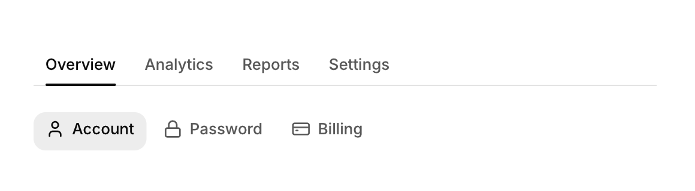

```c
static int tab = 0;
const char *tabs[] = { "Overview", "Analytics", "Reports" };
cui_tabs(ui, "tabs", tabs, 3, &tab);
cui_tabs(ui, "account", items, 3, &sel, .variant = CUI_TABS_PILL, .icons = icons);
switch (tab) { /* content */ }
```

The underline slides to the active tab. Keyboard: Left and Right.

## Sidebar navigation

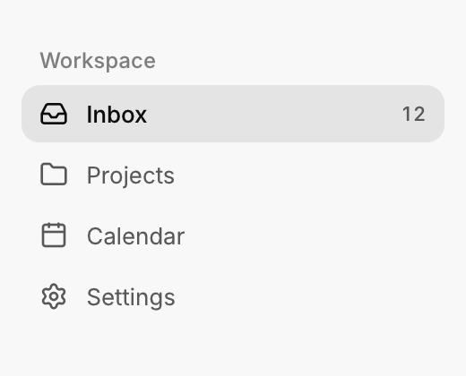

```c
cui_nav_section(ui, "Workspace");
if (cui_nav_item(ui, "Inbox", .icon = CUI_ICON_INBOX, .badge = "12", .selected = page == 0)) page = 0;
if (cui_nav_item(ui, "Projects", .icon = CUI_ICON_FOLDER, .selected = page == 1)) page = 1;
```

All items of a `group` share one highlight that glides to the selected item.

## Breadcrumb, pagination and stepper

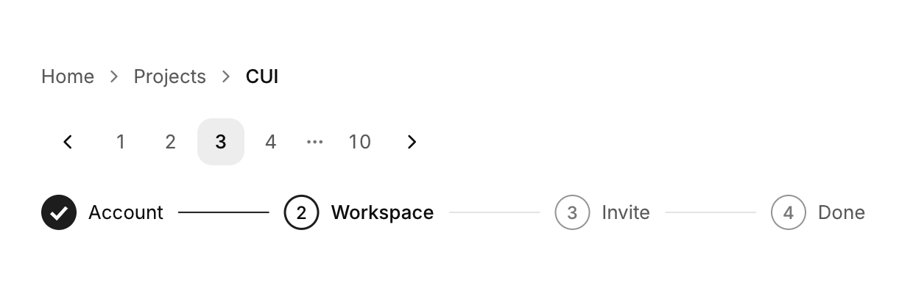

```c
int clicked = cui_breadcrumb(ui, (const char *[]){ "Home", "Projects", "CUI" }, 3);   /* index or -1 */
cui_pagination(ui, "pages", &page, page_count);                                        /* page is 0 based */
cui_stepper(ui, steps, 4, current);
```

## Dropdown and context menu

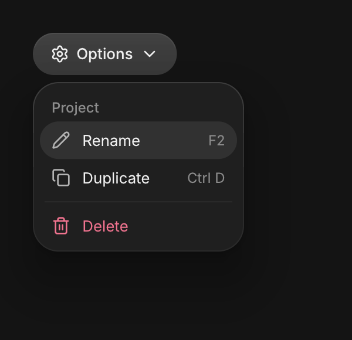

```c
cui_menu(ui, "Options", .icon = CUI_ICON_SETTINGS) {
    cui_menu_label(ui, "Project");
    if (cui_menu_item(ui, "Rename", .icon = CUI_ICON_PENCIL, .shortcut = "F2")) rename();
    cui_menu_separator(ui);
    if (cui_menu_item(ui, "Delete", .icon = CUI_ICON_TRASH_2, .danger = true)) confirm = true;
}

cui_card(ui, .id = "file", .hoverable = true) { ... }
cui_context_menu(ui, "file-menu") {                   /* right click on the previous component */
    cui_menu_item(ui, "Copy", .icon = CUI_ICON_COPY);
}
```

Menus open with a short scale and fade from the trigger, close on a click outside, Esc or after choosing. Item options: `icon`, `shortcut`, `danger`, `disabled`, `checked`. Menu options: `icon`, `variant`, `placement`, `width`, `icon_only`. Keyboard: Down opens from the focused trigger, Up/Down move, Enter chooses.

## Popover

```c
if (cui_button(ui, "Filters", .icon = CUI_ICON_FILTER)) cui_popover_toggle(ui, "filters");
cui_popover(ui, "filters", .width = 280) {
    cui_checkbox(ui, "Only active", &only_active);
    if (cui_button(ui, "Apply", .variant = CUI_BUTTON_PRIMARY)) cui_popover_close(ui, "filters");
}
```

Anchored to the component before it, flips to stay on screen. Options: `placement`, `width`, `pad`, `gap`.

## Tooltip

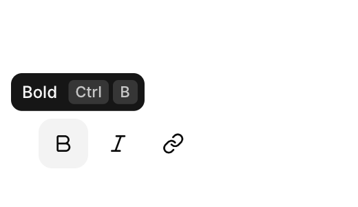

```c
cui_icon_button(ui, CUI_ICON_BOLD, .tooltip = "Bold", .shortcut = "Ctrl B");
cui_badge(ui, "Beta");
cui_tooltip(ui, "Features in beta may change");   /* for the previous component */
```

Appears after a short delay, then instantly while you move between tooltips.

## Dialog

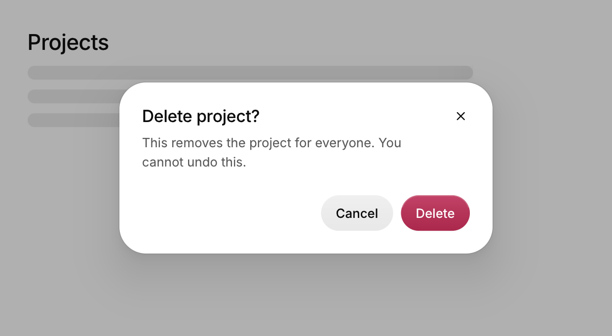

```c
cui_dialog(ui, "Edit profile", &open, .description = "Changes are visible to your team.") {
    cui_input(ui, "name", name, sizeof name, .label = "Name");
    cui_dialog_footer(ui) {
        if (cui_button(ui, "Cancel")) open = false;
        if (cui_button(ui, "Save", .variant = CUI_BUTTON_PRIMARY)) { save(); open = false; }
    }
}
```

Modal: the scrim blocks everything behind it. Esc, the close button or a click on the scrim close it, unless `persistent`. Options: `description`, `width` (440), `no_close_button`, `persistent`. Opens with a fade and a scale from 0.96, closes faster than it opens.

## Sheet

```c
cui_sheet(ui, "Notifications", &open, .side = CUI_SIDE_RIGHT, .size = 400) { ... }
```

A panel that slides in from an edge. Content scrolls.

## Toast

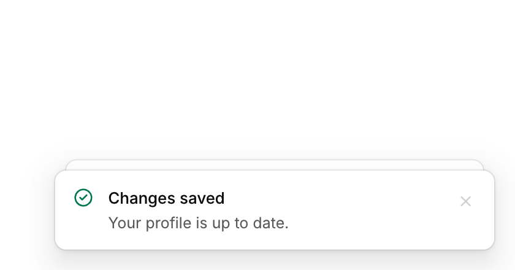

```c
cui_toast(ui, "Changes saved", .tone = CUI_TONE_SUCCESS);
cui_toast(ui, "Upload failed", .description = "The file is larger than 25 MB.", .tone = CUI_TONE_DANGER);
int t = cui_toast(ui, "Message archived", .action = "Undo");
if (cui_toast_action_clicked(ui, t)) undo();
```

Toasts stack in the bottom right corner. Older toasts tuck behind the newest one; hovering expands the stack and pauses the timers. Options: `description`, `tone`, `duration` (seconds, default 4, negative to keep), `action`. Use toasts for background events; for the result of a button press, change the button instead.

## Command palette

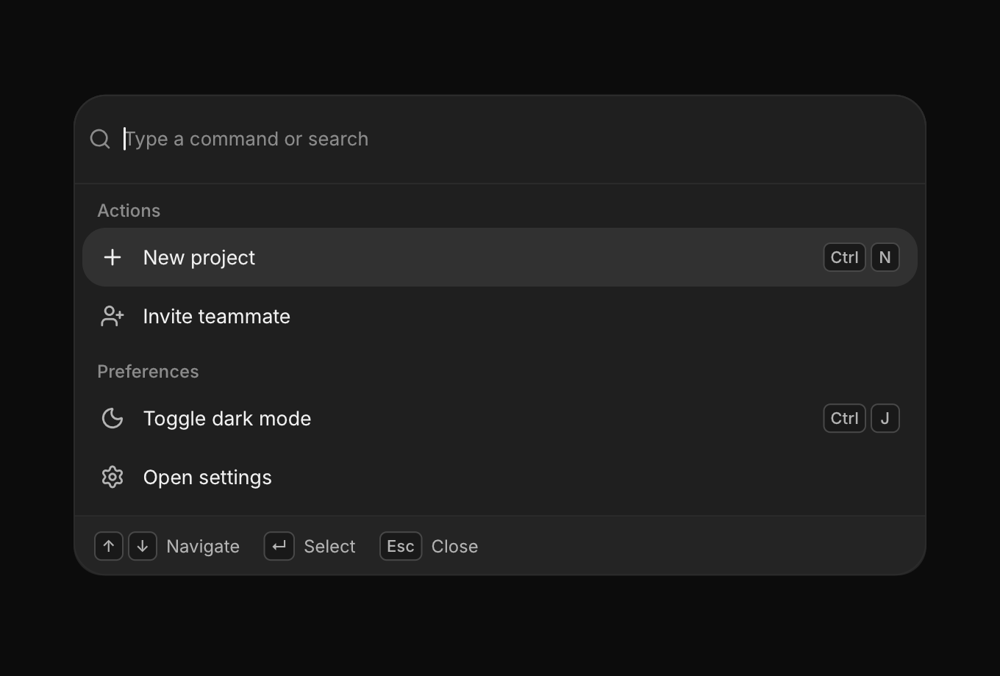

```c
static const cui_command commands[] = {
    { "New project", CUI_ICON_PLUS, "Actions", "Ctrl N" },
    { "Toggle dark mode", CUI_ICON_MOON, "Preferences", NULL },
};
if (cui_shortcut(ui, CUI_MOD_PRIMARY, CUI_KEY_K)) palette = true;
int chosen = cui_command_palette(ui, &palette, commands, 2);   /* index or -1 */
```

Fuzzy search with ranking, grouped results, Up/Down to move, Enter to run, Esc to close.

## Alert

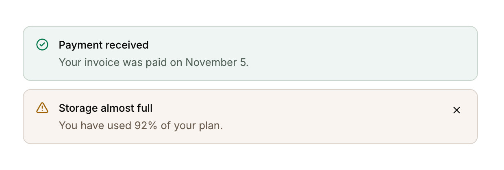

```c
cui_alert(ui, "Payment received", .description = "Paid on November 5.", .tone = CUI_TONE_SUCCESS);
cui_alert(ui, "Storage almost full", .tone = CUI_TONE_WARNING, .dismissible = true);
```

Tones: `CUI_TONE_NEUTRAL` (info), `SUCCESS`, `WARNING`, `DANGER`. Returns false once dismissed.

## Progress, meter, spinner and skeleton

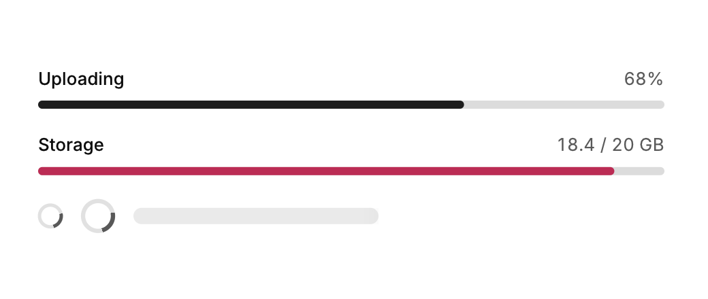

```c
cui_progress(ui, 0.68f, .label = "Uploading", .show_value = true);
cui_progress(ui, 0, .indeterminate = true);
cui_meter(ui, "Storage", 18.4f, 20, "GB");     /* turns amber and red near the limit */
cui_spinner(ui, 20);
cui_skeleton(ui, CUI_PCT(60), 12);             /* shimmering placeholder */
cui_gauge(ui, "CPU", 0.42f, 130);
```

## Badge, avatar and keycap

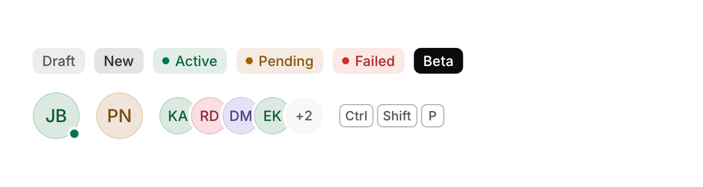

```c
cui_badge(ui, "Active", .tone = CUI_TONE_SUCCESS, .dot = true);
cui_badge(ui, "New", .tone = CUI_TONE_INFO, .solid = true);
cui_avatar(ui, "Grace Hopper", .size = 40, .status = "online");   /* online, away, busy, offline */
cui_avatar(ui, "Ada", .image = texture);
cui_avatar_group(ui, names, count, 4, 32);
cui_kbd(ui, "Ctrl Shift P");
```

Avatars without an image show initials on a color picked from the name, so the same person always gets the same color.

## Card and metric

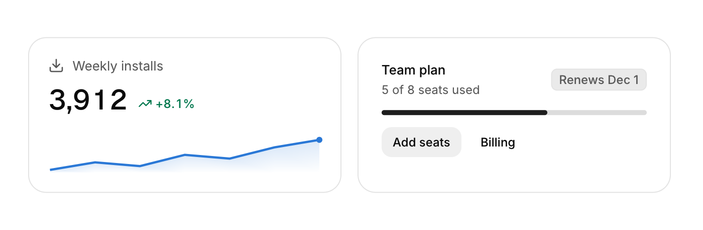

```c
cui_card(ui, .gap = 12) { ... }
if (cui_card(ui, .id = "project", .hoverable = true)) { ... }   /* lifts on hover, returns clicks */
cui_metric(ui, "Revenue", "$48,210", .delta = 12.4f, .spark = values, .spark_count = 12, .icon = CUI_ICON_DOLLAR_SIGN);
```

Cards rest on a hairline border with no shadow. Card options: `pad` (24), `pad_x`, `pad_y`, `gap`, `dir`, `align`, `width`, `height`, `hoverable`, `muted`, `selected`.

## Empty state

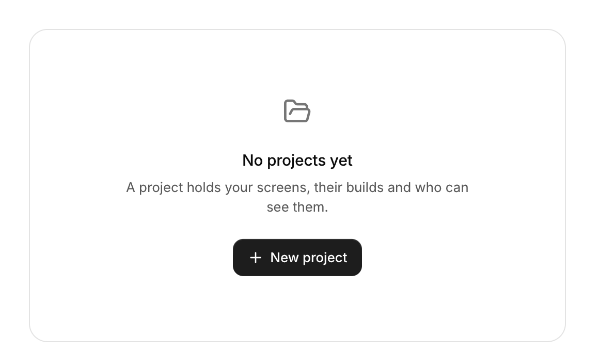

```c
if (cui_empty_state(ui, "No projects yet", .icon = CUI_ICON_FOLDER_OPEN,
                    .description = "Create a project to get started.", .action = "New project"))
    create_project();
```

## Table

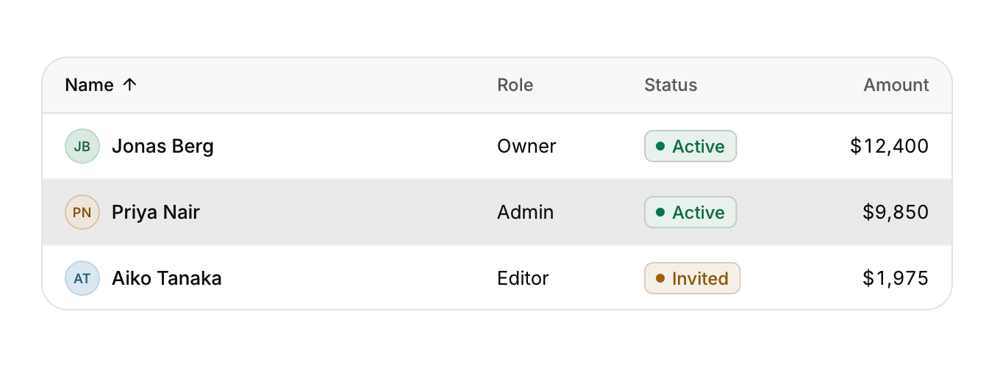

```c
cui_table_column cols[] = {
    { "Name", CUI_FILL, CUI_TEXT_LEFT, true },          /* title, width, align, sortable */
    { "Status", CUI_PX(120), CUI_TEXT_LEFT, false },
    { "Amount", CUI_PX(110), CUI_TEXT_RIGHT, true },
};
static cui_table_sort sort;
cui_table(ui, "orders", cols, 3, .sort = &sort, .selectable = true, .height = CUI_PX(400)) {
    for (int i = 0; i < n; i++) {
        if (cui_table_row(ui, selected == i)) selected = i;
        cui_table_cell(ui);
        cui_avatar(ui, rows[i].name, .size = 24);
        cui_text(ui, rows[i].name, .nowrap = true);
        cui_table_cell(ui);
        cui_badge(ui, rows[i].status, .tone = CUI_TONE_SUCCESS, .dot = true);
        cui_table_cell_textf(ui, "$%.2f", rows[i].amount);
    }
}
```

Cells hold any components. Clicking a sortable header updates `sort` (column and direction); you sort your data. With `height` the body scrolls under a fixed header. Options: `sort`, `height`, `striped`, `compact`, `selectable`.

## List and tree

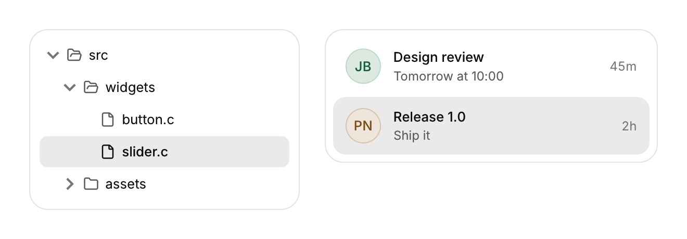

```c
if (cui_list_item(ui, "Design review", .avatar = "Grace Hopper", .subtitle = "Tomorrow at 10:00", .trailing = "45m")) open();

static bool src_open = true;
if (cui_tree_begin(ui, "src", &src_open, NULL)) {
    cui_tree_begin(ui, "main.c", NULL, &(cui_tree_opts){ .leaf = true, .selected = true });
    if (cui_tree_clicked(ui)) open_file("main.c");
    cui_tree_end(ui);
}
```

Tree keyboard: Right opens, Left closes.

## Accordion

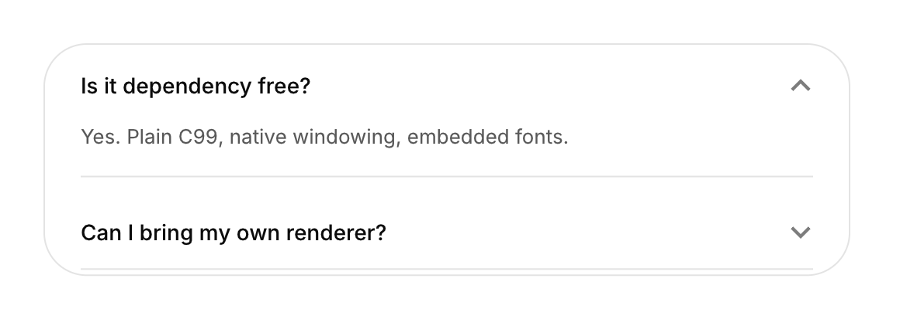

```c
static bool open = true;
if (cui_accordion_begin(ui, "Is it dependency free?", &open)) {
    cui_secondary(ui, "Yes.");
    cui_accordion_end(ui);
}
```

The content animates its height on a smooth spring and the chevron rotates.

## Charts

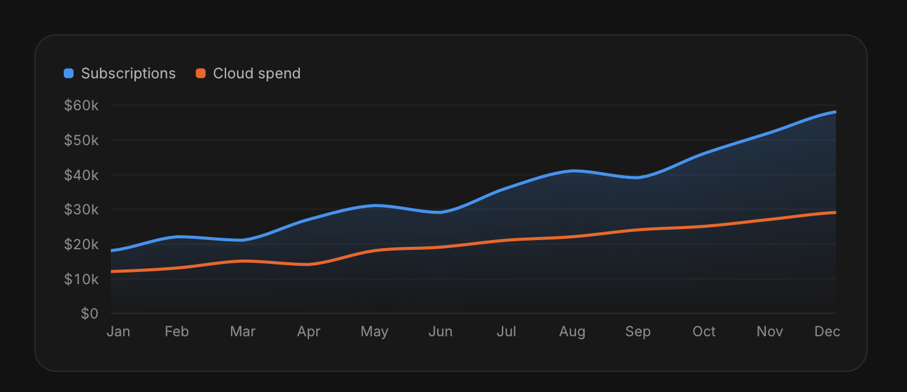

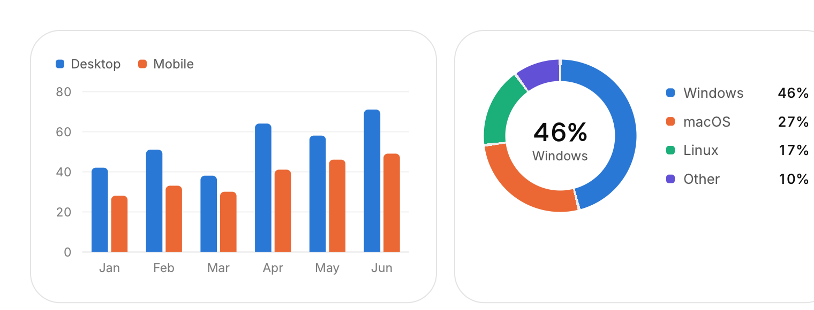

```c
cui_series s[] = { { "Revenue", revenue, 12 }, { "Costs", costs, 12 } };
cui_line_chart(ui, "revenue", s, 2, .labels = months, .label_count = 12, .area = true, .smooth = true, .format = "$%.0fk");
cui_bar_chart(ui, "visits", s, 2, .labels = months, .label_count = 6);
cui_bar_chart(ui, "plans", s, 3, .labels = weeks, .label_count = 8, .stacked = true);
cui_donut_chart(ui, "share", values, labels, 4, .format = "%.0f%%");
cui_sparkline(ui, values, 12, CUI_PX(120), 32, CUI_COLOR_SERIES(0));
```

Charts draw in once, pick nice axis ticks, show a crosshair that glides between points and a tooltip with every series on hover. Colors come from the theme's series palette, which starts at the accent hue. Options: `width`, `height`, `labels`, `label_count`, `area`, `smooth`, `stacked`, `no_grid`, `no_legend`, `format`, `min`, `max`.

## Image

```c
int w, h;
cui_texture tex = cui_image_load(ui, "photo.jpg", &w, &h);      /* PNG, JPEG, BMP, GIF, TGA */
cui_image(ui, tex, .width = CUI_PX(240), .height = CUI_PX(160), .radius = 12);
cui_texture raw = cui_image_create(ui, w, h, rgba_pixels);        /* from memory */
cui_image_destroy(ui, tex);
```

## Radio cards

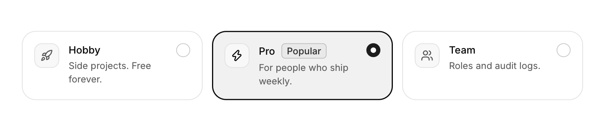

```c
static const cui_choice plans[] = {
    { "Hobby", "Side projects. Free forever.", CUI_ICON_ROCKET, NULL },     /* title, description, icon, badge */
    { "Pro", "For people who ship weekly.", CUI_ICON_ZAP, "Popular" },
    { "Team", "Roles and audit logs.", CUI_ICON_USERS, NULL },
};
cui_radio_cards(ui, "plan", plans, 3, &plan, .columns = 3);
```

Bigger targets for choices that need a sentence of explanation. Keyboard: arrows move the selection.

## Tag input

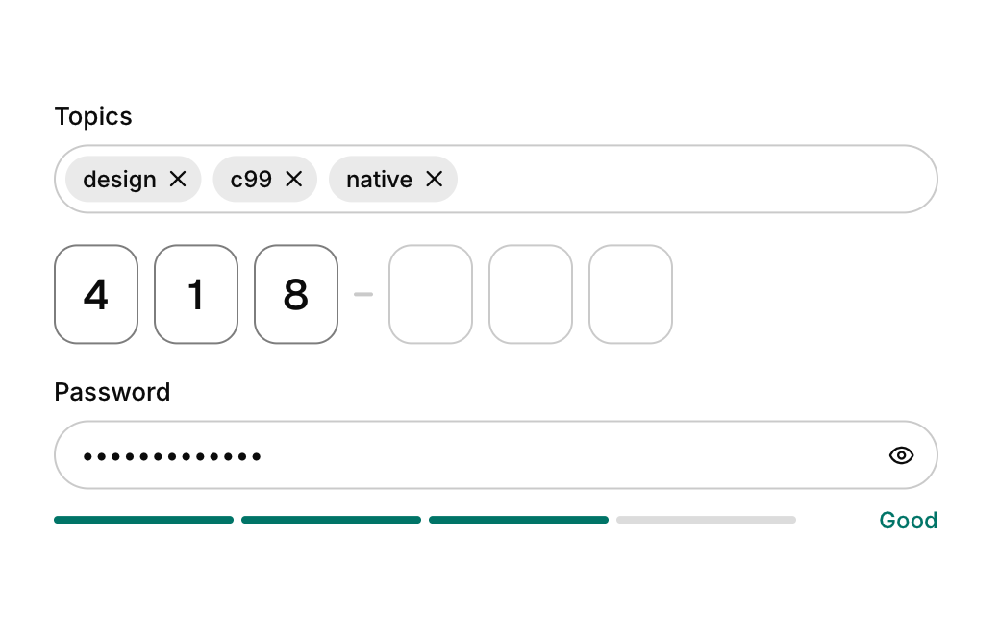

```c
static char tags[256] = "design, c99";
cui_tag_input(ui, "topics", tags, sizeof tags, .label = "Topics", .max_tags = 8);
```

Tags live in your buffer as a comma separated list. Enter or a comma adds the typed tag, the x on a chip removes it, Backspace in an empty field removes the last one.

## One time code

```c
static char code[7];                        /* length + 1 */
if (cui_otp_input(ui, "code", code, 6)) verify(code);   /* true once when complete */
```

Type or paste: letters and digits fill the boxes in order, anything else is ignored. Backspace removes the last character.

## Password strength

```c
cui_input(ui, "pw", pw, sizeof pw, .label = "Password", .password = true);
int score = cui_password_strength(ui, pw);   /* 0 too short .. 4 strong */
```

## Button group, copy and hold to confirm

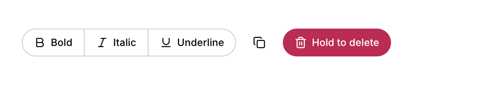

```c
cui_button_group(ui) {
    cui_button(ui, "Bold", .icon = CUI_ICON_BOLD);
    cui_button(ui, "Italic", .icon = CUI_ICON_ITALIC);
}
cui_copy_button(ui, "copy-key", api_key);                      /* confirms with a check */
if (cui_hold_button(ui, "Hold to delete", .icon = CUI_ICON_TRASH_2)) delete_everything();
```

The hold button fills while pressed (or while Space is held with keyboard focus) and fires once when full; let go early and it springs back. Options: `duration` (1.2 s), `icon`, `variant` (danger by default).

## Timeline and progress ring

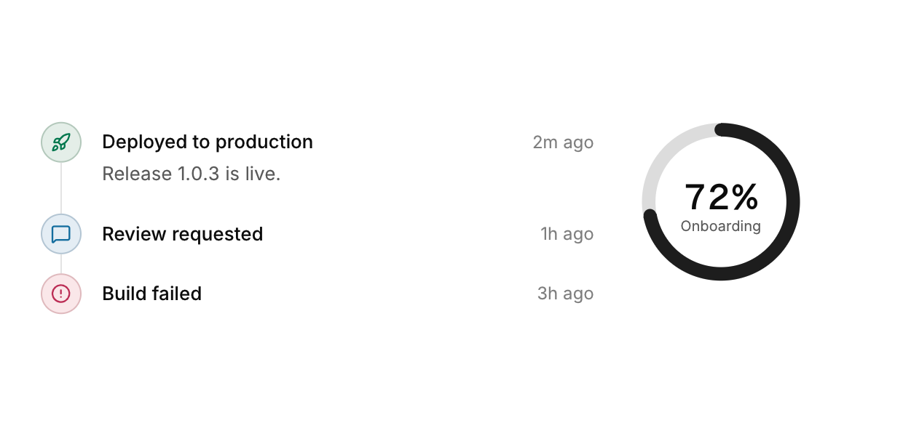

```c
cui_timeline_item(ui, "Deployed to production", .time = "2m ago", .description = "Release 1.0.3 is live.",
                  .icon = CUI_ICON_ROCKET, .tone = CUI_TONE_SUCCESS);
cui_timeline_item(ui, "Build failed", .time = "3h ago", .icon = CUI_ICON_CIRCLE_ALERT, .tone = CUI_TONE_DANGER, .last = true);
cui_progress_ring(ui, "Onboarding", 0.72f, 110);
```
