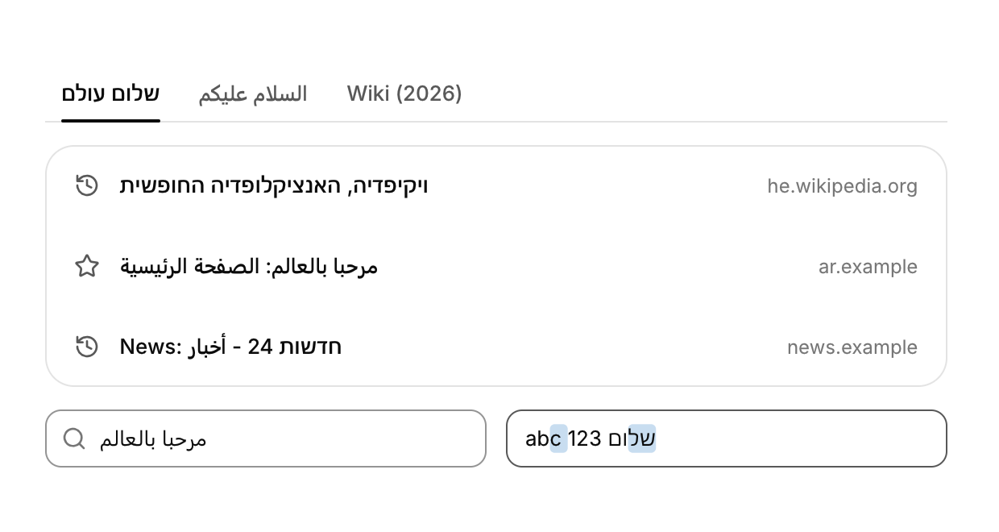
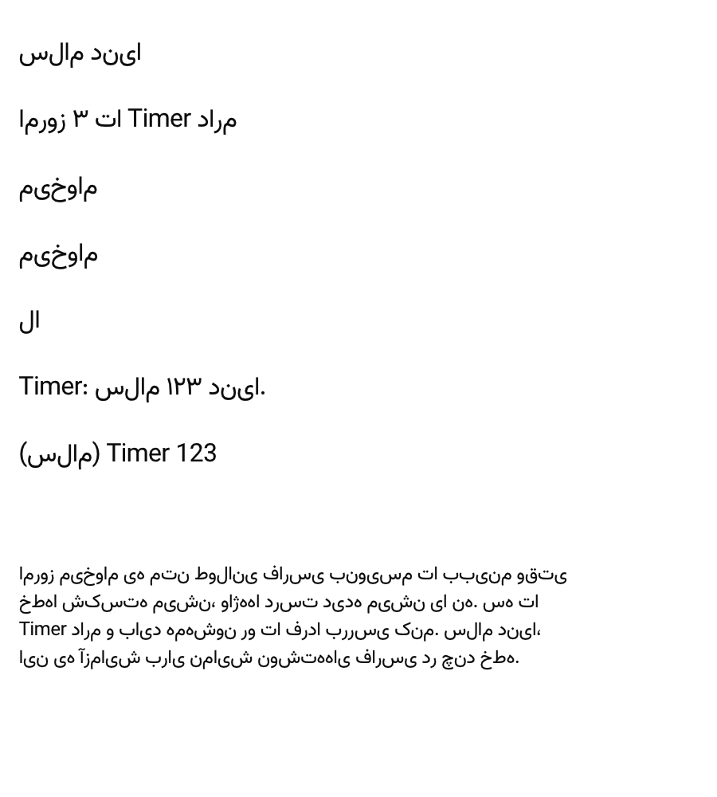
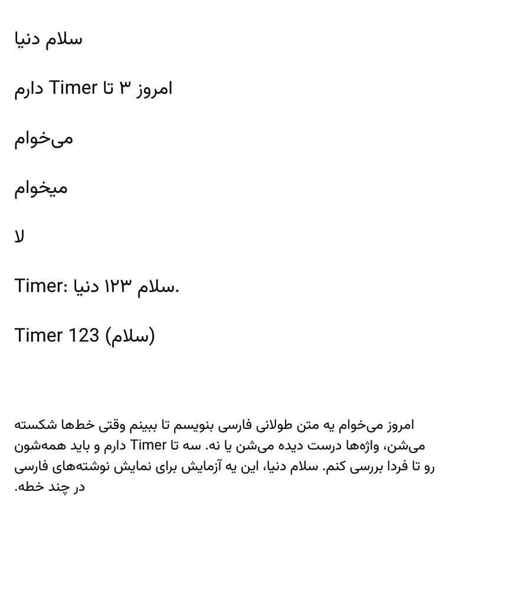
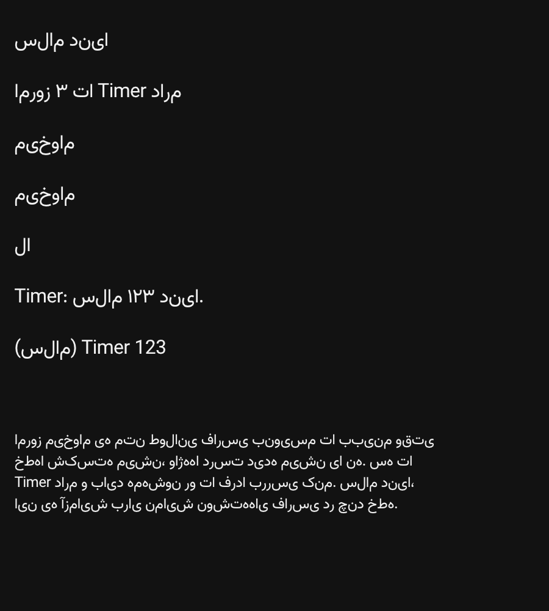
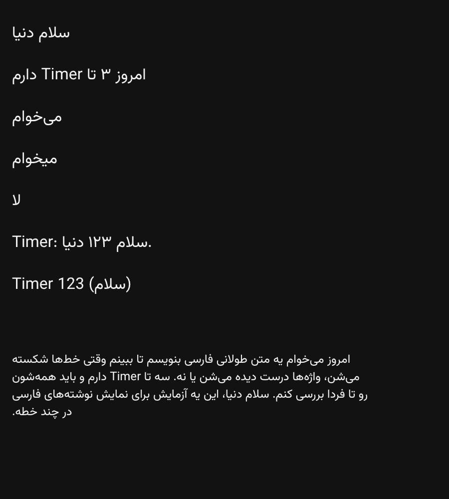

# Integration

`cui_app` is optional. The core of CUI is a pure library: you give it input and a viewport size, it gives you vertices. That makes it easy to put CUI inside a game engine, an existing app or a custom window, on any graphics API.

## The core loop

```c
#include <cui/cui.h>
#include <cui/cui_render.h>

cui_gl_renderer *gl = cui_gl_create(get_proc_address);          /* after your GL context is current */
cui_ctx *ui = cui_create(&(cui_ctx_desc){ .renderer = cui_gl_iface(gl) });

for (;;) {
    /* 1. forward input from your window system */
    cui_input_mouse_move(ui, mouse_x_points, mouse_y_points);
    cui_input_mouse_button(ui, CUI_MOUSE_LEFT, down);
    cui_input_scroll(ui, 0, wheel_lines);
    cui_input_key(ui, CUI_KEY_ENTER, pressed, mods);
    cui_input_text(ui, utf8_from_ime);

    /* 2. build the UI */
    cui_set_viewport(ui, width_points, height_points, pixels_per_point);
    cui_begin_frame(ui, seconds_since_last_frame);
    my_ui(ui);
    cui_end_frame(ui);

    /* 3. render */
    cui_gl_render(gl, cui_get_draw_data(ui), false);   /* false: draw over your scene */
    swap_buffers();

    /* 4. sleep until something happens (optional) */
    if (!cui_needs_redraw(ui)) wait_for_events(cui_next_wakeup(ui));   /* seconds, or -1 for no timer */
}
```

Coordinates are in points (logical pixels). `pixels_per_point` is 2 on a typical retina screen. Input events can arrive at any time between frames; CUI collects them for the next frame.

Double-click timing uses the clock advanced by `cui_begin_frame`, so the first
click after an idle interval is timed in the frame that receives it. Forward each
press and release, including quick taps collected before the same frame.

An idle CUI app costs nothing: with no input and nothing animating, `cui_needs_redraw` is false and the loop sleeps. Components that blink or wait (the caret, tooltips, toasts) set `cui_next_wakeup`; a focused text field asks for a frame about twice a second while its caret blinks, and `cui_set_caret_blink(ui, 5)` stops the blink 5 seconds after the caret last moved (as Windows does; `.follow_system_caret = true` in `cui_app_desc` takes the system's own timeout, see [Saving work at rest](#saving-work-at-rest-and-fullscreen-opt-in-windows)), or `-1` never blinks, so a focused field at rest draws nothing. When your own content changes on a timer, such as a clock, a poll or messages arriving, call `cui_request_wakeup(ui, seconds)` during the frame. The loop then wakes for it instead of redrawing continuously. `cui_request_redraw` asks for the next frame right away, for things that change every frame.

### Input reference

| Function | Notes |
|---|---|
| `cui_input_mouse_move(ui, x, y)` | Points, relative to the viewport |
| `cui_input_mouse_button(ui, button, down)` | `CUI_MOUSE_LEFT`, `RIGHT`, `MIDDLE` |
| `cui_input_mouse_leave(ui)` | The pointer left the window |
| `cui_input_scroll(ui, dx, dy)` | In lines. Positive `dy` is the wheel moving up, toward the top of the content. Trackpads: pixels / 44 |
| `cui_input_key(ui, key, down, mods)` | `CUI_KEY_*` and `CUI_MOD_SHIFT`, `CTRL`, `ALT`, `SUPER`. Send key repeats as additional presses |
| `cui_input_text(ui, utf8)` | Typed characters after keyboard layout and IME processing |
| `cui_input_focus(ui, focused)` | Window focus changes |

### Component input

`cui_set_input_hook` delivers events synchronously before CUI batches them.
An observer can handle pointer motion, buttons, scrolling and focus changes
while returning false so CUI controls still receive the same input. A hook
that returns true owns delivery. Copy any text kept beyond the callback.

A host that queues input can replay its pointer events through the normal
entry points. For key, text and focus events, call `cui_dispatch_input` after
`cui_begin_frame` and before submitting components. A route can handle an
event or let CUI apply its default action. Unregister capture during replay.
Submit a [focusable canvas](custom-components.md#keyboard-focus) with
`.component_input = true` to receive keys through that route. On each event,
use `cui_component_has_input(ui, id)` to check window and canvas focus and
whether an overlay covers the canvas. Check on every event because a Tab
you pass to CUI can move focus before the next event in the same batch.

Inside the route, `cui_input_repeated` identifies repeated key-down events.
`cui_key_down` reports the physical state. `cui_key_action_down` excludes
keys whose presses were handled by the route. Committed text arrives as a
separate event even if the route handled the preceding key press.
Use `cui_focused_id` and `cui_window_focused` to inspect focus directly.

### Platform services

```c
cui_set_platform(ui, &(cui_platform_iface){
    .user = my_window,
    .set_clipboard = my_set_clipboard,           /* (void *user, const char *utf8) */
    .get_clipboard = my_get_clipboard,           /* returns a string valid until the next call */
    .set_cursor = my_set_cursor,                 /* CUI_CURSOR_ARROW, HAND, TEXT, RESIZE_EW... */
    .set_text_input_rect = my_set_ime_rect,      /* where the IME candidate window should go */
});
```

CUI calls `set_text_input_rect` every frame a text field has focus, with the caret in window points (top-left origin, one line tall). Place the input method's composition and candidate windows there; the built-in Win32, Cocoa, X11 and SDL2 backends and the docs site do.

Useful queries for your app: `cui_wants_keyboard` (a text field has focus), `cui_wants_mouse` (the pointer is over the UI), `cui_get_cursor`.

A custom component can request a cursor with `cui_set_cursor` during submission
or painting. The platform receives the last cursor requested that frame.
The next frame starts with the arrow cursor.

## Using the built-in backends with your loop

The SDL2 and GLFW backends are complete `cui_app` implementations (`-DCUI_PLATFORM=sdl2` or `glfw`). Read `src/platform/cui_app_sdl2.c` for a compact, real example of the integration above: about 250 lines including the key map.

## Saving work at rest, and fullscreen (opt in, Windows)

Three options an app turns on when it wants to cost nothing while nobody is looking. Each is off by default, and each is a no-op on the other backends (the same code runs there). Test: `tests/test_fullscreen.c` (`cui_test_fullscreen`).

### The caret stops blinking as the system's does

A focused text field asks for a frame twice a second for as long as its caret blinks. Windows' own caret stops after its timeout (5 seconds by default, set in the accessibility settings), and so can CUI's:

```c
cui_app *app = cui_app_create(&(cui_app_desc){ .title = "Notes", .follow_system_caret = true });
```

`follow_system_caret` is `cui_set_caret_blink(ui, cui_system_caret_blink())`. `cui_system_caret_blink()` is the system's timeout in seconds, or `-1` when its caret does not blink (Windows: a caret blink time of INFINITE), or 5 where the system cannot tell. Typing, moving the caret or focusing a field starts the blink again. Use `cui_set_caret_blink(ui, seconds)` directly for another time (`< 0` never blinks, `0` blinks while focused, the default). It covers text fields, text areas, the code editor and code boxes (the terminal's cursor does not blink in CUI).

### Copying only the part the system asks for

With the software renderer each frame copies to the window only what changed, but a repaint the system asks for (WM_PAINT) made the next frame copy the whole picture. An app whose child window changes shape while something animates (a browser cutting a popover out of its page) gets such a request on every frame, for the part the child no longer covers. Opt in and the next frame copies that part with its own change instead:

```c
cui_app *app = cui_app_create(&(cui_app_desc){ .title = "Browser", .present_exposed_part = true });
```

A request for the whole window, the first frame and a resize still copy everything. Windows only; ignored with OpenGL and elsewhere. `tests/test_present_part.c` checks it.

### Frames only when something changed

On Windows an embedded engine's message pump, an input method window or COM's apartment window can wake the loop many times a second, and every wake used to draw a frame. Opt in and the loop skips the wakes that change nothing:

```c
cui_app_frames_on_change(app, true);       // after your own window subclasses: it must see each message first
while (running) {
    cui_app_arm(app);                      // forget what came before
    cui_app_wait(&app, 1);
    if (!cui_app_frame_due(app)) continue; // nothing changed: sleep again
    if (!cui_app_frame_poll(app)) break;
    /* ... draw ... */
}
```

A frame is due when CUI wants one (`cui_app_pending`: input, an animation, a `cui_request_wakeup` that is due, the first frame), when any message other than a harmless question (cursor, hit test, accessibility and title queries) reached the window, or when you said so with `cui_app_request_frame(app)`: call it when something of yours changed that CUI cannot see (an engine callback ran, a worker finished). `cui_app_frames_skipped(app)` counts the skipped wakes for a trace.

Timers become deadlines. `cui_app_schedule(app, ms, tick, user)` runs `tick` from a thread timer in `ms` milliseconds, between frames and without drawing one, and replaces the timer set before (`ms < 0` clears it). Re-arm it from the frame with the next deadline, so that a window at rest runs nothing at all; if another message loop is running (a dialog, the size loop) the timer asks for a frame instead. JNBrowser measures 0 ms/s and 0 frames at rest this way (`tests/scripts/run_idle.ps1`).

### Fullscreen

```c
cui_app_set_fullscreen(app, true);              // F11: between frames, the window covers its monitor
bool fs = cui_app_is_fullscreen(app);           // the change has been made: build no chrome while true
```

The window loses its caption and frame, covers its monitor (over the taskbar), and leaving puts back what was there: the normal rectangle, maximized, or minimized with the right state to come back to. While fullscreen the window ignores the system's move, size and maximize commands; minimize and restore work. The change is posted to the window and made between frames, so the size change it causes runs the next frame at the new size. Call `cui_app_set_fullscreen` with the wanted state every frame if that is easier: a change under way is not posted twice. It returns false while the window is minimized (when it is restored the change goes on) and on other backends.

Peek (the chrome slides in over the content when the pointer touches the top edge): reserve `cui_app_fullscreen_strip(app)` points at the top of your content (2 pixels: a child window such as an embedded browser must leave them uncovered, so the pointer reaches CUI there). Each frame while fullscreen, `cui_app_fullscreen_peek(app, chrome_h, hold)` says whether to show the chrome now: on when the pointer touches the strip, off when it is below `chrome_h` points or outside the window and `hold` is false (a menu is open, a field has the focus). While shown it asks for a frame every 0.1 s and reads the pointer from the system (no mouse messages arrive over a child window); at rest nothing runs. `cui_app_fullscreen_end_peek` hides it at once.

Hint: `cui_app_fullscreen_hint(app, NULL)` shows the toast "Press F11 to exit full screen" the first frame after the window entered fullscreen, once per entering (a text of your own replaces it), and returns whether it did.

```c
bool fs = cui_app_is_fullscreen(app);
bool peek = fs && cui_app_fullscreen_peek(app, toolbar_h, menu_open);
if (!fs || peek) build_toolbar(ui);      // the peeked toolbar goes over the content
cui_app_fullscreen_hint(app, NULL);
```

Tests that cannot move the real pointer use `cui_app_fullscreen_sim_pointer`.

## Renderers

### OpenGL

`cui_gl_create(loader)` works with OpenGL 3.3 core and OpenGL ES 3.0 contexts (detected automatically). No GL headers or loader library are needed; pass `SDL_GL_GetProcAddress`, `glfwGetProcAddress`, `wglGetProcAddress` or similar. It returns NULL when the context is too old.

`cui_gl_render` sets its own blend, scissor and viewport state and leaves depth testing and face culling off. Restore your state afterwards if your renderer relies on it.

### Software

```c
cui_sw_renderer *sw = cui_sw_create();
cui_ctx *ui = cui_create(&(cui_ctx_desc){ .renderer = cui_sw_iface(sw) });
...
cui_sw_render(sw, cui_get_draw_data(ui), pixels, width, height, stride_bytes, CUI_SW_BGRA);
```

Renders into any 32 bit buffer, using several threads. Output matches the GPU renderer to within a fraction of a percent. Great for servers, tests, thumbnails and embedded framebuffers. `cui_write_png` saves a buffer.

### Direct3D 12, Vulkan, Metal

```c
cui_gpu_renderer *gpu = cui_gpu_create(window, true);   /* an HWND, a cui_x11_window *, an NSWindow * */
cui_ctx *ui = cui_create(&(cui_ctx_desc){ .renderer = cui_gpu_iface(gpu) });
...
cui_gpu_render(gpu, cui_get_draw_data(ui));              /* draws and presents */
```

With `CUI_D3D12` (Windows), `CUI_VULKAN` (Linux) or `CUI_METAL` (macOS): the OpenGL renderer's shader, drawing into a swapchain or layer of its own on the window. The app layer picks it with `CUI_RENDERER_GPU`; [Performance](performance.md#direct3d-12-vulkan-and-metal-against-opengl) has the comparison.

### Your own renderer

You need two things:

1. **Textures.** Implement the three callbacks in `cui_renderer_iface`: create (R8 for the font atlas, RGBA8 for images), update a sub-rectangle, destroy. Return any nonzero handle.
2. **One draw call per command.** For each `cui_draw_cmd` set the scissor rectangle to `clip` (pixels, top left origin), bind `texture` (0 means `font_atlas`) and draw `index_count` indices starting at `index_offset` as triangles. Blend with premultiplied alpha: `src * 1 + dst * (1 - src_alpha)`.

The vertex format and the reference shader are in [rendering.md](rendering.md). Porting them to WebGPU, sokol, bgfx or Direct3D 11 is mostly syntax; the Direct3D 12, Vulkan and Metal renderers in `src/render/` are three such ports.

## Threads

A `cui_ctx` is not thread safe; use it from one thread. You may create several contexts (for several windows) and use each from its own thread. The software renderer parallelizes internally.

## Memory

All allocations go through `cui_ctx_desc.allocator` if you provide one. Per frame data lives in an arena that is reused, so a steady UI does not allocate. Component state is freed automatically a few seconds after the component disappears.

### What a window costs

Most of what a process uses with the OpenGL renderer belongs to the graphics driver, not to CUI. Measured with `examples/hello` and `examples/tracker` (Release build, 6 seconds after start, three runs each, the same within 2%):

| | `hello`, resident (private) | `tracker`, resident (private) |
|---|---|---|
| Linux, software renderer | 7.1 MB (4.5 MB) | 12.6 MB (9.9 MB) |
| Linux, OpenGL (Mesa llvmpipe) | 100 MB (59 MB) | 108 MB (63 MB) |
| Linux, a bare OpenGL 3.3 window that only clears, no CUI | 76 MB (33 MB) | |
| Windows 10, OpenGL (NVIDIA), reported in issue #9 | 66 MB (111 MB) | 74 MB (126 MB) |
| Windows 10, software renderer, same report | | 19 MB (11 MB) |

The Linux machine has no GPU, so its OpenGL is Mesa's CPU rasterizer; on it CUI picks the software renderer by itself unless told otherwise (see [Performance](performance.md)). The bare window shows the driver's own cost before anything is drawn. The rest of the OpenGL figure is mostly the driver compiling and keeping CUI's shader. CUI's part is small:

- the context, its state and buffers, with the five embedded fonts unpacked (about 180 KB): 1.6 to 2.3 MB for the example apps after an hour of use ([Performance](performance.md));
- the glyph atlas, 1 MB at first. It doubles as needed, up to 16 MB with very large or many text sizes, and compacts back when the text is gone;
- with OpenGL, one shader program, one copy of the atlas as an 8-bit texture (1 MB at first) and a vertex buffer the size of a frame's triangles (usually under 1 MB).

CUI keeps the CPU copy of the atlas because it grows and compacts the atlas there and the software renderer draws from it. That is 1 MB at first, small next to the driver.

Pick the software renderer (`.renderer = CUI_RENDERER_SOFTWARE` in `cui_app_desc`, or `CUI_RENDERER=software`) when memory matters more than GPU offload: tools that stay open all day, many windows, small machines. It redraws only the tiles that changed, so a steady app costs almost no CPU; [Performance](performance.md) has the numbers. Keep OpenGL for large, busy windows on machines with a real GPU.

## Binary size

CUI is built to stay small. Measured with GCC, `-DCMAKE_BUILD_TYPE=MinSizeRel`, stripped, x86-64:

| | Size |
|---|---|
| Whole library (about 210 components, both renderers, X11 backend, fonts) | about 1,130 KB |
| of which embedded fonts (Inter, Geist, Geist Mono, 211 Lucide icons) | 95 KB, compressed |
| `examples/hello` on Linux, whole executable | about 250 KB |
| `examples/hello.exe` on Windows (MinGW, linked with `-flto`), whole executable | about 300 KB |
| `examples/assistant`, an AI chat app | about 360 KB |
| `examples/gallery`, every component in use | about 1,140 KB |

What keeps it small:

- The library is compiled with one section per function, so the linker can drop everything your app never calls. Turn that on in your own executable for release builds: `-Wl,--gc-sections` (GCC and Clang on Linux), `-Wl,-dead_strip` (macOS), `/OPT:REF /OPT:ICF` (MSVC). The examples already do.
- **MinGW:** its linker cannot drop single functions (every function has an unwind record, and it keeps them all), so it keeps whole files. Release builds of CUI also carry link-time optimization data, so link your app with `-flto` (or set `CMAKE_INTERPROCEDURAL_OPTIMIZATION`) and only what you call remains: `assistant.exe` is 420 KB that way and 740 KB without. Without `-flto` everything still links and works, only bigger.
- Release builds on Linux and BSD leave out unwind tables (6 to 7% of an app; CUI is C and throws nothing). `-DCUI_KEEP_UNWIND_TABLES=ON` keeps them, for backtraces from release builds or C++ exceptions thrown through CUI callbacks.
- The embedded fonts are stored as DEFLATE streams (about 48% smaller) and unpacked into memory once, when a context is created (about 1.5 ms).
- Parts only some apps use (color emoji, the file browser, the terminal, the image decoder) are reached only from their own components; the core never calls into those files directly, so even a linker that keeps whole files leaves them out of an app that does not use them.
- Image decoding covers PNG and JPEG only. `-DCUI_IMAGE_ALL_FORMATS=ON` adds BMP, GIF and TGA.

Going smaller:

| Option | Saves |
|---|---|
| `-DCUI_DEFAULT_FONTS=OFF` (load your own fonts with `cui_font_load_file`) | 95 KB plus the decoder |
| `-DCUI_STB_IMAGE=OFF` (upload pixels yourself with `cui_image_create`) | about 24 KB |
| `-DCUI_WITH_APP=OFF` (core only, for use inside your engine) | the window layer and dialogs |

## From C++

The headers are `extern "C"` and compile as C++11 or later, so CUI links into a C++ program like any C library. One thing differs: the named-argument calls (`cui_button(ui, "Save", .variant = ...)`) and the block macros (`cui_column(ui) { ... }`) are C99 and are not defined in C++. Call the function behind each one instead: the `_ex` function with an options struct, and the `_begin` and `_end` pair.

```cpp
#include <cui/cui.h>
#include <cui/cui_app.h>

static void frame(cui_ctx *ui, void *) {
    cui_box page{};
    page.pad = 24;
    page.gap = 12;
    cui_column_begin(ui, &page);
    cui_heading(ui, "Welcome", 2);
    static bool notify = true;
    cui_switch_ex(ui, "Email me when a build fails", &notify, nullptr);
    cui_button_opts save{};
    save.variant = CUI_BUTTON_PRIMARY;
    if (cui_button_ex(ui, "Save", &save)) { /* ... */ }
    cui_box_end(ui);
}

int main() {
    cui_app_desc desc{};
    desc.title = "My app";
    return cui_app_run(&desc, frame, nullptr);
}
```

Pass `nullptr` for the options to take every default. With C++20 the struct can be written in place, close to the C form: `cui_button_opts save{ .variant = CUI_BUTTON_PRIMARY };` (fields in the order the header declares them; GCC's `-Wextra` then warns about the fields you left out, which `-Wno-missing-field-initializers` turns off). Every component's page on the site names its `_ex` function and lists the struct's fields. CUI's own tests compile this example as C++ on every push (`tests/cpp_compat.cpp`).

## Text in other languages

The date components show month and weekday names and a "Today" button. Give CUI a table to show them in another language; it keeps the pointer and reads it every frame, so switching language is one call, and passing `NULL` goes back to English. An entry you leave `NULL` stays English. Weeks start on Monday, as in every CUI calendar.

```c
static const cui_strings es = {
    .month = { "enero", "febrero", "marzo", "abril", "mayo", "junio", "julio",
               "agosto", "septiembre", "octubre", "noviembre", "diciembre" },
    .month_short = { "ene", "feb", "mar", "abr", "may", "jun", "jul", "ago", "sept", "oct", "nov", "dic" },
    .weekday = { "lunes", "martes", "miércoles", "jueves", "viernes", "sábado", "domingo" },
    .weekday_short = { "lun", "mar", "mié", "jue", "vie", "sáb", "dom" },
    .weekday_min = { "lu", "ma", "mi", "ju", "vi", "sá", "do" },
    .today = "Hoy",
};
cui_set_strings(ui, &es);
```

The date picker, date range picker, calendar, month and week calendars, gantt, calendar heatmap and file browser read the table. A component option that names its own words (the month calendar's `month_names`, the tour's button labels) wins over it. The order of day, month and year in a date stays the English one for now, and the date range picker's preset names ("Last 7 days") are not in the table yet. The English names live in one small file that only these components link, so an app without them pays nothing.

### System fonts for other scripts

The embedded fonts cover Latin. Text in any other script (a Russian page title, a Japanese mail subject) would draw as nothing, and giving every app its own set of fallback fonts is work, so one call turns the system's fonts on:

```c
cui_font_use_system_fallback(ui, true);   /* Windows; elsewhere it does nothing yet */
```

A character that the role's font, its `cui_font_add_fallback` fonts, the icons and every font the app loaded all lack is looked up in the system's fonts chosen by script. On Windows: Segoe UI for Latin extended, IPA, combining marks, Greek, Cyrillic, Armenian, Georgian, Hebrew, Arabic, punctuation, currency, letterlike and arrows (its semibold face for the medium and display roles); Nirmala UI for the Indic scripts; Leelawadee UI for Thai, Lao and Khmer; Microsoft YaHei, Yu Gothic, Malgun Gothic, Microsoft JhengHei and SimSun for Han, kana and Hangul (kana from Yu Gothic, Hangul from Malgun, Han from YaHei first); Ebrima for Ethiopic, N'Ko and others; and Segoe UI Symbol and Segoe UI Historic after them. Mongolian, Tibetan, Myanmar, Thaana, Yi, Cherokee and Javanese have their own Windows fonts too. A file that is not on the machine is passed over.

- **Memory and time.** A font file is mapped read only and used without copying, so the outlines stay shared file pages of the system and cost almost no private memory, a 20 MB CJK collection included. It is mapped and parsed the first time a character of its script is measured or drawn (about a millisecond, measured in `tests/test_sysfont.c`), and the frame asks for another one so that nothing stays blank. Latin text never reaches the lookup; a character that no font has is remembered, so it does not walk the chain every frame.
- **Order.** The app's own fonts come first, so a font you add as a fallback wins, and the old limit of four fallbacks per font does not block the system chain. Emoji stay with the emoji font, whatever Segoe UI Symbol has. The icons role gets nothing. The mono role gets the proportional system fonts, which is better than nothing.
- **Size.** Glyphs are scaled by their font's units per em like every glyph, and sit on the text's baseline; a system font is a little smaller or larger than Inter in x-height, which is all the difference there is.
- **Off.** The default. Turning it off again returns to the old lookup at once; fonts already mapped stay mapped and are not used.

Fonts loaded in the middle of a frame are the one place CUI adds a font while text is being measured. The array of fonts is made roomy when the option is turned on, so a `cui_font_*` pointer never moves during a lookup, and the cached layouts are kept: nothing cached can contain a glyph of a font that was not loaded when it was measured. Turning the option on or off drops them.

## Optional Arabic-script text shaping

Configure with `-DCUI_TEXT_SHAPING=ON` to enable experimental static
Arabic-script shaping and Unicode bidi. It is off by default. The draw and measure
paths share the shaped advances; labels, headings, buttons and `cui_text` need no
API changes. Load a trusted Arabic-script font, such as Vazirmatn, and assign it to
a font role or add it as a fallback. The embedded Latin fonts do not cover Persian.

Text inherits its resolved context/container direction. Explicit RTL/LTR set the
paragraph base. AUTO finds the first strong character and neutral containers inherit.
Direct drawing uses the context direction; AUTO/INHERIT use first-strong, default LTR.
See [reading direction](layout.md#reading-direction).
CUI resolves the Unicode embedding levels and visual run order. CUI's internal
`cui_shape.c` reads OpenType substitutions and positioning directly from the loaded
font bytes, including lam-alef, ZWNJ and ZWJ. It needs no additional library. Only
strings containing RTL characters or bidi/join controls enter this path. Latin-only
strings keep the original iterator, rasterization and optical tracking. Shaped
strings use the font's natural advances without optical tracking, which would
otherwise pull cursive joins apart.

Text fields keep their existing drawing, cursor and selection behavior unless the app
calls `cui_input_use_bidi(ui, true)`: then a single-line field, or each line of a text area, with right-to-left
text draws it like a label (one left-to-right paragraph, shaped and ordered), and
the caret, the selection and clicks follow the glyphs. A caret goes at the trailing
edge of the character before it (the leading edge of the first character at offset
0), so at a boundary between runs of different direction it sits where the next
character of the earlier run would appear; a ligature's inner offsets spread evenly
across it. A selection is one rectangle per visual piece. Left and Right still move
one character in logical order (in a Hebrew run the caret moves the other way on
screen), as do Home, End and the word jumps. A text area orders each wrapped line by
itself (clicks, selection pieces and the input method's caret rectangle too); its
lines stay left-aligned and its Up and Down keys keep their logical columns. Password
fields draw their dots exactly as before (the dots have no direction). IME
composition shown inside the text is unchanged.

Text areas can also work as bidi paragraphs: `cui_input_use_paragraphs(ui, true)` (with
`cui_input_use_bidi`). A paragraph is the text between newlines. Its base direction is
`cui_input_opts.direction` (`CUI_DIRECTION_LTR` or `CUI_DIRECTION_RTL`) or, by default,
its first strong character (none: left to right); all its wrapped lines are ordered by that one
resolution, so a line that wraps inside a right-to-left run stays right, and a right-to-left
paragraph is right-aligned. Up and Down keep the caret's x position on the screen from line
to line, whatever the lines' direction. In a line with right-to-left text Left and Right move to
the neighbouring place on the screen (a boundary between a left-to-right and a right-to-left
run has two places; the caret remembers which one it is at), at a line's edge on to the next
line's first place or back to the previous one's last (right-to-left paragraph: Left goes on);
word jumps, Home and End stay logical. The wrap still measures the text unshaped (joined
Arabic is a little narrower than measured). IME composition is drawn by the system at the
rectangle `set_text_input_rect` reports, which follows the caret; CUI does not draw it inside the text.
Off, nothing changes. `test_bidi_edit --bench-area` times a 150 KB mixed document.



`cui_test_bidi_edit` checks the visual order, Arabic joining, and the caret, hit and
selection helpers with the Windows fonts; `cui_test_bidi_edit --bench` prints the
layout time of a title: Latin about 0.6 us, a Hebrew or Arabic title shaped the first
time 45 to 110 us (a Latin prefix in the same string adds about 80 us: Inter's
lookups), then about 0.05 us from the cache. The cache keeps 64 paragraphs and grows
by half (up to 768) when a frame asks for more than it holds, so a history panel or
a strip of tabs with more than 64 different right-to-left strings shapes each of
them once, then draws from the cache (`cui_test_bidi_edit`: 200 strings kept, a
warm frame 0.07 ms). A label cut with an ellipsis (`cui__draw_text_ellipsis`) is
cut by its shaped width: Arabic joins are narrower than its letters one by one, and
the ellipsis used to float away from the text; the cut is remembered per string.

Shaped paragraphs wrap greedily
at spaces using complete shaped candidate-line advances. They retain their
paragraph levels and use UAX #9 line ordering for each resulting line. The Latin
path retains its existing heading balancing and orphan adjustment. An overlong
shaped word stays whole, like the browser's default overflow behavior. RTL ellipsis
truncation remains experimental.

The C99 bidi implementation has no runtime dependency or allocator. It implements
P2/P3, W1-W7, N0-N2 (including bracket pairing), I1/I2, L1/L2 and L4 character
mirroring from UAX #9. Explicit embeddings, overrides and isolates are unsupported
and treated as boundary neutrals. CUI substitutes mirrored characters before shaping.
The internal `cui_bidi.h` separates paragraph resolution from line ordering: resolve
the paragraph once, then order each line range without changing paragraph levels.
The wrapper resolves each paragraph once and reuses those levels for every line.
A context retains up to 64 paragraphs (more while one frame uses more, up to 768) in least-recently-used order and up to 128
shaped line ranges per paragraph. Cached glyph positions are shared by measurement
and drawing; loading fonts or changing font roles/fallbacks invalidates them. Atlas
resets and viewport scale changes keep glyph positions in logical units valid.
Each retained text also keeps its completed wrapping result for the most recent
font, size and width, so repeated frames skip candidate-line measurements.
Multiline measurement returns the widest newline-separated paragraph.

Unicode 17.0.0 tables are checked in. To regenerate, download
`extracted/DerivedBidiClass.txt`, `BidiBrackets.txt` and `BidiMirroring.txt` from
`https://www.unicode.org/Public/17.0.0/ucd/` into a scratch UCD directory, then run
`python tools/gen_bidi.py UCD_DIRECTORY src/cui_bidi_data.h`.
The data files are not bundled. `cui_bidi_conformance BidiCharacterTest.txt` runs
the separately downloaded Unicode 17 character tests, excluding cases containing
explicit embeddings, overrides or isolates; levels and visual order must both match.
`cui_test_bidi` checks paragraph context across line ranges, L1/L2 and mirroring.

The internal shaper and bidi sources compile only with this option. Shaping buffers
use the CUI allocator. Font loading requires trusted fonts because stb_truetype
does not validate untrusted downloaded font data. Script segmentation covers
Arabic, Hebrew and Latin; other script tags currently fall back to Latin.

The internal shaper implements Arabic joining, canonical Arabic composition and
mark ordering, GSUB single/multiple/alternate/ligature/context/chained-context/
extension lookups, and GPOS single/pair/mark-to-base/mark-to-ligature/mark-to-mark/
context/chained-context/extension lookups. It uses the font's default language
system. It does not implement variable-font positioning, device corrections,
cursive attachment, reverse-chained substitutions or Arabic presentation-form
fallback for fonts without OpenType Arabic features. Context and ligature rules
are limited to 256 input glyphs. This remains an experimental subset of OpenType,
not a claim of general HarfBuzz equivalence.

Regenerate the Unicode 17.0.0 tables with `python tools/generate_joining.py`.
The script downloads Unicode data for generation; the data files are not vendored.
For the test-only HarfBuzz oracle, install `uharfbuzz` in an isolated Python
environment, build `cui_shape_dump`, then run:

```sh
python tools/compare_shape.py build/tests/Release/cui_shape_dump.exe path/to/Vazirmatn-Regular.ttf path/to/tahoma.ttf --output shape-results.json
python tools/check_shape_size.py build-off/examples/Release/hello.exe build-on/examples/Release/hello.exe
python tools/test_shape_size.py
```

MSVC x64 Release `hello.exe` must stay within 46,080 bytes of the fixed upstream
OFF reference (282,112 bytes), so ON must not exceed 328,192 bytes. The size
command prints both actual sizes and exits unsuccessfully above this ceiling.
The fixed upstream reference is never replaced by the current OFF size.

The 220-line Persian corpus matches HarfBuzz 15.0.0 glyph IDs, advances and offsets
with Vazirmatn Regular and Windows Tahoma. With the additional 441 mark-pair cases
(`--marks`), all 661 glyph sequences match for both fonts. Tahoma positions match
on all 661; six Vazirmatn cases differ by one font unit in one mark's horizontal
offset. Exact positioning equivalence is therefore not yet achieved.

With tests enabled, `cui_rtl` is a headless visual probe. Pass an external trusted
Vazirmatn-Regular.ttf and output PNG path. It checks lam-alef advance reduction,
ZWNJ's effect, fallback measurement and the Persian glyphs in a mixed-script
label. It renders Persian, mixed text, digits, punctuation and a wrapped paragraph:

```sh
cmake -S . -B build -DCUI_TEXT_SHAPING=ON
cmake --build build --config Release
build/tests/Release/cui_rtl path/to/Vazirmatn-Regular.ttf rtl.png
```

The font is not bundled. The ordinary CTest suite needs no external font.

`cui_rtl_paragraph FONT.ttf OUT_PREFIX` checks forced-container direction and shaped wrapping and captures the
mixed Persian paragraph at 240, 360 and 600 px. Append `bench` for 200 measured
build/layout/draw-list frames after 30 warm-up frames, excluding rasterization.
It also benchmarks two copies joined into one 156-word Persian paragraph.
It fails if either Persian average exceeds 0.25 ms. This measures cached steady-state
frames, not cold-frame latency. Add any fourth argument to `cui_rtl` for dark images.

The following fixture is rendered by `cui_rtl` with shaping OFF and ON:

| | Before | After |
|---|---|---|
| Light |  |  |
| Dark |  |  |
